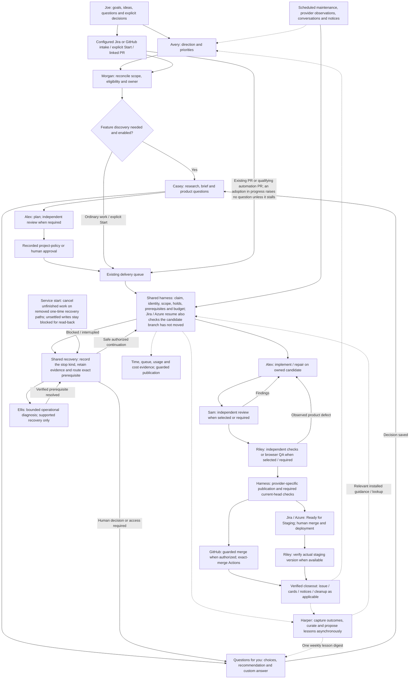
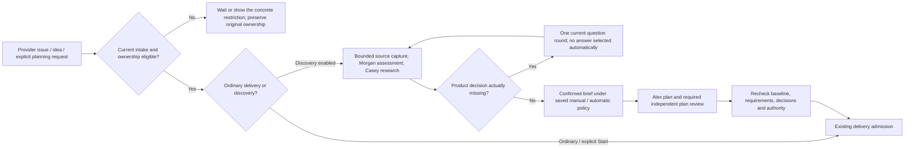
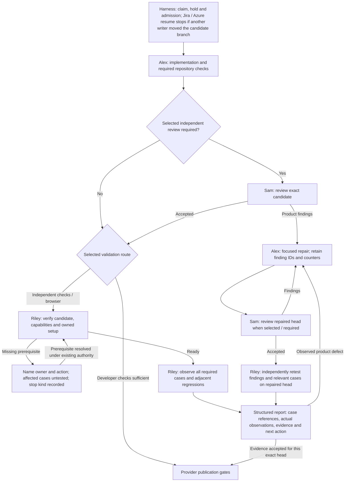
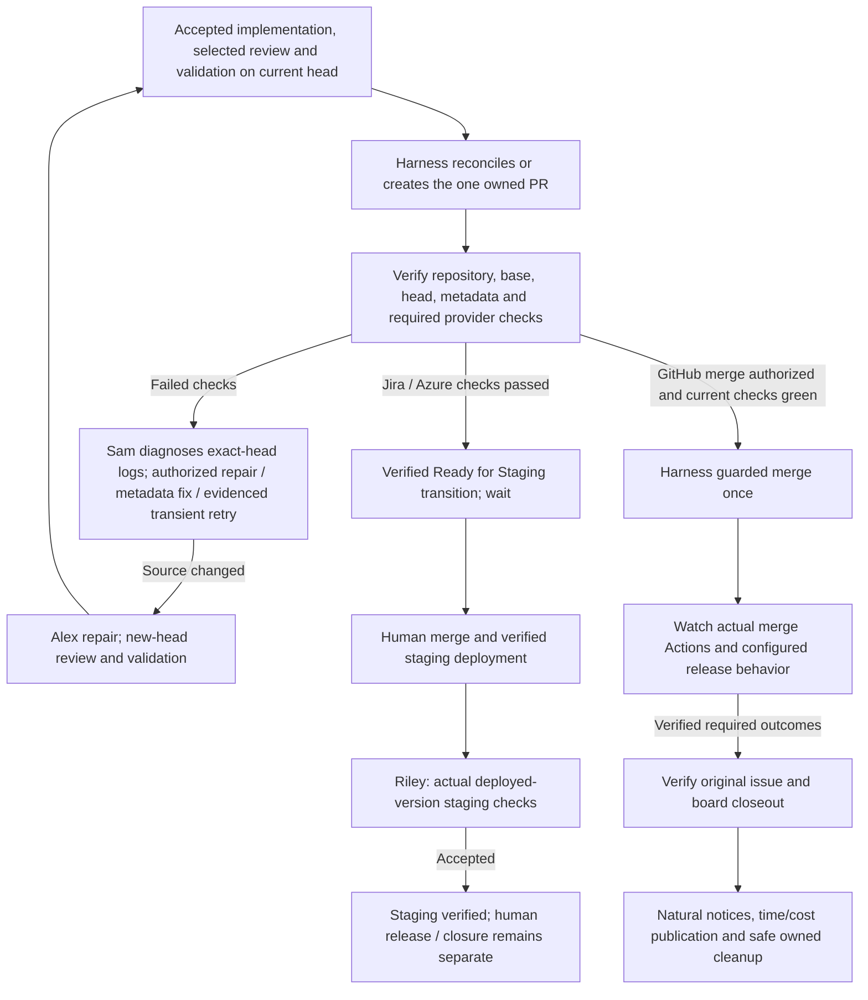
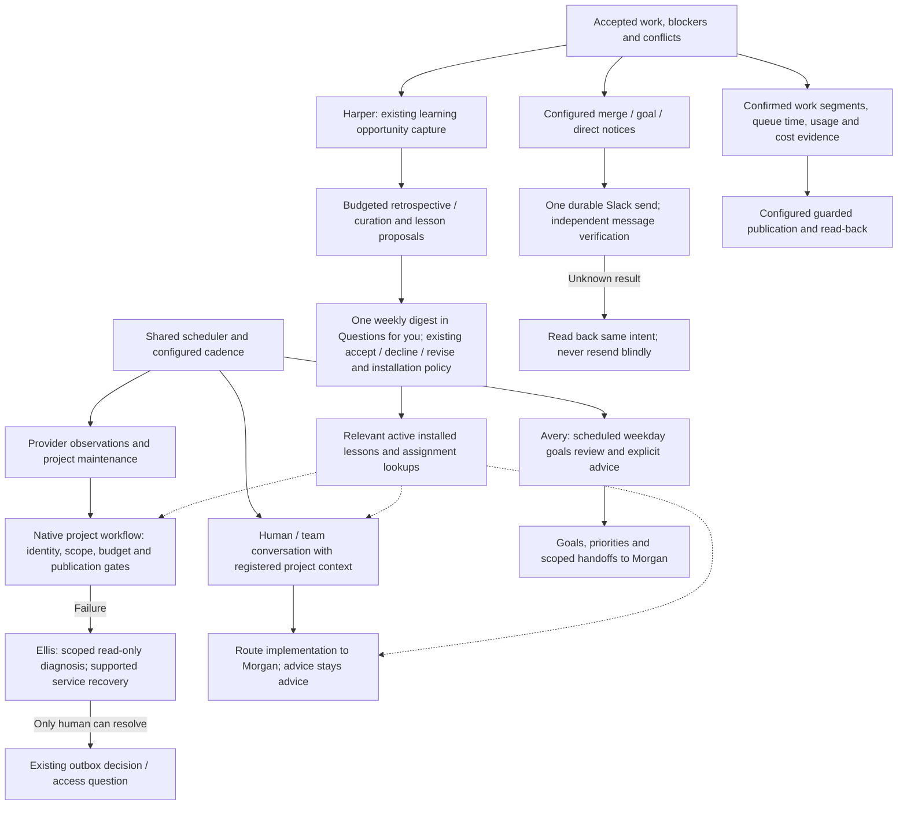

# Office process — version 1

This is the shared process baseline agreed on November 15, 2026. Every employee
uses the existing Office runtime, scheduler and role-specific response schema.
There is no separate QA dispatcher or learning system. The diagrams describe
the supported process, not proof that a particular ticket passed it. Configured
project policy determines which optional stages run; a diagram grants no new
permission. Changes to these boundaries belong in the same PR as their code and
behavioral tests. Do not add a ticket-specific process when a shared mechanism
can carry the same authorized task.

## Whole Office

Solid arrows move work; dotted arrows supply advice or evidence. The scheduler
releases the project lane between stages. CTO, IT and knowledge capacity stay
separate from delivery capacity; their advice never becomes a second writer.

## Discovery, decisions and intake

Morgan first checks the configured project, assignee, intake status, supported
issue type, existing feature/delivery/PR ownership, holds and prerequisites.
An issue is not admitted merely because it appears in a chat or search result.
Existing PRs are reconciled before any development is created. Exact bot identity
and content qualification allow routine Dependabot, Renovate and canonical wiki
PRs to use current-head provider checks and repository rules without an added
model review or local QA cycle.

On a hands-off GitHub project the harness also reads the repository's open Dependabot alerts each
poll (`server/delivery/intake/dependabot/track-alerts.ts`). An alert open for more than a day with
no open Dependabot pull request naming its package gets one issue, created through Effects and
carrying a hidden marker for the alert number. When pickup is enabled its card is placed in the
pickup lane if it is absent or still in Backlog, so admission treats it like any other ticket. A
lesson issue Joe files from the Lessons panel is moved the same way: his File issue action is the
permission to move its card from Backlog to the pickup lane ([knowledge loop](knowledge-loop.md)). An issue already
carrying the marker, open or closed, is never duplicated or reopened. When the alert is no longer
open and no delivery is in flight for the issue, the harness reads that alert's own state, says it on
the issue and closes it: completed when fixed, not planned when dismissed. A write it could not
confirm is never repeated; the record stays blocked, reaches the outbox, and settles once a person
moves the card or files the issue with the marker.

When the Jira intake source is the configured project list, the harness reads it itself and no
model runs for the mailbox check. TWG marks a further page with a cursor and the last page with
nothing, so the list is read in key order, each page asking for keys after the last one, until a
page comes back empty; a read that does not advance, repeats a key, or returns a ticket outside the
list is refused whole. The tickets are delivered in the list's own pickup order, highest priority
first (`server/cec/intake-enumeration.ts`). A board is still enumerated by Morgan.

An assignment review that stopped is closed as history, with no model run, once a complete
assignment read shows its ticket is no longer assigned or no longer open. A review of a ticket that
is still assigned keeps its status, so a blocked review still requires its read-back before any new
work. Reviews in flight, tickets the Office is delivering and configured holds are left as they are,
and an empty read by itself closes nothing (`server/delivery/intake/settle-stopped-reviews.ts`).
When the read is empty on a Jira project, the harness asks Jira about the tickets of its stopped
reviews by key and closes only the reviews of tickets Jira returns as resolved or no longer assigned
to the Office; a failed or empty answer closes nothing (`server/delivery/intake/confirm-gone.ts`).

For Jira/Azure work the harness reads the complete list of active pull requests before and after
a PM read-back or assignment review. The assessment is refused only when a pull request that could
concern the ticket was added, removed or modified in between: one that names the ticket key in its
title, source branch or description, uses the ticket's branch, or is the ticket's own. Any other
pull request changing is recorded and does not stop the dispatch
(`server/cec/related-pr-change.ts`).

Each Jira/Azure project uses its own configured Jira statuses, ticket key, prompt authority and
observed deployment. A project added beside CEC never inherits CEC's authority, statuses or
repository facts; CEC keeps its legacy values.

Questions use the existing Questions for you / outbox action. Joe sees the actual
question, recommended choice, alternatives and custom answer. Saving a note is
not an approval or retry. A resolved decision stays bound to its recorded scope;
an expired observation prompts a fresh check, not another approval for unchanged
scope. Changed requirements use the existing revision and approval policy.

## Development, review and QA

Morgan proposes the approach and Alex confirms it after source inspection.
Planning can be none, brief or reviewed; code review can be none, focused or
full; validation can be developer checks, independent checks or browser QA.
Repository requirements, explicit acceptance criteria and unresolved findings
take precedence. No gate is downgraded to hide a failure.

Riley is one independent QA worker. The fixer does not verify their own fix.
Browser QA verifies startup, callback origin, actual signed-in actor, tenant,
test-data permissions and owned application/database/browser before feature
actions. Checks-only QA starts no browser merely to satisfy a template. Show a
visible named browser window before asking Joe to sign in. Keep it available
while waiting. An HTTP response or login page is not feature acceptance.

The v2 QA report refers to each saved check by a deterministic criterion ID.
The worker can explain the case in its own words. Changing a saved requirement
changes its ID; it needs the normal route/baseline decision, not silent semantic
equivalence. IDs persist across candidate revisions when the requirement text
does not change. A regression has no acceptance criterion ID. Legacy v1 reports
retain their exact-text coverage rule and original bytes. Current-head evidence,
all required cases, prior finding dispositions and known usage/effects still
gate acceptance. Open a ticket's **QA Results** to see setup, cases, evidence,
findings, next owner/action and the full report.

A Jira/Azure retest must mark verified, itself, every finding a QA stage has reported, every
finding the current repair was sent to fix, and any finding on the ticket that is not yet verified.
Only a finding another stage raised about its own work and that is already verified, such as a
developer's note that its verification was unfinished once the review has settled it, is not owed a
QA disposition. A refusal names the findings that are missing
(`server/cec/qa/retest-dispositions.ts`).

## Publication and closeout

CEC may retain a verified draft PR before QA under its existing stage route;
QA pass promotes/publishes that PR rather than creating a duplicate. A staging PR
can trigger checks, so PR-triggered checks are not required before the PR exists.
Ready for Staging is a waiting boundary, not permission to merge or deploy COS.
GitHub automatic merge is limited to configured authorization; it never grants
that authority to Jira/Azure work. A project's `policy.merge` is a ceiling above
that authorization: under `human` no merge is queued or dispatched, a merge
already queued blocks with "Project policy requires human merge", and a merge
already attempted is still settled by read-back. Release, package or downstream-runner success
must be observed from the relevant provider; a merge is not proof of release.

After a GitHub closeout the harness removes the candidate it owns: the worktree, the local branch
and the remote branch, the last through Effects (`server/delivery/candidate/remove-candidate.ts`).
It owns a candidate the job created, and one a completed maintenance run of the same project
created for the issue: that run's passed `draft-pr` step names the issue, the branch and the
Office's own worktree path for it (`server/delivery/candidate/maintenance-candidate.ts`). The remote
branch must be at the delivered head. A maintenance run's worktree and local branch may be at that
head or behind it, because a later repair happens in the job's private clone; anything ahead of it
or outside it, uncommitted work, or an open pull request from or into the branch preserves
everything. A cleanup recorded before a maintenance run's candidate counted is tried once more by
the poll. A branch the Office did not create is left alone.

The remote branch is deleted through the provider API, not by a push, so the repository's pre-push
hook does not run on a delete. Deleting a merged branch a second time changes nothing more. When an attempted delete is still
unverified ten minutes later and the branch is read back at the delivered head with every guard
above passing, the attempt is recorded as not landed and the delete is sent once more under a fresh
intent (`server/delivery/harness/resend-not-landed.ts`). A second miss for the same branch is not
sent again and stays with a person. No other effect is resent this way. A branch someone restored
at the same head within those ten minutes is indistinguishable from a delete that never landed and is
deleted; every commit on it is already merged.

After staging QA passes on a project with production settings (CEC: branch `production`, pipeline
`prod-deploy`), the harness follows the ticket to production without a model
(`server/cec/production/`). When the ticket's commit is on staging and not on production it makes
sure one staging-to-production pull request is open: the one already open is joined, otherwise one
is opened through Effects and read back. An uncertain creation is settled by reading the open pull
requests and is never sent again. The harness never completes that pull request and never starts a
deploy. A ticket is recorded as in production when a passed `prod-deploy` run on the production
branch ran a commit that contains the ticket's commit; a squashed copy does not count. Nothing is
opened while another ticket of the Office is still in staging QA, because the pull request carries
everything on staging. A pull request someone abandoned is said once and not reopened. A ticket is
followed for 30 days. The harness then keeps Jira in step, each move one effect that carries its comment and is read back
(`server/cec/production/production-status.ts`). With the promotion pull request open, a parent in
Ready for Staging moves to Ready for Production. Once production is recorded, every sub-task that is
not Done moves to Done, whoever it is assigned to, and then the parent. The available moves are read
from Jira each time: one Jira does not offer, or whose screen needs a field other than the comment,
stops there and is said once, and a parent is never closed before its sub-tasks. Both steps act
only on a parent that is still the Office's and still in Ready for Staging or Ready for Production:
a status or owner a person set in between leaves the ticket and its sub-tasks alone. A sub-task
list that cannot be read whole closes nothing. A move that was sent and did not read back is never
sent again, one a person undid is not made again, and one stopped before sending is tried three times.

A Jira/Azure draft pull request is expected on the accepted candidate. When the developer brings the
branch up to date with the target first, so the pull request opens on a head that contains the
accepted candidate, the harness verifies that with git, records the pull request and sends the new
head back to the developer to confirm. The confirming pass spends no repair attempt and posts no Dev
update, because the move is not a finding, and it must report the moved head or a commit that
contains it. The confirmed head then takes the review the approach selects. A head QA had already
tested is retested; a head that moved before any QA goes on to the validation the approach selected.
It is published without drafting again. A stopped ticket whose recorded draft result is in this
shape takes the same route on resume without running the stage again. A head that does not contain
the accepted candidate is still refused (`server/cec/draft-pr-moved-head.ts`,
`server/cec/confirm-moved-head.ts`, `server/cec/resume-moved-head.ts`).

A change made to a Jira/Azure candidate that already passed the verification the approach selects
is verified at its own scope. A passing repair that starts from such a candidate, and whose commit
git shows contains it, may state the review, validation and checks its own change needs, with a
reason. What it states is never the ticket's approach: the harness applies it to this change only
and keeps the ticket's own approach to return to. The reviewer and QA are told the verified commit
and the scope and can widen it through a route change before executing; nothing else a stage
states replaces a scope in force. A retest of a scoped change owes a disposition for findings not
yet verified and for those the repair was sent to fix. A stated approach that raises review or
validation above the ticket's is a lasting decision under the ticket-wide rule, and a scope that
cannot be shown to sit on the verified candidate is ignored. A scope describes one change, from the
verified commit to the current head, and holds while that change is the same: a later repair that
commits nothing keeps it (git must show the worktree still on that commit), and one that changes the
commit keeps a scope only by stating one for the whole change; a restated scope keeps review and
validation at least at the scope in force. The scope ends when the change is published, when a
repair changes it again without a new scope, or when its repair attempts are exhausted and a revised
approach is assessed; the ticket's own approach then applies again and the return is recorded as a
decision. A ticket whose review once failed keeps at least a focused review
on the change, because publication requires a passing review on the current head. A candidate is
not verified while its latest review or QA result failed, whatever the approach selects, and a
repair on such a candidate keeps the ticket-wide rule: a reduction with work unresolved is refused
(`server/cec/change-scope.ts`, `server/cec/change-scope-note.ts`).

The same scope applies after a QA run that failed. The harness reads QA's own failed report for
this ticket, stage and validation level on the candidate the repair starts from, held to the report
and evidence a pass at that level needs: a required check is carried when every case that refers to
it passed with evidence saved in the ticket's run on that commit,
and every other required check is owed. A repair whose review stands may then state a scope; the
harness adds every owed check, keeps validation at least at the ticket's level and keeps a review
where the ticket has one, so a failed case cannot be scoped away, and records the carried checks
with the commit they passed on. Owed checks stay in every scope restated on a later commit and
through a route change (`server/cec/reroute-under-scope.ts`), and while checks are owed whatever the
repair states is a scope; one that would exceed twelve checks is not applied. A required check the
scoped retest reported and did not pass is owed from then on, including one that had been carried. QA is told which checks are carried and widens the scope before executing if the change
touches one, and the QA comment on the ticket says how many checks were carried and from which
build. Nothing is carried by assertion, across a commit that does not contain the one it passed on,
or from a run that stopped in setup (`server/cec/qa/carried-checks.ts`).

Office QA judges what can be observed at its own stage. A check that only a later stage can observe
(a hosted build that runs only once the pull request is opened or published, or publication itself)
is covered for the part observable now and named for the owner of that stage; it is not failed,
blocked or raised as a finding. A required check with no part observable now is taken out through
a route change before QA executes, not given an invented case. An earlier finding that records only
that such a gate has not run yet is settled with that reason. A gate that has run and failed, or is
running now, is reported as observed
(`server/qa/later-stage-gates.ts`).

A Jira/Azure review's findings must agree with its verdict: the gate refuses a review that leaves
any finding open, and only a failed review goes back to the developer. A reviewer names a later
stage's gate in the summary instead of holding it as an open finding, settles an earlier finding
that only says such a gate has not run yet, and returns failed for a finding that needs source
work, including a pull request that now conflicts with its target branch
(`server/cec/prompts/review-findings-rule.ts`).

Sam's GitHub readiness review does not run on a PR that GitHub already reports as not
reviewable. A draft PR and running current-head checks wait without a model run, and the
review queues once when the PR is ready and its checks finish. A conflict on a head the team
already reviewed is refreshed by the harness (Alex merges the current target into the same
branch) without Sam assessing the conflict first; a conflict on an unreviewed head still goes
to Sam. An earlier repair that has finished (no finding still pending) does not change this:
a later conflict on the same pull request is refreshed the same way. A conflict repair, by
either route, leaves a hands-off job on harness delivery: the harness publishes the repaired
head, Sam reviews it and the guarded merge follows. Only the records of a real legacy
recovery keep a job on the older model-performed contracts, including the conflict step an
initial draft conflict recovery wrote for the worker it adopted. The review is told who merges on the project: the Office's project policy and its
merge switch decide that, not a repository document, so a line in a repository's `AGENTS.md` about
agents stopping before a merge is not a blocker (`server/delivery/readiness/merge-authority-note.ts`). On a
hands-off project the review also gives any acceptance the repository reserves for a maintainer
before merge, such as of a reviewed source observation, on the cited evidence; a configured hold or
a required approval on the pull request still binds
(`server/delivery/readiness/delegated-acceptance-note.ts`).

On a hands-off project the harness marks a maintenance proposal's draft pull request ready itself.
A maintenance run publishes its draft only after the review and verification its approach selected
ran on the head its proposal step built, and it checks the draft against that head; so once the run
has completed, a draft whose issue and head match that built head counts as verified. The prepare
stage then marks it ready through its effect, and a job parked at the readiness review on such a
draft is sent back to that stage on its next observation, once per head. A run still in flight is
left alone, because it re-reads its draft on every step. The readiness review and merge
authorization are unchanged (`server/delivery/publication/maintenance-verified-draft.ts`).

## Recovery and human involvement — shared across roles

| Observation | Next action | Boundary |
|---|---|---|
| Known safe read stale / timed out | Refresh the unfinished read within the existing persisted budget; check freshness at use | Do not restart the job, extend freshness or reset counters |
| Complete JSON surrounded by one presentation fence | Local schema-validated normalization; retain original bytes and hashes | No model call or action replay; no fragment extraction or invented fields |
| Malformed / incomplete output | Retain failure; existing stage recovery or owner decides permitted repair | Formatting cannot replace missing evidence or imply a product pass |
| Product defect observed | Developer repair, selected review, independent retest | Setup errors are not product defects |
| Missing setup / information | Route named prerequisite to capable owner | Joe is asked only for his actual decision or access |
| External write uncertain | Independent read-back against exact saved Effects intent | Never blind resend or infer non-execution from a negative search |
| Wrong identity, permission denied, competing writer, real hold | Stop affected action; authoritative resolution required | Lessons and free-form prose do not grant authority |
| Native helper survives / output missing | Retain claim, failure and original evidence; supported reconciliation only | No success assertion, unrelated kill or repeated investigation loop |

When a delivery stage, ticket stage or harness request stops on an error, the harness records
why on the record (`stop.kind`: provider checks, PR not ready, closed source, uncertain effect, transient read,
pause, hold, authority or unclassified). The label is for counting stops (`pnpm office baseline`);
it changes no status and grants no retry, resume or authority.

A GitHub writer stage (implement or update base) on a hands-off project whose run died within
the last six hours is restarted by the harness, not read back by a model. The harness first confirms the
run's processes are gone and that the remote branch and PR are still at the accepted head. It
keeps whatever the run left in the worktree under a local ref (`refs/office/salvage/<job>/<run>`),
resets the worktree to the accepted head and queues the same stage again: up to three times,
after 30 seconds, 2 minutes and 5 minutes. A returned verdict (including a returned `failed`), a moved
branch or PR, an unsettled effect, a hold, a nested repository in the worktree or an existing
recovery record is not restarted and keeps its existing handling. Scope repair always carries a
recovery record, so it is never restarted this way. Once a job has been restarted, the
stopped-base readback no longer applies to it: a run the harness then declines, or a job that
uses up its three restarts, stays blocked for a person. Jira/Azure work is unchanged.

Parking moves the issue card and the pull request's card to Block, and a person releases the park by
moving the issue card alone. The pull request's card is then the harness's to move, when its own
verified write to Block is the last thing it did to that card (`server/delivery/board/harness-parked-card.ts`).
A hands-off job that stopped at the start of update-base because that move was refused is queued
again once; the board move comes before any source work, so nothing is repeated
(`server/delivery/recovery/parked-card-refusal.ts`).

A hands-off job on an adopted pull request can also stop inside the harness after its conflict-only
readiness assessment was accepted and recorded, before anything was written. Such a job is queued
again at most once per running revision of the Office, because a refusal by the harness only ends
differently when its code or the provider changed. Its stage then acts on the saved assessment
without another review, after reading the pull request back as open, on the same head and still
conflicting; when that read shows otherwise the ordinary review runs, and a read or guard that fails
stops the job as any stage error does. Only the assessment the harness accepted, on inputs that have
not changed and whose review was not already closed, qualifies. A job that is parked, held, awaiting a merge, claimed, under a
metadata or blocked CI repair, or with any unsettled receipt, board move or effect is left alone
(`server/delivery/recovery/undispatched-assessment.ts`,
`server/delivery/recovery/redispatch-assessment.ts`).

On a hands-off project a finding the independent review leaves open while passing is advisory. It
stays advisory at the QA gate for the same head: QA cannot settle a reviewer's note for a later stage,
so a finding the passed review of the current head raised and left open, and QA returns still open,
does not fail the gate. A finding QA raises itself, one an earlier stage raised or a repair is still
answering, and one from a failed review or a review of another head, still do
(`server/delivery/findings/review-advisories.ts`). The gate records a refusal on the job with the
human inputs QA ran on. A job blocked at validate by such a refusal, on unchanged inputs, whose saved
QA result the gate now accepts is queued again at most once per running revision, and the saved
result is accepted without another QA run once the candidate is read back as the checkout QA
verified; the refused copy is kept in the job's history
(`server/delivery/recovery/refused-qa-result.ts`, `server/delivery/recovery/reaccept-qa-result.ts`).

For Jira/Azure work, a QA stage that stopped in setup (nothing tested, no paid run) is run again
on resume instead of being reconstructed. A review stage whose worker returned its own verdict
is likewise run again on resume, since a read-only review repeats nothing. So is plan, implement,
repair, QA or retest when its latest run finished and returned its own result with every write read
back and its paid runs counted: its blocker is that result's own words, so a phrase such as "tests
timed out" describes the work and not an interrupted run. Plan, implement, QA and retest work only
in their own worktree or test environment. Repair also writes to the provider, but only a
fast-forward push of the same branch and returning its pull request to draft, which repeat
idempotently, and only a result that passed those guards is run again. A result with an unverified
or unknown write, or an unknown paid-run count, is still reconstructed, and so is any other stage
that writes to a provider (a Jira update, opening or publishing a pull request), whose wording
still decides. Once the
implementation that a recorded continuation produced has passed, the receipt of the run it
replaced is settled history: stage, chat and reconcile workers are shown it as settled and told it
is history, a restated copy is dropped from any stage's result, and it gates nothing. A review decides on the source and its evidence; work
that belongs to a later stage is not a reason for it to block. After three setup stops in a row on one
candidate, the next resume shows the count and latest reason without starting a worker;
resuming again runs one more attempt. The read-back before that attempt is told the stops are the
reason for it and not a current hold; the QA agent checks its own setup again
(`server/cec/qa/setup-stop-cap.ts`).

A browser observation counts toward the QA gate when it was made in the application the report's
setup names: on the setup URL's origin, at or under its path (`server/qa/setup-url.ts`). For
Jira/Azure work, a QA stage blocked only by one of the gate's fixed refusals, with its paid runs
counted and every receipt verified, has the gate run again on its saved result when the ticket is
resumed. If the gate accepts it, the result is taken as a pass under a new attempt with its own QA
comment, and no PM transition or QA worker runs; otherwise the stage runs as usual
(`server/cec/qa/gate-refused-pass.ts`).

A QA worker that leaves a browser window open for a person to sign in also writes a record in its run
directory: the browser's loopback debugging port, the sign-in page and the application
(`server/qa/sign-in-wait.ts`). While the work waits on that sign-in for its current candidate, the
harness reads the tab URLs on that port and nothing else: no page content, no cookie, no input
(`server/qa/browser-pages.ts`). The sign-in is seen as done when a tab is in the application and no
tab is still on the sign-in page (`server/qa/sign-in-observed.ts`). For Jira/Azure work the Office
then requests one resume of the ticket, the same resume a person asks for, so the setup-stop cap,
the PM read-back and QA's own check of the signed-in actor still run
(`server/cec/qa/resume-after-sign-in.ts`). For GitHub delivery, where the wait parks the card, the
harness moves the card from Block back to the pickup lane with one issue comment, through Effects,
and the ordinary parked resume follows (`server/delivery/parking/sign-in-unpark.ts`,
`server/delivery/parking/return-to-pickup.ts`). Each is tried once per recorded wait, and a GitHub
job is returned this way at most twice. A missing or
malformed record, a browser that no longer answers, a hold, a pause, or a card a person moved
leaves the work for a person to resume.

A QA run that stopped in setup without exercising any case or making a paid run posts no QA
comment. A setup stop that parks for a person or sends the ticket to repair still posts it: the
park is settled against that comment, and a repair should be explained on the ticket. When the stage runs again after a
setup stop and the harness's own two matching reads show Jira still in that stage's status, no PM
run is spent moving it (`server/cec/qa/status-held.ts`).

A writable Codex worker saves its finished result as a completion checkpoint before it returns. If
the stage time limit stops the worker after that save, the checkpoint is the stage result: the
runner uses it directly, and for a Jira/Azure stage already recorded as interrupted the next
resume accepts it instead of reconstructing the stage. It passes the same gates as any result
and no work is run again. A worker that stalled, a reader, or a worker stopped while an action
was still running is not covered. On resume, a checkpoint for another candidate or attempt is
not accepted.

A stage runner holds its ticket or job for the whole run. When a store transaction fails, the
store restores its saved contents in place, so that record stays the live one and nothing the
runner writes afterwards is lost. If a Jira/Azure stage result was saved to its attempt but is
not on the ticket, the next run of that stage applies it under the same attempt: no worker runs
again and writes already verified for that attempt are not repeated.

The move to Jira Blocked is the one Jira write that does not go through TWG. The workflow requires
a comment in the transition request itself, as Jira's own dialog sends it, and TWG posts a
transition comment separately. The harness resolves the Blocked transition for that issue by
reading Jira, then sends one Jira REST transition carrying the decision comment, through Effects
like every other write. Its Jira API token is read from the login Keychain (service
`the-office-jira`, account the Jira user) when a park is sent; it is never stored, logged or put
in a command's arguments. Before the write the harness asks Jira which account the token acts as.
A missing token, a token Jira does not accept, a token for another account or a missing transition
refuses the park before any write, and the ticket keeps its Office block. A move Jira refuses after
that stays unconfirmed with Jira's reason and is never resent; the settlement described next
recognizes only the older TWG refusal, so such a move needs IT. Every other read, the read-back
and the fallback comment stay on TWG.

A Jira move to Blocked that carried its decision comment and was refused by Jira is settled as
rejected at the next resume, by reading Jira: the ticket is still at the status it was parked
from, nothing changed its status after the Office's verified QA comment, and no comment carrying
that decision exists. The refusal text alone is never taken as proof. If the read does not prove
it, the ticket says so and stays blocked.

The harness writes the comments people read on a Jira ticket, in one shape: a headline, a short
plain summary, what is needed, the findings, a few real links and one closing reference line
(`server/comments/`). It posts the QA comment for qa, retest and staging-qa, which is verified by
read-back and gates the stage, and the Dev update after a draft PR or a repair, which informs and
never gates. It is posted once the stage result is accepted. An update that may have reached Jira
is settled by reading the ticket, at once and again at the next resume if that read failed: found,
it is verified; absent, it is closed as not sent. It is never resent. Workers return the outcome and evidence and post no Jira comments of their own.

When a Jira/Azure ticket's repair budget runs out, Sam assesses one revised technical approach
before any further repair. That assessment runs as a code-review pass on the same candidate, but it
is not a review of a new candidate: the harness asks for no Jira status move for it, and the
ticket keeps its status until the repair that follows is reviewed. The PM read-back before it is
told that the exhausted budget and the failed QA result are the reason for the dispatch, not
blockers for it. Until the assessment has run there is nothing to reconstruct, so a resume
dispatches it without a completion reconciliation.

The revised approach Sam returns is recorded with every gate level (plan, review, validation) kept
at least as strict as the ticket's current one: its changed checks and reason are what extend the
repair window, and the assessment never lowers a gate. The assessment runs once. If it returned a
result that did not reach the ticket, the next resume applies that saved result without running Sam
again, and the PM read-back is told so.

What a resume does with the current stage is one named step, decided in `server/cec/resume-step.ts`
in this order: apply a result the worker already returned, accept a finished result a timed-out run
saved, continue a stopped session, run again a QA stage a provider limit cut off, read back a stage
whose outcome is unknown, or run the stage. The PM read-back before a plain resume is told that expected step,
and that the step's own inputs (findings an earlier run left open, an earlier failed or blocked
result, the repair budget, the routing of any repair) are not in themselves blockers: the harness
routes them after the step. A hold such a result reports that is still current remains a blocker,
and the read-back still returns any current hold. A first pickup, a QA handoff, a QA plan retry
and a saved-source continuation follow other routes and are told no step. The resume event
names the step.

A QA or retest run that a provider capacity limit (usage limit, rate limit or quota) cut off
before it returned a result is run again at the next resume. Nothing is reconstructed: the harness
treats that run's work as confined to its own test environment, and it posts the Jira comment
itself and posted none. The rule holds only while no worker on the ticket has since failed with an
unknown write and no harness write for the ticket is unsettled. The PM read-back and the rerun's
worker are told the interruption is history, not an open item. The interrupted run and its unknown
provider usage stay in history, and its IT investigation closes when the rerun returns a result.
A crash, a time limit, staging QA and every other stage keep their existing handling.

A QA worker attaches to a browser a handoff names while that browser is live. When its process and
port are both gone the handoff has ended and the worker starts its own browser. On a sign-in page it
clicks a single sign-on button itself and stops only at a password, verification, account or consent
prompt, never typing a credential. A QA run that stopped in setup, tested nothing and waits on its
own environment (a browser, a sign-in) does not park the Jira ticket in Blocked; it stays blocked in
the Office. A setup stop that asks a person to decide still parks. When such a ticket is resumed, the read-back before
the resume is told that the wait is what the resume answers and is not to be returned as a blocker;
the QA worker verifies access itself and stops again if it is missing.

A QA, retest or staging QA worker that returned normally, and whose result the Office then refused
to accept (a report it would not save, for example), left nothing unknown. The stage is blocked in
those words, without an uncertain-effect stop, and the next resume runs it again. A record saved
before this rule, with the interrupted-stage wording, resumes the same way. The rule holds only
while no run on the ticket has failed since. A QA run that did not return keeps its handling.

A QA stage on the browser route runs for up to 90 minutes, and the worker is told that limit.
A Jira/Azure repair also runs for up to 90 minutes. Other stages keep their existing limits (45
minutes for Jira/Azure stages, 60 for GitHub delivery stages).

Ellis does not investigate a timed-out run whose saved result the stage accepted: that
investigation resolves from the accepted result.
A stopped-base recovery is settled once its delivery has finished or been cancelled.

Stopped work is counted by the cause the harness itself recorded. It is counted as needing a
decision only when its park reached a person, it is under a hold or it lacks authority. A park
waiting on a release is a prerequisite, a write of unknown outcome is unconfirmed, and a status that
names its own cause (failed, interrupted) keeps it. Work with no recorded cause is shown as exactly
that, never assumed to be a decision (`server/scheduling/stop-cause.ts`). Work whose exact stop a
harness repair in progress covers is counted as awaiting repair, in place of a failed, interrupted
or unexplained stop only (see Repair wait under Incident ledger).

Ellis's follow-ups close when the work they are about finishes, and only real trouble reaches
Morgan or Joe:

- An investigation of a failed worker is kept as history once the delivery it ran for is
  completed or cancelled, or its Jira/Azure ticket is complete. A Jira/Azure stage worker is
  recorded without a request ID: it is investigated on its own, and a later completed run of the
  same ticket stage settles its read failure.
- An old blocked nightly checkpoint is settled by a later night that completed.
- On a hands-off project one stopped daily maintenance run whose automatic read-backs are used up is
  not put in the outbox while the next night's run is not yet overdue (26 hours), provided the night
  before ended in a completed run that re-observed its sources: the next scheduled run takes it over
  without a person. It stays in the maintenance view with its error. A second stopped night in a row
  reaches a person as one item, the later run's; a night that ended only in a read-back or in
  never-started retries counts as stopped (`server/maintenance/single-missed-run.ts`). Weekly runs,
  projects with no automatic read-back and projects that are not hands-off are unchanged.
- A blocked Brain nightly checkpoint whose own run did finish is closed by the harness, not by the
  worker's notes: Brain's gate file must show that date published by the run's own session, the
  accepted read-back must cover every call and receipt, and git itself must show each published pull
  request merged into the target branch with no remote branch, local branch or worktree left at its
  head (`server/maintenance/brain/published-cleanup.ts`). The worker's follow-up notes have no
  fixed format and are never parsed.
- A blocked Brain run that provably never started is tried again by the harness, not read back by a
  model: its worker returned no receipt, the nightly gate reads exactly as it did before dispatch for
  the same slot with nothing active, and the primary checkout is at the same commit with the same
  uncommitted changes (`server/maintenance/brain/not-started.ts`). It is retried after five minutes, at
  most six times for one checkpoint; after that, and for any run that left a receipt or moved the gate,
  the ordinary read-back applies. A worker's session inventory request reads again for up to ten
  seconds while the inventory is incomplete; a newer incomplete read still replaces an older complete one.
- A session log is read from a captured clone that shares the log's blocks: the service opens the clone
  inside a directory only it can read, removes its name at once and reads from that descriptor, so capture
  does not grow with the log's size and nothing is copied (`server/workers/session-context-clone.ts`).
  For the moment between the clone and the unlink the clone has a name; a capture directory left by a
  service that died then is removed by a sweep at start and every five minutes after, once it is older
  than a minute
  (`server/workers/session-snapshot-cleanup.ts`). Hosts without the clone primitive keep the byte copy.
- The session inventory is complete when every Codex process is explained: by a session transcript it
  holds, by being a running Office worker, or by descending from one of these. Three kinds of process
  that hold no transcript and cannot work in a checkout are explained by what they are: an exec-server
  running nothing (`server/workers/idle-exec-servers.ts`), the desktop app's read-only memory writer
  started by its Computer Use service (`server/workers/computer-history-writers.ts`), and a
  `codex login status` query such as the Office's own health check runs
  (`server/workers/login-status-queries.ts`). Each is recognised by its exact start-up arguments, never by
  words in a prompt.
- A Brain result stops for read-back when it is blocked or reports a write whose outcome is unknown.
  A write refused before it took effect is a known outcome and does not stop a completed run.
- A failed project refresh or assignment read is retried by Ellis; Morgan is told only after
  three failures in a row. The Azure monitor's reads are read-only, so a lingering helper is not
  treated as a possible write.
- Session visibility and service status probes are informational and stay with Ellis. They are
  listed but not counted as follow-ups, and do not by themselves show Ellis as retrying, even while
  such a watch is being retried or once it names Morgan. Any other recovery in progress, and anything
  waiting on Joe however it is flagged, is counted. Probes are
  raised only for services the project uses. A confirmed logout still reaches Joe, and work that
  needs a complete session inventory reports its own block.

A Jira/Azure developer stage (implement or repair) on Claude that is stopped by its time limit
is continued, not restarted or reconstructed: the next run resumes the stopped session's
conversation under its own session ID, in the same worktree, and is told to check what is
committed and finish what remains. The worktree must still be on the ticket's branch and hold
the accepted commit. A stage is continued at most twice, each with a fresh time limit; after
that, or after any other kind of failure, it stops as an interrupted stage. If the ticket was
already recorded as interrupted, the next resume continues the session instead of reconstructing
the stage. Codex stages are not continued this way; a Codex worker's saved completion checkpoint
is used instead.

A stage worker that produces no output for 20 minutes is stopped as stalled, whatever its time
limit; a stalled Claude developer stage is continued like one that reached its limit. A Claude
worker is stopped with an interrupt first, so it ends its turn and records where it stopped; if
it has not exited five seconds later its process group is terminated as before.
What the worker prints in answer to that interrupt is not treated as its own completion of the
assignment. A read-only worker stopped as stalled is retried like one that timed out.

This policy is not a new automatic retry budget. Existing feature, delivery,
maintenance and investigation limits remain authoritative. Special historical
continuations keep their already-bound evidence and approvals; this baseline
neither replays nor retroactively upgrades them. Retiring incomplete history is
an explicit record-bound administrative decision, never proof of success or a
fixed cause.

## Operations, communication, leadership and learning

Harper supplies advisory guidance across roles; exposure is not proof of use or
improvement. Workers cite a lesson when it changed an action and report conflicts.
Feedback/curation is asynchronous and does not gate a completed delivery. External
Brain content stays read-only. A lesson proposal is not an accepted lesson or a
global rule. Repeated mechanical defects belong in code and behavioral tests.

Avery's scheduled review is at 5 PM America/New_York on weekdays. Project
maintenance and learning follow their own configured cadence and budgets; no
chart adds a new scheduled job. Slack notices are configured separately, with
no automatic backfill or resend. A Slack delivery left unconfirmed by an earlier
run of the service is read back once per release without a person asking, as
scheduled work behind what a person asked for: read-only, nothing is sent, and
one that still does not match keeps its outbox item and its original error
(`server/conversations/slack/reread-uncertain.ts`). A notice whose delivery is
unconfirmed is listed in the outbox once, as that delivery's read-back. Pauses stop new work and retain resources until
termination is confirmed; drains let already-claimed work settle. UI timers do
not rewrite actual time or provider usage. Publication and corrections retain
their existing Effects/read-back rules, including the documented absolute-total
hours exception; that exception is not a general resend policy. A GitHub hours
sync that stops before it writes anything has sent nothing: with no write
outstanding for the ticket, that day is not an uncertain write. It is returned to
pending and the current total is written with read-back, with growing pauses from
five minutes up to six hours and no last try; it stays visible until it posts, and
a board changed outside the Office is still never overwritten. A reconcile asked
for such a day does the same at once (`server/time/unsent-time.ts`).

Jira worklogs (CEC time) are published through Effects in `server/time/jira-worklog-effect.ts`.
Each attempt gets a fresh ledger publication and its own Effect
(`jira-worklog:<projectId>:<publication id>`). The publication is saved as prepared and the day
reserved before Effects runs; the identity and worklog reads are its preflight, and the
publication is saved as dispatching before the one TWG add or update. An attempted write whose
outcome is unknown is settled only by read-back, never resent. A verified Effect whose ledger
record was not finished is completed from its saved receipt without calling Jira. `reconcile-time`
queues a day to publish again only when no write can have been dispatched for it: no known
worklog and no attempted publication or Effect. An interruption during the preflight reads now
holds the day until `reconcile-time`, which requeues it with no Jira call unless the day already
has a known worklog, which stays held for a person. Publications saved before this change keep
their original read-back. The GitHub absolute-hours exception above is unchanged.

### Deployment fence and admission journal

A deployment holds the Office-wide deployment fence (`server/office/deployment-fence.ts`) while it
replaces the running release. It is one row on the control database, separate from the leases
start-up recovery deletes, so a newly started release opens already fenced. An unreadable row
counts as held.

While the fence is held:

- **Scheduling and ticks.** No claim is taken and no tick starts. The scheduler pumps, the queue
  producers at the top of the pump, the coordinator tick, the daily CTO collection and Ellis's tick
  do not run. Ellis's tick is skipped whole, forced checks included, so no recovery attempt is
  spent on a refusal. Start-up feature recovery still marks interrupted work but reserves no
  replacement until the fence is released.
- **Work already in flight.** A tick, an Ellis recovery or an HTTP write that began before the fence
  was taken is not interrupted. It may still queue a new request, which is journaled and waits
  unclaimed. `/api/health` reports `busy` until each of these ends.
- **Already-owned work.** It may finish. A stopping worker is still settled and its claim released.
- **Refresh.** The provider refresh is deferred to the first tick after release, not dropped.
- **HTTP.** Every write is refused with 409 except the fence's own endpoints and the `pause` and
  `drain` commands with a declared whole-number `Content-Length` of 1–4096 bytes. A `pause` or
  `drain` request with a missing or out-of-range length gets 409 without its body being read.
  Reads, including `/api/health` and its `fence` field, still answer.

Only the token that acquired the fence releases it; the stored row keeps a digest, never the token.
The fence grants no authority and changes no recovery budget.

Each project database keeps an append-only admission journal (`server/store/admission-journal.ts`).
It records every new scheduler claim, effect intent, harness request and delivery request, in the
same transaction as that write and outside the saved state. The journaled writers are
`Store.claimWork`, `Effects.execute`, `enqueueRequest`, `requestDelivery`, the history-retirement,
PR-metadata, QA plan-retry and saved-implementation operator commands, and the closeout cleanup
request. One start-up migration that queues a legacy `adopt-candidate` request is not journaled; it
runs identically in every release.

The journal omits status changes to existing records under a claim, during start-up recovery and
through operator commands. An IT tick that began before the fence was taken can also requeue
an existing request under the same ID without advancing the cursor.

A deployment compares a project's journal cursor from before a release started with its cursor while
that release is still fenced. An unchanged cursor means no new admission rows were appended.
The deployment makes the comparison before releasing the fence, when operator commands that can
requeue existing records are still refused.

### Deploy building blocks

`server/release/` holds the parts a deployment is assembled from. None of them stops, starts or
reconfigures the service on its own; the deployment controller below sequences them.

- **Deploy lock** (`deploy-lock.ts`). One deployment per data root. A live owner refuses a second
  deployment. Acquisition uses a guard file. A takeover atomically replaces a confirmed dead
  owner's lock and names the owner it replaced. An inconclusive PID check, an unreadable lock or a
  leftover guard refuses acquisition.
- **Deployment journal** (`deploy-journal.ts`). One append-only file per operation under
  `deployments/`, outside every release directory. It fixes the ordered steps when the deployment
  starts and takes an `intended` entry before a step and its outcome after, each synced to disk. A
  step cannot start until the one before it is `done`. An `uncertain` or `failed` step ends the
  journal, so an uncertain step is never resent from it; an abort or rollback after one is a new
  operation with its own journal. A cut-short final line is reported and nothing more is appended.
- **Idle wait** (`wait-idle.ts`). Idle is two consecutive, separately fetched `/api/health` reads of
  the same service instance, each `busy: false` with this deployment's fence held. An unreachable
  service, a read still unanswered at the deadline, a changed instance, a fence that is open or
  held by another token, unreadable health, or the deadline each end the wait with a named refusal
  and no idle receipt.
- **Store backup** (`backup-stores.ts`). Copies each store database into `backups/<operation>/` with
  an inventory of sizes, digests and schema, and lists the archive files beside the stores without
  copying them. A retry clears stale staging after checking it contains no declared database. The
  backup is for recovery by a person. No deployment or rollback restores from it.
- **Admission snapshot** (`admission-snapshot.ts`). Reads each project's journal cursor on a
  read-only connection; the database file is not written. Two snapshots compare as unchanged only
  when both name the same projects and every cursor is readable and equal; anything else, including
  an entry with no project name, counts as admitted or unknown.
- **Plist rendering** (`render-plist.ts`). Derives the service plist for another release of the same
  data root. Only the working directory, the entry script and the release's own `node_modules/.bin`
  PATH entry change. Rendering requires a Node service with absolute data and working directories.
  Any reference to the current release commit outside those three locations causes refusal.

### Deployment

`pnpm office deploy COMMIT` replaces the running release with a verified one. The command only
launches the controller and reports; the controller (`server/release/deploy.ts`) runs from the
release named by the controller pin (`controller-pin.json` in the data root), never from the
invoking checkout or the target release. A person sets the pin. An operation keeps the controller
it started with: a resume or an `end` runs under the pin its journal recorded. The operator's
procedure, the bootstrap and STOP recovery are in [the overseer guide](overseer.md).

A deployment is refused, with nothing changed, unless the target release verifies against its
manifest, launchd runs a release of this data root and the running process loaded that release,
`/api/health` reports the deployment fence, the fence is open, no STOP record stands, no other
deployment holds the lock, and no earlier deployment is unfinished. A deployment that journaled a
plan and recorded no outcome is unfinished until it is resumed or a person ends it. A busy service
is not refused: the fence stops new work being admitted so the work in flight can drain, and the
service is stopped only after it reads idle.

It then runs these steps in order under the deploy lock. Each is journaled `intended` before it runs
and settled after:

1. `fence`: acquire the deployment fence. The token stays in an owner-only file beside the journal,
   never in the journal or an effect.
2. `idle`: wait for two idle `/api/health` reads of the same instance with the fence held.
3. `stop`: `launchctl bootout`, then confirm launchd no longer has the service and its process is
   gone.
4. `backup`: copy every store into `backups/<operation>/`.
5. `snapshot`: record every project's admission cursor and a content fingerprint of every store.
6. `plist`: install the plist rendered for the target, after re-verifying the target against the
   manifest digest frozen at the start.
7. `start`: recheck the frozen target before sending `launchctl bootstrap`.
8. `verify`: `/api/health` must report the target manifest's hash, a service instance not seen
   before and this deployment's fence still held.
9. `record`: write `active-release.json`, the receipt of the verified activation. The plist stays
   the source of truth for what runs. The service reads this receipt to name its own release in
   `/api/health` (see Release identity under Incident ledger).
10. `release`: release the fence. The `record` and `release` writes each require a fresh health
    read of the verified instance with its fence held.

**Mutations.** Fence acquire and release, the stop, the plist install, the start and the
active-release record each go through Effects on the controller's own store
(`deployments/controller.sqlite`) under one identity per operation and step. Read-back comes first,
so a step whose outcome is already visible is not dispatched again. A dispatched step that read-back
cannot confirm is uncertain and is never resent.

**Before the stop.** A service that does not become idle, or is no longer the idle fenced instance
when the stop is about to be dispatched, is left running; the deployment releases its own fence and
ends `aborted`.

**After the stop.** The controller confirms the service is still down before backup and snapshot.
Loss of that confirmation goes directly to STOP. Other failures in steps 4 to 8 enter a rollback
with its own journal (`rollback-…`). The rollback halts the service, checks eligibility, reinstalls
the saved plist, restarts the previous release, verifies its hash under the fence and releases
the fence. This includes a plist install or a start that read-back could not confirm: the step is not
sent again, and the rollback's own separately identified steps settle the service by read-back. The
rollback is code only. It requires a complete, readable baseline taken after the old service
stopped. The controller checks that every admission cursor and store fingerprint still matches
before restoring the plist and before sending the restart. A missing baseline, unreadable store,
or difference goes to STOP. If the restarted previous release fails verification, the controller
attempts a separate halt and records whether it was confirmed. Backups are for manual recovery.

**STOP.** These each leave `deployments/STOP.json` naming the operation and its last journaled
step: a fence acquire, a stop, an active-release record or a fence release that read-back cannot
confirm; a journal that ends in a cut-short line; a rollback that is not eligible or does not
complete. The launcher also writes STOP if the controller cannot start, times out, exits non-zero,
or returns without an outcome for its operation. A saved outcome stays available for diagnosis
after an abnormal exit. While the record stands every deployment is refused.
Only a person removes it. `pnpm office deploy end OPERATION` releases the fence that operation's
token holds and nothing else, and records an unfinished operation `ended`.
`pnpm office deploy resume OPERATION` continues an operation whose controller died, from its
journal: the step in progress is settled by read-back. An operation that recorded an outcome, or
whose fence a person ended, is not resumed.

No deployment path pauses, drains or resumes a project. The fence is the only hold a deployment
places, and the only one it lifts.

### Incident ledger

The Office keeps one office-wide record of stopped work, on the control database beside the
deployment fence (`server/incidents/`). Its scheduled collector only observes: it reads each
project's state and the scheduler's own projection, writes two tables of its own, and never
writes a project store, calls a provider or runs a model. A person can also record a repair start
and a fix binding on an incident (see Write-back below), and the Office compares the release it
runs with fixes that are on `main` (see Deployed fixes below); both read GitHub and write only the
ledger. One step writes a project store: while a repair is in progress, the stops it covers are
marked in their project (see Repair wait below), and that marker is all it writes. An incident
describes a stop; it grants no retry, no resume and no authority over the work.

**What is read.** Once a minute, unless a deployment holds the fence, one collector per signal
reads every project:

- stopped work: everything the scheduler projects as blocked (tickets, delivery jobs, requests,
  intake reviews, checkpoints, maintenance, notices and conversations), and waiting work whose own
  record is a stop (a pull request that is not ready, checks or required Azure policies still
  running, a merge waiting for approval, a pull-request review that needs follow-up) or that waits
  on a configured hold, a retry the Office planned or an unfinished structured prerequisite;
- runs that failed after dispatch, by failure category, each counted for 24 hours;
- IT recoveries handed to a person;
- IT investigations that name the harness or propose an Office fix;
- improvement proposals addressed to the Office harness;
- the latest error of the assignment listener, the mailbox intake and the GitHub and Azure readers,
  kept while the reader's next read is under way; a GitHub project's mailbox error is the GitHub
  read's own and is reported once;
- Slack deliveries that could not be confirmed and were not replaced;
- any other open outbox item, by its title only, including the item of a ticket or intake review
  the scheduler does not project.

A saved stop is read only while the record's status makes it current; a watching job keeps only a
wait's own stop. A record that could run but is held by the scheduler's condition, a prerequisite
or a configured hold, is described by that condition and not by what the record last said. An
intake review another delivery owns is not a stop. A paused or draining project is one subject,
the project, with one cause for both. Evidence is one bounded line with credentials removed,
including the provider token formats the office-wide redaction does not cover; a conversation body
is never copied.

**Cause identity.** Only text the harness is known to have written is identity. Such a cause is
fingerprinted from its source, provider, stage, typed cause and normalized text, without the
project, so the same cause in two projects is one incident. Everything else is identified by its
subject, stage and typed cause, and its wording is evidence only:

- `model`: the stop repeats what a saved result said. For a ticket that is its last refused
  transition, then the stage's last result; for a job the stage's last result, a blocked metadata
  assessment or a CI diagnosis; in each case when the stage's run recorded no harness failure that
  still stands. For an
  intake review, any detail without a typed failure or prerequisite error; for maintenance and the
  checkpoint that repeats it, the last step's blocker; a pull-request review that needs follow-up;
  an investigation; an improvement proposal.
- `unknown`: the record does not say where its text came from: work with no retained record, a
  delivery request's error, a ticket blocker with no saved stop, result or failure behind it, what
  a run that completed handed back to a request, notice, conversation or Jira mailbox read, a
  recovery's copied detail, and the outbox item of an unprojected ticket or review. For these the
  scheduler's own cause, which can come from the text's wording, is neither kind nor explanation.

A merge waiting for approval is identified by that restriction, not by the job's changing detail.

A result the stage runner wrote itself when it cut a stage short carries the runner's own receipt
for that ticket and stage; it is the harness's, and groups.

**Subjects and episodes.** Each affected subject is bound to its project, kind, source ID, stage,
saved stop, the run that last worked it, candidate head and whether a write filed under any of its
references is still unsettled. Two sources that report the same stop yield one subject: a failed
run is folded into the job, ticket, review or maintenance run it worked for, and an unconfirmed
Slack delivery into its notice or conversation, which then carries the unsettled write and, when
it has no explanation of its own, the delivery's; a delivery request that only mirrors its
ticket's stop is folded into the ticket, and a checkpoint that only repeats its maintenance run's
into the run. An exhausted recovery and the record it tried to recover stay separate subjects. A subject whose signal is gone is cleared. A subject that returns
after it cleared, or whose stop marker changed, is a new episode of the same incident and one
observed resume, and how long it has stood is counted from that latest stop; the count survives
the projection dropping an old cleared subject, because it is read back from the events. A subject is not cleared while its signal cannot be seen: stopped work
while its project is paused or draining, a source whose collector failed for that project, and
everything of a project that could not be read. While stopped work cannot be seen, the runs and
deliveries its open subjects hold stay with them, and those a pause newly hides fold into the
pause; while another source cannot be seen, what it had contributed to a subject stays on it.

**Expected waits.** Holds, decisions, merge approvals, prerequisites, pauses, authentication
blocks, provider waits, planned retries, uncertain effects and questions are recognised from typed
fields and the office config, never from wording, and recorded as expected. A hold may be
configured under the ticket or its pull request; a park on a provider's own wait is that wait; a
retry whose budget is spent explains nothing. A stop kind the
harness derived from a model's blocker is left out, so a model's words never choose the
explanation. Each subject keeps its own explanation; the incident names one only when every open
subject shares it. An incident with an open subject that has no explanation is eligible for
research at once. Otherwise it becomes eligible only after an open subject has two observed
resumes, or with three open subjects, two projects or 24 hours. Eligibility permits investigation; it does not lift the hold,
decision or wait. It is about now: withdrawn as soon as no reason for it holds, and earned again
if one returns.

**Record.** An append-only event history (`incident-observed`, `subject-observed`,
`episode-observed`, `subject-cleared`, `research-promoted`, `research-withdrawn`) with stable
event IDs, and one projection per incident with a revision. A change is recorded whole or not at
all; an event ID reused with different content, whatever order its properties are written in, or
a projection that skips a revision, is refused.
An unchanged office costs no write, and the tables themselves are created by the first recorded
change, so a release that starts under a deployment's fence leaves the control database as it
found it. The lifecycle states `triaged`, `fixing`, `shipped`, `deployed`, `verified`, `recurred`,
`housekept`, `dismissed`, `needs-joe` and `abandoned` are defined; observation alone reaches only
`observed` and never changes a state a later step set. `fixing`, `shipped` and `dismissed` are set
by the write-back events below, `deployed` by the Office when the release it runs holds the fix
(see Deployed fixes), and a dismissal that no longer holds returns its incident to `observed` (see
Dismissal); the others have no writer yet.

`GET /api/incidents` lists the ledger (`open=1`; `research=1`, which leaves out dismissed
incidents); `GET /api/incidents/<id>` returns one incident with its events;
`GET /api/incidents/<id>/evidence` returns its evidence packet. All three are read-only.

**Write-back.** Three events can be recorded from outside observation, by a person now and by the
repair runner later, through one route and one validation: `POST /api/incidents/<id>/events`. The
deployment fence's gate refuses it like any other write. They are `repair-started` and `fix-bound`,
described here, and `dismissed`, described under Dismissal.

- `repair-started` records the repair issue, read back from GitHub as an issue of the Office's own
  repository, and a digest of every subject open at that revision: its key, episode count and
  marker, stage, saved stop and head. It moves an incident that is `observed`, `triaged` or
  `recurred` to `fixing`; fixes bound to an earlier repair stay on record.
- `fix-bound` records a fix as GitHub reports it. A full commit SHA is read back and compared with
  `main`. A pull request of the Office's repository is read back for its state, head and merge
  commit: merged, the fix is its merge commit, compared with `main` like any commit; open, the fix
  is its observed head. A number alone is neither a commit nor a merge receipt, and a comparison
  GitHub does not answer plainly is refused. The incident stays `fixing` while the fix
  is not on `main` and becomes `shipped` when it is. A pull request whose head moved is bound
  again by a new event; an earlier binding is never changed.

A fix states, for every subject its repair recorded and for no other, one of: a route (action,
payload of at most 4,096 characters, expected stage) with a repaired boundary; a route whose
boundary is undeclared, with the reason; or no route, with the reason. A boundary is one of a
closed list of observable checks (`stage-result-passed`, `stage-left`, `record-settled`); nothing
executable is accepted. Each binding must carry the digest recorded when the repair started, so a
binding written for another stop, stage or head of that subject is refused. A repair covers at
most 1,000 subjects. A route recorded here is checked against the handler it names when a resume
is admitted, not now.

Every event carries an ID its sender chose and the incident revision its sender read. The same ID
with the same request returns the saved event and the revision it produced, without reading
GitHub again, beside the incident as it stands now; the same ID with
another request, a stale revision, a transition not in the table or a binding that fails any rule
above is refused and nothing is saved. Observation changes neither the state these events set nor
the repair and fixes they recorded.

**Release identity.** The service can name the release it runs only from records it can check
(`server/office/release-identity.ts`). The identity is `verified` when all of these agree: the
service runs from a release directory of its data root; that directory's `release.json` names the
directory's commit and the content hash loaded at start-up; and the receipt a deployment wrote
after verifying its activation (`active-release.json`) names the same commit and hash and the
digest of that `release.json`. Any disagreement, and any record that is missing, is `unknown` with
its reason; a reason never repeats text read from a file. `/api/health` reports it as `release`.
It is read on demand: a release that starts under a deployment is unknown until that deployment
records it, and a release without a matching receipt stays unknown however it was started. The
receipt identifies the release, not the process: the same recorded release restarted is still
verified. Paths are compared as physical paths, so an alias for the data root changes nothing.

**Deployed fixes.** A merge or a binding never makes a fix live. After each observation, and so
never while a deployment holds the fence, the Office takes every `shipped` incident and compares
the fix commit with the release it runs (`server/incidents/deployed-fixes.ts`). When the release
identity is verified and GitHub reports the fix commit in the history of the release commit, one
`fix-deployed` event is recorded, the fix carries the release (commit, hash, deployment, activation
time) and the incident becomes `deployed`. A release that does not hold the fix records nothing
and the incident stays `shipped`. When the identity is unknown, one `release-identity-unknown`
event per incident, fix and loaded hash says why, no state changes and GitHub is not asked. Only a
plain answer from GitHub is believed; an unclear one or a failed read is asked again on a later
pass. A release commit and a fix commit are compared once per service process, at most ten new
comparisons a pass, and each pass starts after the incident the last one asked about, so reads
that keep failing do not hold up the rest. The receipt is read again before a fix is marked: if it
changed while GitHub was asked, nothing is recorded and the answer is kept. A comparison in flight
keeps `/api/health` busy, and it stops, reading and writing nothing more, as soon as a deployment
holds the fence. `fix-deployed` cannot be written through the events route. Nothing waits on or
resumes after a deployed fix yet.

**Evidence packet.** What the Office knows about one incident, bounded and hashed, for a verdict to
be tied to (`server/incidents/evidence-packet.ts`). It is built from the ledger and the running
release only; no project store is read. It holds the incident's identity, state, cause, research
status and revision; the loaded hash and the release identity; at most 50 subjects, open ones
first and then the most recently cleared, each with the facts the ledger holds for it (key and
digest, stage, saved stop, last worker run, head, whether a write is unsettled, expected wait,
sources, episodes and bounded evidence); the repair issue; the last five fixes without their
bindings; the last five dismissals and whether each lapsed; and the count of events with the ID,
time and kind of the last 30. Every list that is cut states its total, and the packet as JSON never
exceeds 256 KiB: subjects are taken whole and in order for as long as they fit, so a key or a
digest is never cut. Credentials are removed from every string before the digest is taken, so the
packet carries the SHA-256 of exactly what is handed out; it has no time of its own, and the same
ledger state and release give the same bytes. Wording a provider or a model wrote appears in it
only as bounded evidence; nothing in a packet is an instruction or grants anything.

**Dismissal.** A verdict that the stop is correct can be remembered, against exactly what it
judged (`server/incidents/dismissal.ts`). `dismissed` carries a reason, the digest of the evidence
packet the verdict was formed on and 1 to 20 citations; a citation is a path in the running
release, the SHA-256 of that file as the citer read it, and optionally a line. It is allowed from
`observed`, `triaged` or `recurred`. The Office refuses it unless the digest is the one it computes
for the incident now and every citation matches the code it loaded at start-up; those versions
come from the service's own manifest, never from the caller. It records the subjects open at that
revision as they stood, and the loaded hash. The reason is kept as evidence only: its first line,
at most 1,000 characters, credentials removed, including the value of a credential property in
pasted JSON. The digest of the reason exactly as it was sent is kept beside it, so the same event
ID sent again with other words is refused as a different request.

A dismissal holds only while what it cited and what it judged stay the same
(`server/incidents/dismissal-validity.ts`). After each observation the Office checks every
dismissed incident: a cited file that changed or left the running release, a subject that was not
part of the dismissal, or a covered subject with a new episode or another stage, stop or head,
lapses it. One `dismissal-invalidated` event records the reason, the dismissal stays on record
marked as lapsed, and the incident returns to `observed`. A covered subject that clears, and a
change to a file the verdict did not cite, do not lapse it. The check reads and writes only the
ledger. Research eligibility is still computed from the stops alone; a dismissed incident is left
out of the research listing rather than made ineligible. Nothing produces a verdict yet.

**Repair wait.** While an incident's repair is in progress (`fixing`, `shipped` or `deployed`), the
Office marks the exact stops that repair covers, in each project's own store, where the scheduler
and the recovery paths read (`server/incidents/repair/`). After each observation, and so never
while a deployment holds the fence, every subject the repair recorded that the ledger still holds
open exactly as recorded, and whose project record stands stopped the same way, gets one marker in
that project's coordination state (`repairWaits`): the incident, the repair event and issue, the
subject and its digest, and how the stop stood (stage, episode, saved stop, head). This is the
only write the incident domain makes to a project store, one transaction per project, and it
writes nothing else; the fence is asked again before every write. The ledger keeps a subject as it
last saw it while it cannot see a project, so a record that has since stopped again or moved stage
is not marked on the ledger's word. A subject with no record of its own in a project store (an IT
recovery, an investigation, an outbox-only item, a worker run, a paused project) is not marked.

A wait is in effect only for the stop it was admitted for. The project-side check reads the record
the way observation does: a new episode, or another stage, saved stop or head of the same record,
ends the wait without any write, and a marker is read only for the project it names. A marker
follows the repair's own progress (its start, a fix bound, that fix found in the running release)
and runs out 48 hours after the last progress that reached it in time: progress that comes more
than 48 hours after the one before it came after the wait had run out, and does not revive it. The
expiry is recorded once, on the marker and as one `repair-wait-expired` event on the incident, and
the original cause is counted again. An expired wait is never brought back for the same repair and
subject: the expired marker is kept while the repair covers the stop, and if the marker was
removed in between (the stop changed and changed back) it is rebuilt from the recorded expiry, as
expired. A new repair of the incident can admit a new wait. A marker is removed when its incident
no longer carries that repair or the ledger no longer holds the subject as the repair recorded it,
and an expired marker only after its expiry is on record.

Where blocked work is counted for health, a wait in effect shows as `awaiting-repair`, and only in
place of an unclassified, failed or interrupted stop or a missing cause. A decision, a
prerequisite, a pause and an unconfirmed write are counted as themselves, also when they arise
after the marker. The scheduler's projection, and with it the cause and reason the ledger derives
a stop's identity from, are unchanged: a marked stop keeps its fingerprint, its incident and its
digest.

While a wait holds a record back, the Office leaves that stop alone
(`server/incidents/repair/repair-freeze.ts`). A record is held only while a wait is in effect for
its exact stop and nothing stronger explains it. It is never held while its project is paused or
draining, under a configured hold, parked on the board for any reason, waiting for a merge approval
or an answer, stopped for missing authority or authentication (by its saved stop or by the typed
failure of the run that worked it), gated by a prerequisite, or while a write for it is
unconfirmed: a saved stop that says so, a saved result of the record that still owes a read-back,
or a write still dispatching or uncertain in the project's Effects ledger. A delivery job's saved
results are judged by the pipeline's own rule for that, in any of its steps
(`server/delivery/pipeline/uncertain-effects.ts`); a ticket's by an uncertain receipt or an
unverified status change on its stage result or its transition; a maintenance run's by an
uncertain receipt. Those keep their own handling, whether they stood before the wait or arose after it. The
unsettled writes and the prerequisites are read at the moment of each decision, from the project's
own store and with the scheduler's own validation (`server/incidents/repair/freeze-reads.ts`);
nothing about them is kept on the marker or between decisions. A reader that cannot make those
reads, or whose read fails, holds nothing back. A prerequisite in another project is not visible
to these reads and always gates. For a held record:

- an IT recovery about it spends no attempt, queues no request and does not become `needs-human`;
  it leaves one routine follow-up naming the repair issue. The record a recovery is about is read
  from the recovery's own ID: a checkpoint family names its checkpoint, a conversation read-back, a
  service probe and the Office-wide watches are about none, and every other family names a delivery
  job (`server/it/recovery-record.ts`). The question is asked afresh at every place a recovery
  could be written, on the project's clock at that moment: before an attempt and again after its
  awaited read returns, the budget rebuild at the start of a tick, the direct status writes for
  closeout and scope-repair read-backs, the stopped-base read-back and the ledger pass that would
  otherwise call an unvisited recovery resolved (`server/it/held-recovery.ts`). A wait that ends
  in the middle of a tick stops holding at once, so nothing written after it is lost; one that
  begins while an attempt is in flight keeps the attempt already counted and any request already
  queued, and writes no outcome;
- IT does not requeue its ownership read (`server/it/delivery-recoveries.ts`);
- its dead writer run is not restarted. The job stays the harness's to restart, so no other
  recovery takes it over in the meantime (`server/delivery/attempts/restart-stopped-writers.ts`).
  Nothing is read or written for it, including a failed read's note or a decline, until the
  worktree reset is sent; from that point the restart is completed whatever arrives;
- an investigation of the run that worked it is not ready. A run belongs to the record its request
  is (a job, a delivery request, an intake review, a maintenance run, a checkpoint, a harness
  request, a notice or a conversation), and a stage run without a request to the ticket whose stop
  names it; a delivery request that only repeats a stopped ticket's stop is that ticket; a Slack
  delivery is about no stopped record (`server/it/investigations/source-record.ts`). The
  investigation is judged on its own runs as well: when a run under investigation itself failed
  for authentication, permission, ownership or a write of unknown outcome, the investigation is
  never held, whichever record it resolves to
  (`server/it/investigations/held-investigation.ts`, used by `readiness.ts` and by Harper's guard);
- Harper does not hand it to Morgan or nudge IT about it, including through a recovery or an
  investigation about it; the follow-up record is still kept (`server/knowledge/blocker-followups.ts`);
- its read-back or follow-up request is not shown in the outbox, and a held intake review is not
  named in the shared session-visibility request (`server/conversations/outbox.ts`). Wherever the
  outbox is saved or served it is projected as it reads now, at one time sampled from the
  project's clock and with the project's current reads (`server/conversations/current-outbox.ts`):
  on every event, at start-up recovery, after assignment polling, in the messages endpoint, the
  project summaries and the snapshot. The incident ledger's own reading of the outbox is not given
  those reads, so a held stop keeps its identity there.

Nothing is reset, resumed or rewritten: recovery attempts, read-back counts, restart counts and
investigation attempts are exactly what they were. When the wait ends or expires each path
continues from them under its own rules, and the outbox request returns. A wait does not extend a
path's own time limit: a writer run that stopped more than six hours ago is no longer restarted by
the harness, so after a long wait that job is a person's to read back, unless a resume after the
fix releases it. The Office's own bounded retry of a transient failed read is not held. The
scheduler's dispatch is unchanged; a held record was already not running.

## Code owners and verification

| Process boundary | Owning source |
|---|---|
| Fair dispatch, lanes and claims | `server/scheduling/scheduler.ts`, `server/scheduling/scheduled-work.ts`, `server/workers/assignment-context.ts` |
| Common worker assignment, provider execution, output and lessons | `server/workers/worker-runtime.ts`, `server/workers/handoff-guidance.ts`, `server/workers/parse-result.ts` |
| Feature research, questions, plan and release | `server/features/workflow.ts`, `server/features/progression/`, `server/features/questions/`, `server/features/release/` |
| Approach and optional gates | `server/delivery/pipeline/approach.ts` |
| CEC / Jira-Azure transitions | `server/cec/ticket-stage-runner.ts`, `server/cec/workflow.ts` |
| GitHub result acceptance, merge and closeout | `server/delivery/pipeline/accept-stage-result.ts`, `server/delivery/harness/`, `server/delivery/readiness/`, `server/delivery/closeout/` |
| Independent QA and coverage | `server/qa/assignment.ts`, `server/qa/criteria.ts`, `server/qa/report-evidence.ts` |
| External actions | `server/store/effects.ts` |
| Release build, deployment and rollback | `server/release/` |
| Incident observation and cause identity | `server/incidents/` |
| Release identity and recognition of a deployed fix | `server/office/release-identity.ts`, `server/incidents/deployed-fixes.ts` |
| Evidence packets, dismissals and their lapse | `server/incidents/evidence-packet.ts`, `server/incidents/dismissal.ts`, `server/incidents/dismissal-validity.ts` |
| Repair waits: marker, admission, expiry, effective cause | `server/incidents/repair/` |
| IT, maintenance and native workflow evidence | `server/it/`, `server/maintenance/` |
| Harper and assignment learning | `server/knowledge/lesson-selection.ts`, `server/knowledge/lesson-exposure.ts`, `server/knowledge/learning-events.ts` |
| Conversations, notifications, time and cost | `server/conversations/`, `server/time/`, `server/telemetry/`, `server/leadership/` |

Behavioral checks must prove that all roles use the shared boundary, a normalized
negative result stays negative without another provider turn, missing or changed
criteria cannot pass, older v1 reports still parse, and current-head evidence is
still required. Existing ownership, Effects and staged-delivery tests retain
their original authority. No diagram or unit fixture establishes live QA success.

## Research references

The architecture decision reuses the installed harness instead of installing a
new framework. The recommendation draws on [Anthropic's composable workflow
guidance](https://www.anthropic.com/research/building-effective-agents),
[A2A's task/input lifecycle](https://a2a-protocol.org/latest/topics/life-of-a-task/),
[JSON Schema's structural constraints](https://json-schema.org/understanding-json-schema/reference/object)
and [AWS's retry/idempotency guidance](https://aws.amazon.com/builders-library/making-retries-safe-with-idempotent-APIs/).
These support the design distinctions; they do not prove improved Office
throughput, a successful recovery or an applied lesson.
