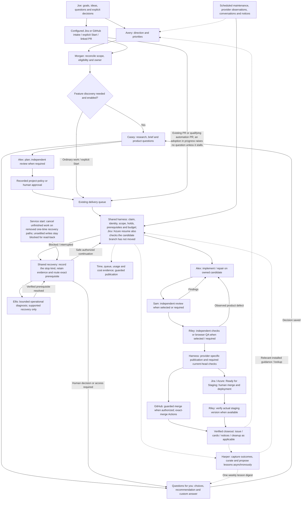
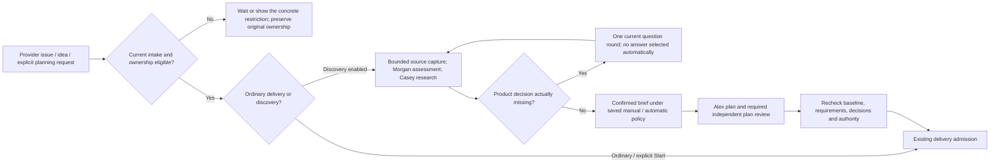
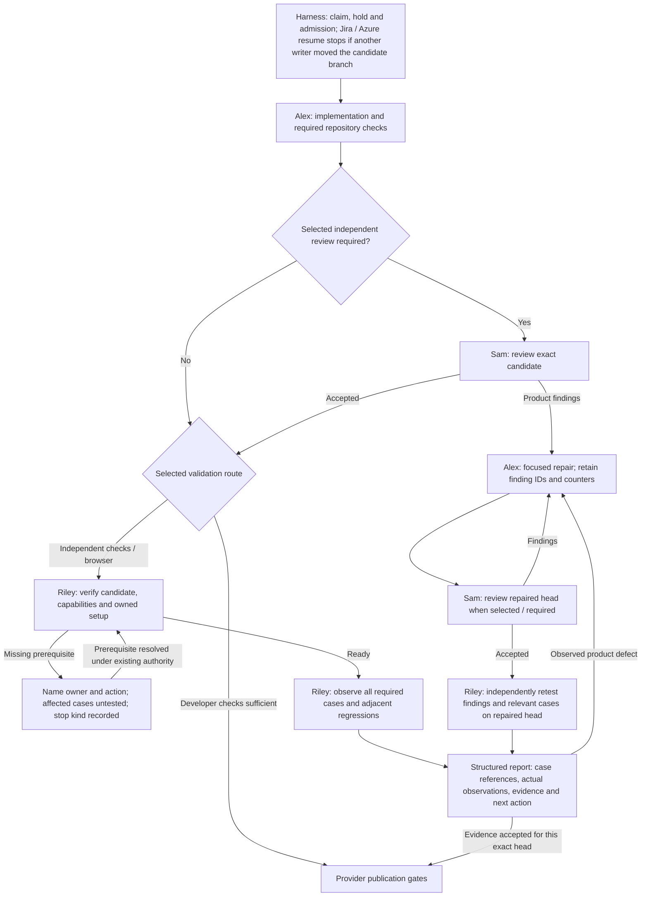
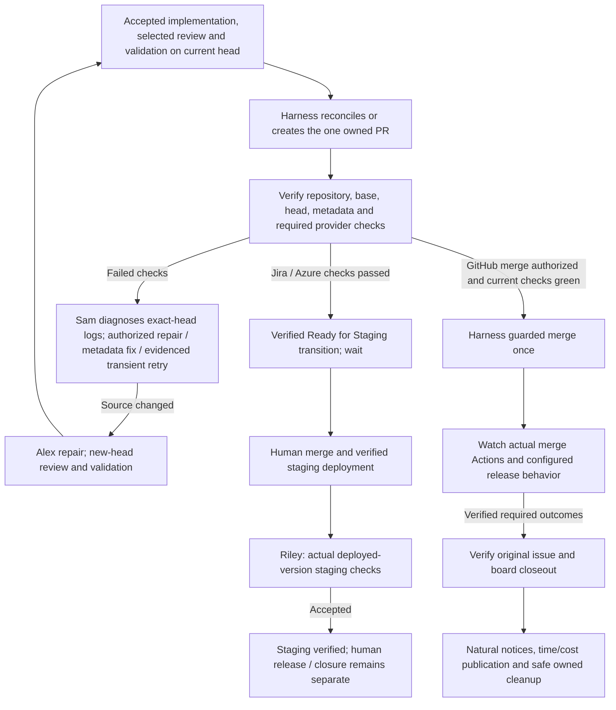
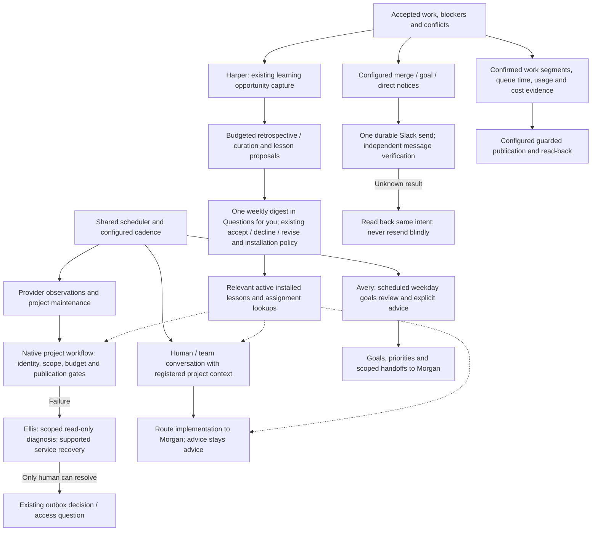

# Office process — version 1

This is the shared process baseline agreed on November 15, 2026. Every employee
uses the existing Office runtime, scheduler and role-specific response schema.
The one exception is the Overseer runner (see [Overseer runner](#overseer-runner)), a
repair orchestrator supervised outside the Office service because it must work when
that service is broken. It takes no scheduler claims, changes live Office state only
through validated Office routes and routes external mutations through the existing
Effects. It gives employees and configured project delivery no other dispatch path.
There is no separate QA dispatcher or learning system. The diagrams describe
the supported process, not proof that a particular ticket passed it. Configured
project policy determines which optional stages run; a diagram grants no new
permission. Changes to these boundaries belong in the same PR as their code and
behavioral tests. Do not add a ticket-specific process when a shared mechanism
can carry the same authorized task.

## Whole Office

Solid arrows move work; dotted arrows supply advice or evidence. The scheduler
releases the project lane between stages. CTO, IT and knowledge capacity stay
separate from delivery capacity; their advice never becomes a second writer.

## Discovery, decisions and intake

Morgan first checks the configured project, assignee, intake status, supported
issue type, existing feature/delivery/PR ownership, holds and prerequisites.
An issue is not admitted merely because it appears in a chat or search result.
Existing PRs are reconciled before any development is created. Exact bot identity
and content qualification allow routine Dependabot, Renovate and canonical wiki
PRs to use current-head provider checks and repository rules without an added
model review or local QA cycle.

Dependency bot PRs enter that existing-PR flow through adoption
(`server/delivery/intake/dependency-bots/`). A hands-off GitHub project with a
configured GitHub Project board adopts Dependabot, pin-courier and wiki-sync PRs
without a person moving a card. An explicit `autoAdopt` list replaces that default
exactly: `["pin-courier"]` adopts only pin-courier, and `[]` adopts none. A
project that is not hands-off, or is Jira/Azure, adopts no bot PR. Settings shows
each GitHub project's effective list and whether it is the default, explicit or
inactive (`effective-auto-adopt.ts`). A bot left off the list is still adopted
when a person moves its PR card to the pickup lane.

Adoption runs only after the poll's board read succeeds; a failed read stops it
for that poll. A PR may lack its own card. A PR with no card, a card with no
Status, or a card in Backlog or the pickup lane is eligible; wiki-sync also takes
In review. Any other lane, or a Status option the board no longer lists, is left
alone. Pause, drain, disabled pickup and a hold on the PR stop adoption, and a
GitHub quota hold lets only adoptions already under way finish. In automatic
mode a new draft, or a new pin-courier or wiki-sync PR for another base, waits
quietly for a later poll. Every other refusal is recorded once with its reason
and reaches the outbox.
That includes a Dependabot PR on another branch (`it targets release, not main`)
and one with commits not authored and verified as Dependabot. A qualification read
that fails skips that PR for the poll without a record; the other PRs and bots
still run. Adoption reuses or creates one tracking issue through Effects and links
the PR with `Closes #<issue>`. It puts the issue card In review, adding it when
missing, and moves the PR's card only when there is one. A closed tracking issue
blocks adoption until it is reopened.

Dependabot qualifies at intake, while its delivery is live and on the guarded
merge path; its adoption writes check only pause and drain. Pin-courier and
wiki-sync reread the PR head and requalify before each adoption write. From
there existing-PR discovery, the authorized harness merge on current-head checks
with native issue linkage, the bot-owned conflict redo below, and the tracking
issue's verified Done-card closeout deliver the PR.

On a hands-off GitHub project the harness also reads the repository's open Dependabot alerts each
poll (`server/delivery/intake/dependabot/track-alerts.ts`). An alert open for more than a day with
no open Dependabot pull request naming its package gets one issue, created through Effects and
carrying a hidden marker for the alert number. When pickup is enabled its card is placed in the
pickup lane if it is absent or still in Backlog, so admission treats it like any other ticket. A
lesson issue Joe files from the Lessons panel is moved the same way: his File issue action is the
permission to move its card from Backlog to the pickup lane ([knowledge loop](knowledge-loop.md)). An issue already
carrying the marker, open or closed, is never duplicated or reopened. When the alert is no longer
open and no delivery is in flight for the issue, the harness reads that alert's own state, says it on
the issue and closes it: completed when fixed, not planned when dismissed. A write it could not
confirm is never repeated; the record stays blocked, reaches the outbox, and settles once a person
moves the card or files the issue with the marker.

When the Jira intake source is the configured project list, the harness reads it itself and no
model runs for the mailbox check. TWG marks a further page with a cursor and the last page with
nothing, so the list is read in key order, each page asking for keys after the last one, until a
page comes back empty; a read that does not advance, repeats a key, or returns a ticket outside the
list is refused whole. The tickets are delivered in the list's own pickup order, highest priority
first (`server/cec/intake-enumeration.ts`). A board is still enumerated by Morgan.

An assignment review that stopped is closed as history, with no model run, once a complete
assignment read shows its ticket is no longer assigned or no longer open. A review of a ticket that
is still assigned keeps its status, so a blocked review still requires its read-back before any new
work. Reviews in flight, tickets the Office is delivering and configured holds are left as they are,
and an empty read by itself closes nothing (`server/delivery/intake/settle-stopped-reviews.ts`).
When the read is empty on a Jira project, the harness asks Jira about the tickets of its stopped
reviews by key and closes only the reviews of tickets Jira returns as resolved or no longer assigned
to the Office; a failed or empty answer closes nothing (`server/delivery/intake/confirm-gone.ts`).

For Jira/Azure work the harness reads the complete list of active pull requests before and after
a PM read-back or assignment review. The assessment is refused only when a pull request that could
concern the ticket was added, removed or modified in between: one that names the ticket key in its
title, source branch or description, uses the ticket's branch, or is the ticket's own. Any other
pull request changing is recorded and does not stop the dispatch
(`server/cec/related-pr-change.ts`).

Each Jira/Azure project uses its own configured Jira statuses, ticket key, prompt authority and
observed deployment. A project added beside CEC never inherits CEC's authority, statuses or
repository facts; CEC keeps its legacy values.

Questions use the existing Questions for you / outbox action. Joe sees the actual
question, recommended choice, alternatives and custom answer. Saving a note is
not an approval or retry. A resolved decision stays bound to its recorded scope;
an expired observation prompts a fresh check, not another approval for unchanged
scope. Changed requirements use the existing revision and approval policy.

## Development, review and QA

Morgan proposes the approach and Alex confirms it after source inspection.
Planning can be none, brief or reviewed; code review can be none, focused or
full; validation can be developer checks, independent checks or browser QA.
Repository requirements, explicit acceptance criteria and unresolved findings
take precedence. No gate is downgraded to hide a failure.

Riley is one independent QA worker. The fixer does not verify their own fix.
Browser QA verifies startup, callback origin, actual signed-in actor, tenant,
test-data permissions and owned application/database/browser before feature
actions. Checks-only QA starts no browser merely to satisfy a template. Show a
visible named browser window before asking Joe to sign in. Keep it available
while waiting. An HTTP response or login page is not feature acceptance.

The v2 QA report refers to each saved check by a deterministic criterion ID.
The worker can explain the case in its own words. Changing a saved requirement
changes its ID; it needs the normal route/baseline decision, not silent semantic
equivalence. IDs persist across candidate revisions when the requirement text
does not change. A regression has no acceptance criterion ID. Legacy v1 reports
retain their exact-text coverage rule and original bytes. Current-head evidence,
all required cases, prior finding dispositions and known usage/effects still
gate acceptance. Open a ticket's **QA Results** to see setup, cases, evidence,
findings, next owner/action and the full report.

A Jira/Azure retest must mark verified, itself, every finding a QA stage has reported, every
finding the current repair was sent to fix, and any finding on the ticket that is not yet verified.
Only a finding another stage raised about its own work and that is already verified, such as a
developer's note that its verification was unfinished once the review has settled it, is not owed a
QA disposition. A refusal names the findings that are missing
(`server/cec/qa/retest-dispositions.ts`).

## Publication and closeout

CEC may retain a verified draft PR before QA under its existing stage route;
QA pass promotes/publishes that PR rather than creating a duplicate. A staging PR
can trigger checks, so PR-triggered checks are not required before the PR exists.
Ready for Staging is a waiting boundary, not permission to merge or deploy COS.
GitHub automatic merge is limited to configured authorization; it never grants
that authority to Jira/Azure work. A project's `policy.merge` is a ceiling above
that authorization: under `human` no merge is queued or dispatched, a merge
already queued blocks with "Project policy requires human merge", and a merge
already attempted is still settled by read-back. Release, package or downstream-runner success
must be observed from the relevant provider; a merge is not proof of release.

An adopted bot PR that GitHub reports as conflicting is recovered by its own bot, never by an
Office commit (`server/delivery/repairs/bot-redo/`). Observation only reads: it records the
conflicted head on the adoption and queues the merge stage. Under the merge claim the harness
asks the bot once per conflicted head, across delivery jobs and restarts. The request is a wiki
workflow dispatch (`docs/wiki-sync-adoption.md`), `@dependabot rebase`, or a check of Renovate's
own rebase box on a Pin Courier PR. A box already checked is waited on. A PR with no single box is
a recorded producer prerequisite, because the Office cannot read Pin Courier's effective
configuration. Each request is an Effect with read-back and is never resent.

A distinct head on the same PR and branch settles the request once the original executor finishes,
when it passes the original qualifier and has its native issue link. This retires an unsent
preparation and preserves the original receipt and error for an uncertain request. Observation
can recover an earlier head's request from its saved intent even if the adoption lost the wait.
The replacement then goes through the ordinary current-head checks and guarded merge. A new
conflict on it is a new allowance. The reporting clocks are six hours from a wiki dispatch, 24 hours from a Dependabot
request, 13 hours from Pin Courier's first observation, and eight days for a maintenance wiki PR
waiting on its weekly refresh. They only report, and observation goes on. A PR closed without merge
while its redo is open is one stop. The closer is named only when GitHub's close event identifies
the bot, and the tracking issue and cards are left for reconciliation. A numbered wiki PR whose
successful run left its head unchanged is closed as superseded only on a containment proof
(`server/delivery/closeout/superseded-wiki-pr.ts`). Nothing else merges or closes on this path.

Rolling back to a release without this path needs active recoveries finished first, or the affected
work held or paused until a compatible reader reconciles it. The adoption's redo records, their
Effects and any partial close record are kept. The older reader looks up Effects only for the
current job, so a replacement job would not see its predecessor's request. It also treats a
verified request still awaiting its outcome as settled.

After a GitHub closeout the harness removes the candidate it owns: the worktree, the local branch
and the remote branch, the last through Effects (`server/delivery/candidate/remove-candidate.ts`).
It owns a candidate the job created, and one a completed maintenance run of the same project
created for the issue: that run's passed `draft-pr` step names the issue, the branch and the
Office's own worktree path for it (`server/delivery/candidate/maintenance-candidate.ts`). The remote
branch must be at the delivered head. A maintenance run's worktree and local branch may be at that
head or behind it, because a later repair happens in the job's private clone; anything ahead of it
or outside it, uncommitted work, or an open pull request from or into the branch preserves
everything. A cleanup recorded before a maintenance run's candidate counted is tried once more by
the poll. A branch the Office did not create is left alone.

The remote branch is deleted through the provider API, not by a push, so the repository's pre-push
hook does not run on a delete. Deleting a merged branch a second time changes nothing more. When an attempted delete is still
unverified ten minutes later and the branch is read back at the delivered head with every guard
above passing, the attempt is recorded as not landed and the delete is sent once more under a fresh
intent (`server/delivery/harness/resend-not-landed.ts`). A second miss for the same branch is not
sent again and stays with a person. No other effect is resent this way. A branch someone restored
at the same head within those ten minutes is indistinguishable from a delete that never landed and is
deleted; every commit on it is already merged.

When a person moves a stopped, unpublished draft back to Backlog, retirement can settle its original push
from the saved Git trace, process settlement and current repository and provider reads. The trace must
prove the hook rejected the exact push before updating the remote. The Office also verifies the clean
candidate at the recorded head and the absence of both the remote branch and prior PRs from or into it.
Missing evidence or another uncertain effect preserves the job. The Office records the dispatch as a
terminal rejection with its original error and capture. It checks the same candidate, capture, remote
branch and PR history again if local cleanup is deferred. The failed push stays on its original intent
even if the capture is lost or publication is entered again. Retirement removes only the local
candidate. Moving the issue to Ready after retirement starts a fresh job on the normal delivery path.

After staging QA passes on a project with production settings (CEC: branch `production`, pipeline
`prod-deploy`), the harness follows the ticket to production without a model
(`server/cec/production/`). When the ticket's commit is on staging and not on production it makes
sure one staging-to-production pull request is open: the one already open is joined, otherwise one
is opened through Effects and read back. An uncertain creation is settled by reading the open pull
requests and is never sent again. The harness never completes that pull request and never starts a
deploy. A ticket is recorded as in production when a passed `prod-deploy` run on the production
branch ran a commit that contains the ticket's commit; a squashed copy does not count. Nothing is
opened while another ticket of the Office is still in staging QA, because the pull request carries
everything on staging. A pull request someone abandoned is said once and not reopened. A ticket is
followed for 30 days. The harness then keeps Jira in step, each move one effect that carries its comment and is read back
(`server/cec/production/production-status.ts`). With the promotion pull request open, a parent in
Ready for Staging moves to Ready for Production. Once production is recorded, every sub-task that is
not Done moves to Done, whoever it is assigned to, and then the parent. The available moves are read
from Jira each time: one Jira does not offer, or whose screen needs a field other than the comment,
stops there and is said once, and a parent is never closed before its sub-tasks. Both steps act
only on a parent that is still the Office's and still in Ready for Staging or Ready for Production:
a status or owner a person set in between leaves the ticket and its sub-tasks alone. A sub-task
list that cannot be read whole closes nothing. A move that was sent and did not read back is never
sent again, one a person undid is not made again, and one stopped before sending is tried three times.

A Jira/Azure draft pull request is expected on the accepted candidate. When the developer brings the
branch up to date with the target first, so the pull request opens on a head that contains the
accepted candidate, the harness verifies that with git, records the pull request and sends the new
head back to the developer to confirm. The confirming pass spends no repair attempt and posts no Dev
update, because the move is not a finding, and it must report the moved head or a commit that
contains it. The confirmed head then takes the review the approach selects. A head QA had already
tested is retested; a head that moved before any QA goes on to the validation the approach selected.
It is published without drafting again. A stopped ticket whose recorded draft result is in this
shape takes the same route on resume without running the stage again. A head that does not contain
the accepted candidate is still refused (`server/cec/draft-pr-moved-head.ts`,
`server/cec/confirm-moved-head.ts`, `server/cec/resume-moved-head.ts`).

A change made to a Jira/Azure candidate that already passed the verification the approach selects
is verified at its own scope. A passing repair that starts from such a candidate, and whose commit
git shows contains it, may state the review, validation and checks its own change needs, with a
reason. What it states is never the ticket's approach: the harness applies it to this change only
and keeps the ticket's own approach to return to. The reviewer and QA are told the verified commit
and the scope and can widen it through a route change before executing; nothing else a stage
states replaces a scope in force. A retest of a scoped change owes a disposition for findings not
yet verified and for those the repair was sent to fix. A stated approach that raises review or
validation above the ticket's is a lasting decision under the ticket-wide rule, and a scope that
cannot be shown to sit on the verified candidate is ignored. A scope describes one change, from the
verified commit to the current head, and holds while that change is the same: a later repair that
commits nothing keeps it (git must show the worktree still on that commit), and one that changes the
commit keeps a scope only by stating one for the whole change; a restated scope keeps review and
validation at least at the scope in force. The scope ends when the change is published, when a
repair changes it again without a new scope, or when its repair attempts are exhausted and a revised
approach is assessed; the ticket's own approach then applies again and the return is recorded as a
decision. A ticket whose review once failed keeps at least a focused review
on the change, because publication requires a passing review on the current head. A candidate is
not verified while its latest review or QA result failed, whatever the approach selects, and a
repair on such a candidate keeps the ticket-wide rule: a reduction with work unresolved is refused
(`server/cec/change-scope.ts`, `server/cec/change-scope-note.ts`).

The same scope applies after a QA run that failed. The harness reads QA's own failed report for
this ticket, stage and validation level on the candidate the repair starts from, held to the report
and evidence a pass at that level needs: a required check is carried when every case that refers to
it passed with evidence saved in the ticket's run on that commit,
and every other required check is owed. A repair whose review stands may then state a scope; the
harness adds every owed check, keeps validation at least at the ticket's level and keeps a review
where the ticket has one, so a failed case cannot be scoped away, and records the carried checks
with the commit they passed on. Owed checks stay in every scope restated on a later commit and
through a route change (`server/cec/reroute-under-scope.ts`), and while checks are owed whatever the
repair states is a scope; one that would exceed twelve checks is not applied. A required check the
scoped retest reported and did not pass is owed from then on, including one that had been carried. QA is told which checks are carried and widens the scope before executing if the change
touches one, and the QA comment on the ticket says how many checks were carried and from which
build. Nothing is carried by assertion, across a commit that does not contain the one it passed on,
or from a run that stopped in setup (`server/cec/qa/carried-checks.ts`).

Office QA judges what can be observed at its own stage. A check that only a later stage can observe
(a hosted build that runs only once the pull request is opened or published, or publication itself)
is covered for the part observable now and named for the owner of that stage; it is not failed,
blocked or raised as a finding. A required check with no part observable now is taken out through
a route change before QA executes, not given an invented case. An earlier finding that records only
that such a gate has not run yet is settled with that reason. A gate that has run and failed, or is
running now, is reported as observed
(`server/qa/later-stage-gates.ts`).

A Jira/Azure review's findings must agree with its verdict: the gate refuses a review that leaves
any finding open, and only a failed review goes back to the developer. A reviewer names a later
stage's gate in the summary instead of holding it as an open finding, settles an earlier finding
that only says such a gate has not run yet, and returns failed for a finding that needs source
work, including a pull request that now conflicts with its target branch
(`server/cec/prompts/review-findings-rule.ts`).

Sam's GitHub readiness review does not run on a PR that GitHub already reports as not
reviewable. A draft PR and running current-head checks wait without a model run, and the
review queues once when the PR is ready and its checks finish. A conflict on a head the team
already reviewed is refreshed by the harness (Alex merges the current target into the same
branch) without Sam assessing the conflict first; a conflict on an unreviewed head still goes
to Sam. An earlier repair that has finished (no finding still pending) does not change this:
a later conflict on the same pull request is refreshed the same way. A conflict repair, by
either route, leaves a hands-off job on harness delivery: the harness publishes the repaired
head, Sam reviews it and the guarded merge follows.

A conflict that develops after the readiness review stopped (`blocked` or `interrupted` at
`lead-pr`, for a reason other than the conflict) is refreshed the same way
(`server/delivery/repairs/refresh-stopped-conflicts.ts`).

- **Trigger.** Only a cached project row for the job's exact head and the target that reports
  `mergeable: false` costs a provider read, and only when the existing refresh rules could admit
  the job on that cached conflict. A job they refuse on local state alone (its budget, head proof,
  merge authority or saved worktree) is never read. A live strict read must then confirm an open,
  unmerged, non-draft PR that still conflicts on the same SHA and branch, with its native issue
  link, and queuing still runs every check after that read.
- **Eligible head.** The head must be one the team reviewed, or an accepted refresh head.
- **Budget.** The three-base-update limit still applies, counting every saved base update.
- **Exclusions.** Any of these keeps the job out, before and after the read: a park, holds,
  pause or drain, prerequisites, a metadata repair bound to the head, an unfinished CI repair,
  a stopped-base record, a stop that needs its own reconciliation (`uncertain-effect`,
  `authority` or `source-closed`), a repair wait, an active claim, worker or recovery request,
  an unverified board move, an uncertain or unverified receipt (including a `lead-pr` read
  receipt), or any unsettled write.
- **Recheck after the read.** The job must still be the same, unchanged record.

The refresh clears the stale stop and supersedes the stopped review, whose verdict stays in the
saved steps. Preparation and a fresh readiness review on the repaired head then decide again on
whatever stopped it. A parked job's conflict is refreshed when the park resumes, through the
fresh review start. Only the records of a real legacy
recovery keep a job on the older model-performed contracts, including the conflict step an
initial draft conflict recovery wrote for the worker it adopted. The review is told who merges on the project: the Office's project policy and its
merge switch decide that, not a repository document, so a line in a repository's `AGENTS.md` about
agents stopping before a merge is not a blocker (`server/delivery/readiness/merge-authority-note.ts`). On a
hands-off project the review also gives any acceptance the repository reserves for a maintainer
before merge, such as of a reviewed source observation, on the cited evidence; a configured hold or
a required approval on the pull request still binds
(`server/delivery/readiness/delegated-acceptance-note.ts`).

On a hands-off project the harness marks a maintenance proposal's draft pull request ready itself.
A maintenance run publishes its draft only after the review and verification its approach selected
ran on the head its proposal step built, and it checks the draft against that head; so once the run
has completed, a draft whose issue and head match that built head counts as verified. The prepare
stage then marks it ready through its effect, and a job parked at the readiness review on such a
draft is sent back to that stage on its next observation, once per head. A run still in flight is
left alone, because it re-reads its draft on every step. The readiness review and merge
authorization are unchanged (`server/delivery/publication/maintenance-verified-draft.ts`).

## Recovery and human involvement — shared across roles

| Observation | Next action | Boundary |
|---|---|---|
| Known safe read stale / timed out | Refresh the unfinished read within the existing persisted budget; check freshness at use | Do not restart the job, extend freshness or reset counters |
| Complete JSON surrounded by one presentation fence | Local schema-validated normalization; retain original bytes and hashes | No model call or action replay; no fragment extraction or invented fields |
| Malformed / incomplete output | Retain failure; existing stage recovery or owner decides permitted repair | Formatting cannot replace missing evidence or imply a product pass |
| Product defect observed | Developer repair, selected review, independent retest | Setup errors are not product defects |
| Missing setup / information | Route named prerequisite to capable owner | Joe is asked only for his actual decision or access |
| External write uncertain | Independent read-back against exact saved Effects intent | Never blind resend or infer non-execution from a negative search |
| Wrong identity, permission denied, competing writer, real hold | Stop affected action; authoritative resolution required | Lessons and free-form prose do not grant authority |
| Native helper survives / output missing | Retain claim, failure and original evidence; supported reconciliation only | No success assertion, unrelated kill or repeated investigation loop |

When a delivery stage, ticket stage or harness request stops on an error, the harness records
why on the record (`stop.kind`: provider checks, PR not ready, closed source, uncertain effect, transient read,
pause, hold, authority or unclassified). The label is for counting stops (`pnpm office baseline`);
it changes no status and grants no retry, resume or authority.

A handoff of an existing pull request that was merged, with its issue closed as completed, outside the
Office is retired by the harness from provider reads alone (`server/delivery/recovery/retire-external-delivery.ts`):
the job is cancelled with its history kept, and no Office review or closeout is claimed. For a merge by
anyone but the project owner, every worker the Office ran on it must have been a read-only review. For
the owner's own merge a PR preparation also counts once it ran to its end, its process group is gone,
and the result it saved passed at the job's head with no receipt other than a verified read
(`completed-preparation.ts`). An unfinished worker, a saved or recorded write, an unverified effect, a
worktree, a merge in flight or a recovery record still holds the handoff for read-back.

When the project owner merges a pull request the Office published itself, while its delivery is stopped
at the Lead review or the PR preparation, the Office settles it (`server/delivery/pipeline/owner-merged-stopped.ts`).
The candidate must be the one the Office created, its branch and worktree, with a passed harness draft that
published the current head to that pull request. GitHub must show the PR closed and merged by the owner at
that head into the project target, still linked to the job's issue. Nothing else of the job may be open: no
claim, recovery request, worker that did not run to its end, hold, unmet prerequisite, park, merge attempt or
approval wait, repair in progress, stopped-base update, unverified board move or receipt, or unsettled effect.
A prerequisite the job keeps must pass the scheduler's own prerequisite check, across the office's projects,
before the Office reads GitHub for the job and again after GitHub answers. The Office then records the owner and both commits,
clears the stop and watches the merge commit like any merge: its Actions decide between the existing CI route
and the ordinary closeout. Closeout moves each card that is not yet in Done with one read-back effect bound to the merge commit.
The finished review and its findings are kept; no merge, worker or provider write is sent to settle it.

A GitHub writer stage (implement or update base) on a hands-off project whose run died within
the last six hours is restarted by the harness, not read back by a model. The harness first confirms the
run's processes are gone and that the remote branch and PR are still at the accepted head. It
keeps whatever the run left in the worktree under a local ref (`refs/office/salvage/<job>/<run>`),
resets the worktree to the accepted head and queues the same stage again: up to three times,
after 30 seconds, 2 minutes and 5 minutes. A returned verdict (including a returned `failed`), a moved
branch or PR, an unsettled effect, a hold, a nested repository in the worktree or an existing
recovery record is not restarted and keeps its existing handling. Scope repair always carries a
recovery record, so it is never restarted this way. Once a job has been restarted, the
stopped-base readback no longer applies to it: a run the harness then declines, or a job that
uses up its three restarts, stays blocked for a person, unless a `release-writer` resume after a
verified fix grants that run one more restart (see Resume after a fix). That grant
(`job.repairRelease`) is bound to the run, its stage and the accepted head, and allows one attempt
once the three are spent or the six hours have passed, five minutes after the stop; an attempt the
ordinary allowance still holds is taken ordinarily and leaves the grant unspent. Every other check
above still applies. The restart is recorded, the job queued and the grant spent in one write; a
write that fails changes nothing in the project. Earlier restarts and their refs are kept. A
salvage ref is created once and never moved: a later salvage of the same run continues only where
the worktree agrees with it (still holding exactly the kept work, or already reset by that salvage
as `ORIG_HEAD` shows), and otherwise declines before any reset, naming the ref. A restart pass
whose job, run, stage, accepted head, branch, worktree or grant changed while it awaited a read
writes nothing. Jira/Azure work is unchanged.

Parking moves the issue card and the pull request's card to Block, and a person releases the park by
moving the issue card alone. The pull request's card is then the harness's to move, when its own
verified write to Block is the last thing it did to that card (`server/delivery/board/harness-parked-card.ts`).
A hands-off job that stopped at the start of update-base because that move was refused is queued
again once; the board move comes before any source work, so nothing is repeated
(`server/delivery/recovery/parked-card-refusal.ts`).

A hands-off readiness review that blocks on the pull request's title or body (the reserved
`pr-metadata` finding, no resolution) is read once (`server/delivery/publication/metadata-admission.ts`).
The harness takes the edit over on one of two routes. On the content route the finding is the only one
open and the repository's own PR lint rejects the live content. On the stale own-description route
(`server/delivery/publication/stale-own-description.ts`) the lint accepts it, or every other open
finding is an advisory the passed review or validation of this head left open (`metadataCarriedAdvisoryIds`
in `server/delivery/findings/review-advisories.ts`, read from the saved steps, never from wording; no
lint runs for a mixed result), and the harness proves the live description is its own, written for an
earlier head of this pull request and unedited since:

- The pull request's description history is read whole (`description-history.ts`); a partial or
  malformed answer is a read error, never a negative answer.
- `own-description.ts` orders the Office's create, metadata and CI metadata Effects for this pull
  request, from any job of the project, by dispatch. The latest must hold the live bytes and be provable:
  a create whose original response recorded its content (`created-content.ts`) on a description never
  edited. Metadata and CI metadata PATCHes verify the resulting content by read-back and confer no
  authorship. If the latest write was a PATCH, attribution declines. Fresh refreshes require creation
  evidence, including after restart. Issue #629 tracks a dedicated GitHub App identity so future
  description edits can be attributed to the Office. A tie, conflicting records, a newer unprovable
  write or bytes matching only an older write are refused. An unsettled write requires read-back.
  An adopted pull request or a shared editor login cannot establish authorship.
- With no Office write recorded, a completed maintenance run proves a never-edited description it
  created (`server/maintenance/draft-provenance.ts`): its latest passed proposal for the issue and branch
  gives the head; one completed draft worker of the following draft step, bound to its claim,
  assignment and saved result, spans the creation time; its one successful `gh pr create` in its native
  Claude record (read with `recorded-gh-command.ts`; another provider declines) printed this pull
  request's URL from a body file in the run's directory; and its own read-back, that file and the live
  description are the same bytes. Missing or ambiguous evidence declines.
- The attributed head must be another full commit and an ancestor of the current head in the job's own
  checkout, with nothing fetched. Git's exit 1 declines; any other failure stays an error.

The proof (route, head, source, content digest and edit revision) joins the binding before its digest;
bindings without it keep their earlier shape, digests and Effect identities. The one read-only Lead
assessment then refreshes the body for the current head and keeps the captured title; no selection, an
unchanged body or a changed title blocks the route with the genuine result kept, and nothing is
written. Immediately before the one body-only PATCH the guard reads the edit history again: a changed
revision stops the write even when the text was restored. GitHub's PR update has no comparison against
the previous body, so a person's edit after that last read can still race the write. An intent already
dispatched is only read back. A fresh Lead readiness review of the same head must then verify
`pr-metadata`. A job admitted from an existing PR needs no assignee on its issue here, as in delivery.
A refused or unprovable attribution is the ordinary human edit below; changes during the reads make the
decision ineligible.

When neither route applies, the harness parks the job instead (`server/delivery/parking/park-unadmitted-metadata.ts`): one decision
comment names the pull request, the field, the edit the finding asks for and every other open finding,
and tells Joe to edit the pull request and then move the issue card back to the pickup lane, which
resumes with a fresh readiness review; a reply to Morgan does not. Model-written text in it is shown
without hidden comments, markup, credentials or live mentions.

It parks only while the decision holds: the saved review step and result, the human inputs that review
read, and the same open, unmerged pull request with the head, branch, title and body it read. It parks
only when a card can resume it (`server/delivery/parking/card-resume-route.ts`): the open issue assigned
to the account the assignment poll reads, pickup turned on with a Ready, In progress or In review lane,
one lane by the pickup name, one Block lane, one In review lane and one issue card. When a route is
missing at the start, nothing is written and the job stops with the edit and `review-pr`, naming first
anything a fresh review also needs, such as the issue card or a single In review lane.

The park is recorded once, with what it was decided on, its exact route and cards and where its board
updates start, before anything is written. The cards go first: the whole inventory and every lane is read
before the first move, each move is one lane Effect keyed to the park's step, and the issue card and
every card of the pull request (a new one included) are read back in Block and recorded before the
decision comment is posted, last. Every write not yet sent is guarded by the live decision, route, Block
lanes and claim. The move guard reads the target lanes again so it respects human changes made
during preflight. The comment guard verifies that the current card set matches the saved Block proof
and that pickup still names the recorded lane. The comment is bound to its issue, author and full body, and is only ever read back
against that original intent, across every page, or adopted when exactly it is there; a comment or move
that was sent is never sent again. A park saved before this record existed is read back under its
original marker and Effect, and sends nothing new (`server/delivery/parking/historical-metadata-park.ts`).

A park that stopped part way stays unpublished and is finished on the job's next pass at the review
(`server/delivery/parking/finish-metadata-park.ts`). That pass first reads each sent write back, before
the generic board check can stop it (`server/delivery/parking/inspect-metadata-park.ts`). A sent write
that cannot be observed is a visible manual stop: the outbox shows the edit, that the decision comment is
not confirmed and a card may already be in Block, the write and its own provider error, and that moving a
card cannot resume the job yet. Each observation pass reads a rotating group of up to four idle parks
against their original intents. Once every sent write reads back, one finishing pass is queued (`server/delivery/parking/observe-metadata-parks.ts`);
`review-pr` asks for the same pass. A changed pickup, assignment or board stops the park with an outbox
item naming what to restore. A missing live copy of a saved receipt remains eligible for observation.
The finishing claim must still be current when the park is published or released. After comment
read-back, publication rechecks the route and the identities of the cards recorded in Block, leaving the
cards where they are, so an issue card Joe already returned to the pickup lane is resumed by the normal
assignment poll. A park whose comment was never sent is released instead when its decision no longer
holds or a person takes an issue card it had in Block out again
(`server/delivery/parking/release-metadata-park.ts`): its never-sent intents are closed as rejected
before dispatch, the record is kept, and `review-pr` then runs an ordinary review, after the issue card
is returned to a lane a review starts from, when a fresh review still applies. A historical park also
needs every recorded card and the enabled pickup lane named in its original instruction. Jobs the harness does not deliver, source resolutions, older
metadata bindings and a saved conflict assessment acted on again keep the reconciliation stop. A job
keeps one metadata binding: a second stale description after a completed repair is not admitted again.
Before rolling back past the stale own-description route, drain or hold its bound repairs so an older
release cannot publish without the proof; dispatched writes are reconciled by read-back.

A hands-off job on an adopted pull request can also stop inside the harness after its conflict-only
readiness assessment was accepted and recorded, before anything was written. Such a job is queued
again at most once per running revision of the Office, because a refusal by the harness only ends
differently when its code or the provider changed. Its stage then acts on the saved assessment
without another review, after reading the pull request back as open, on the same head and still
conflicting; when that read shows otherwise the ordinary review runs, and a read or guard that fails
stops the job as any stage error does. Only the assessment the harness accepted, on inputs that have
not changed and whose review was not already closed, qualifies. A job that is parked, held, awaiting a merge, claimed, under a
metadata or blocked CI repair, or with any unsettled receipt, board move or effect is left alone
(`server/delivery/recovery/undispatched-assessment.ts`,
`server/delivery/recovery/redispatch-assessment.ts`).

On a hands-off project a finding the independent review leaves open while passing is advisory. It
stays advisory at the QA gate for the same head: QA cannot settle a reviewer's note for a later stage,
so a finding the passed review of the current head raised and left open, and QA returns still open,
does not fail the gate. A finding QA raises itself, one an earlier stage raised or a repair is still
answering, and one from a failed review or a review of another head, still do
(`server/delivery/findings/review-advisories.ts`). The gate records a refusal on the job with the
human inputs QA ran on. A job blocked at validate by such a refusal, on unchanged inputs, whose saved
QA result the gate now accepts is queued again at most once per running revision, and the saved
result is accepted without another QA run once the candidate is read back as the checkout QA
verified; the refused copy is kept in the job's history
(`server/delivery/recovery/refused-qa-result.ts`, `server/delivery/recovery/reaccept-qa-result.ts`).

For Jira/Azure work, a QA stage that stopped in setup (nothing tested, no paid run) is run again
on resume instead of being reconstructed. A review stage whose worker returned its own verdict
is likewise run again on resume, since a read-only review repeats nothing. So is plan, implement,
repair, QA or retest when its latest run finished and returned its own result with every write read
back and its paid runs counted: its blocker is that result's own words, so a phrase such as "tests
timed out" describes the work and not an interrupted run. Plan, implement, QA and retest work only
in their own worktree or test environment. Repair also writes to the provider, but only a
fast-forward push of the same branch and returning its pull request to draft, which repeat
idempotently, and only a result that passed those guards is run again. A result with an unverified
or unknown write, or an unknown paid-run count, is still reconstructed, and so is any other stage
that writes to a provider (a Jira update, opening or publishing a pull request), whose wording
still decides. Once the
implementation that a recorded continuation produced has passed, the receipt of the run it
replaced is settled history: stage, chat and reconcile workers are shown it as settled and told it
is history, a restated copy is dropped from any stage's result, and it gates nothing. A review decides on the source and its evidence; work
that belongs to a later stage is not a reason for it to block. After three setup stops in a row on one
candidate, the next resume shows the count and latest reason without starting a worker;
resuming again runs one more attempt. The read-back before that attempt is told the stops are the
reason for it and not a current hold; the QA agent checks its own setup again
(`server/cec/qa/setup-stop-cap.ts`).

A browser observation counts toward the QA gate when it was made in the application the report's
setup names: on the setup URL's origin, at or under its path (`server/qa/setup-url.ts`). For
Jira/Azure work, a QA stage blocked only by one of the gate's fixed refusals, with its paid runs
counted and every receipt verified, has the gate run again on its saved result when the ticket is
resumed. If the gate accepts it, the result is taken as a pass under a new attempt with its own QA
comment, and no PM transition or QA worker runs; otherwise the stage runs as usual
(`server/cec/qa/gate-refused-pass.ts`).

A QA worker that leaves a browser window open for a person to sign in also writes a record in its run
directory: the browser's loopback debugging port, the sign-in page and the application
(`server/qa/sign-in-wait.ts`). While the work waits on that sign-in for its current candidate, the
harness reads the tab URLs on that port and nothing else: no page content, no cookie, no input
(`server/qa/browser-pages.ts`). The sign-in is seen as done when a tab is in the application and no
tab is still on the sign-in page (`server/qa/sign-in-observed.ts`). For Jira/Azure work the Office
then requests one resume of the ticket, the same resume a person asks for, so the setup-stop cap,
the PM read-back and QA's own check of the signed-in actor still run
(`server/cec/qa/resume-after-sign-in.ts`). The ticket and its wait are read again after the
browser read, and the request is saved together with the record that this sign-in was handled, so
a restart between them loses neither. A request the queue refuses is recorded as handled and not
asked again; a failure to save is not a refusal. For GitHub delivery, where the wait parks the card, the
harness moves the card from Block back to the pickup lane with one issue comment, through Effects,
and the ordinary parked resume follows (`server/delivery/parking/sign-in-unpark.ts`,
`server/delivery/parking/return-to-pickup.ts`). Each is tried once per recorded wait, and a GitHub
job is returned this way at most twice. A missing or
malformed record, a browser that no longer answers, a hold, a pause, or a card a person moved
leaves the work for a person to resume.

A QA run that stopped in setup without exercising any case or making a paid run posts no QA
comment. A setup stop that parks for a person or sends the ticket to repair still posts it: the
park is settled against that comment, and a repair should be explained on the ticket. When the stage runs again after a
setup stop and the harness's own two matching reads show Jira still in that stage's status, no PM
run is spent moving it (`server/cec/qa/status-held.ts`).

A writable Codex worker saves its finished result as a completion checkpoint before it returns. If
the stage time limit stops the worker after that save, the checkpoint is the stage result: the
runner uses it directly, and for a Jira/Azure stage already recorded as interrupted the next
resume accepts it instead of reconstructing the stage. It passes the same gates as any result
and no work is run again. A worker that stalled, a reader, or a worker stopped while an action
was still running is not covered. On resume, a checkpoint for another candidate or attempt is
not accepted.

A stage runner holds its ticket or job for the whole run. When a store transaction fails, the
store restores its saved contents in place, so that record stays the live one and nothing the
runner writes afterwards is lost. If a Jira/Azure stage result was saved to its attempt but is
not on the ticket, the next run of that stage applies it under the same attempt: no worker runs
again and writes already verified for that attempt are not repeated. The attempt is marked as
applied only once applying it has ended, so a restart before its verdict reaches the ticket applies
it again; a verdict already on the ticket is never applied twice. If applying it failed, the attempt
is not applied again.

The move to Jira Blocked is the one Jira write that does not go through TWG. The workflow requires
a comment in the transition request itself, as Jira's own dialog sends it, and TWG posts a
transition comment separately. The harness resolves the Blocked transition for that issue by
reading Jira, then sends one Jira REST transition carrying the decision comment, through Effects
like every other write. Its Jira API token is read from the login Keychain (service
`the-office-jira`, account the Jira user) when a park is sent; it is never stored, logged or put
in a command's arguments. Before the write the harness asks Jira which account the token acts as.
A missing token, a token Jira does not accept, a token for another account or a missing transition
refuses the park before any write, and the ticket keeps its Office block. A move Jira refuses after
that stays unconfirmed with Jira's reason and is never resent; the settlement described next
recognizes only the older TWG refusal, so such a move needs IT. Every other read, the read-back
and the fallback comment stay on TWG.

A Jira move to Blocked that carried its decision comment and was refused by Jira is settled as
rejected at the next resume, by reading Jira: the ticket is still at the status it was parked
from, nothing changed its status after the Office's verified QA comment, and no comment carrying
that decision exists. The refusal text alone is never taken as proof. If the read does not prove
it, the ticket says so and stays blocked.

The harness writes the comments people read on a Jira ticket, in one shape: a headline, a short
plain summary, what is needed, the findings, a few real links and one closing reference line
(`server/comments/`). It posts the QA comment for qa, retest and staging-qa, which is verified by
read-back and gates the stage, and the Dev update after a draft PR or a repair, which informs and
never gates. It is posted once the stage result is accepted. An update that may have reached Jira
is settled by reading the ticket, at once and again at the next resume if that read failed: found,
it is verified; absent, it is closed as not sent. It is never resent. Workers return the outcome and evidence and post no Jira comments of their own.

When a Jira/Azure ticket's repair budget runs out, Sam assesses one revised technical approach
before any further repair. That assessment runs as a code-review pass on the same candidate, but it
is not a review of a new candidate: the harness asks for no Jira status move for it, and the
ticket keeps its status until the repair that follows is reviewed. The PM read-back before it is
told that the exhausted budget and the failed QA result are the reason for the dispatch, not
blockers for it. Until the assessment has run there is nothing to reconstruct, so a resume
dispatches it without a completion reconciliation.

The revised approach Sam returns is recorded with every gate level (plan, review, validation) kept
at least as strict as the ticket's current one: its changed checks and reason are what extend the
repair window, and the assessment never lowers a gate. The assessment runs once. If it returned a
result that did not reach the ticket, the next resume applies that saved result without running Sam
again, and the PM read-back is told so.

What a resume does with the current stage is one named step, decided in `server/cec/resume-step.ts`
in this order: apply a result the worker already returned, accept a finished result a timed-out run
saved, continue a stopped session, run again a QA stage a provider limit cut off, read back a stage
whose outcome is unknown, or run the stage. The PM read-back before a plain resume is told that expected step,
and that the step's own inputs (findings an earlier run left open, an earlier failed or blocked
result, the repair budget, the routing of any repair) are not in themselves blockers: the harness
routes them after the step. A hold such a result reports that is still current remains a blocker,
and the read-back still returns any current hold. A first pickup, a QA handoff, a QA plan retry
and a saved-source continuation follow other routes and are told no step. The resume event
names the step.

A QA or retest run that a provider capacity limit (usage limit, rate limit or quota) cut off
before it returned a result is run again at the next resume. Nothing is reconstructed: the harness
treats that run's work as confined to its own test environment, and it posts the Jira comment
itself and posted none. The rule holds only while no worker on the ticket has since failed with an
unknown write and no harness write for the ticket is unsettled. The PM read-back and the rerun's
worker are told the interruption is history, not an open item. The interrupted run and its unknown
provider usage stay in history, and its IT investigation closes when the rerun returns a result.
A crash, a time limit, staging QA and every other stage keep their existing handling.

A QA worker attaches to a browser a handoff names while that browser is live. When its process and
port are both gone the handoff has ended and the worker starts its own browser. On a sign-in page it
clicks a single sign-on button itself and stops only at a password, verification, account or consent
prompt, never typing a credential. A QA run that stopped in setup, tested nothing and waits on its
own environment (a browser, a sign-in) does not park the Jira ticket in Blocked; it stays blocked in
the Office. A setup stop that asks a person to decide still parks. When such a ticket is resumed, the read-back before
the resume is told that the wait is what the resume answers and is not to be returned as a blocker;
the QA worker verifies access itself and stops again if it is missing.

A QA, retest or staging QA worker that returned normally, and whose result the Office then refused
to accept (a report it would not save, for example), left nothing unknown. The stage is blocked in
those words, without an uncertain-effect stop, and the next resume runs it again. A record saved
before this rule, with the interrupted-stage wording, resumes the same way. The rule holds only
while no run on the ticket has failed since. A QA run that did not return keeps its handling.

A QA stage on the browser route runs for up to 90 minutes, and the worker is told that limit.
A Jira/Azure repair also runs for up to 90 minutes. Other stages keep their existing limits (45
minutes for Jira/Azure stages, 60 for GitHub delivery stages).

Ellis does not investigate a timed-out run whose saved result the stage accepted: that
investigation resolves from the accepted result.
A stopped-base recovery is settled once its delivery has finished or been cancelled.

Stopped work is counted by the cause the harness itself recorded. It is counted as needing a
decision only when its park reached a person, it is under a hold or it lacks authority. A park
waiting on a release is a prerequisite, a write of unknown outcome is unconfirmed, and a status that
names its own cause (failed, interrupted) keeps it. Work with no recorded cause is shown as exactly
that, never assumed to be a decision (`server/scheduling/stop-cause.ts`). Work whose exact stop a
harness repair in progress covers is counted as awaiting repair, in place of a failed, interrupted
or unexplained stop only (see Repair wait under Incident ledger).

Ellis's follow-ups close when the work they are about finishes, and only real trouble reaches
Morgan or Joe:

- An investigation of a failed worker is kept as history once the delivery it ran for is
  completed or cancelled, or its Jira/Azure ticket is complete. A Jira/Azure stage worker is
  recorded without a request ID: it is investigated on its own, and a later completed run of the
  same ticket stage settles its read failure.
- A read-only run that the provider refused because the account reached its usage limit is
  recorded as a provider limit, with the time the provider says to try again, and is not
  investigated: an investigation would run on the provider that is refusing work. A writer the
  provider cut off the same way keeps its effect of unknown outcome and is investigated as before.
- An investigation of a run the provider refused at its usage limit is kept as history once a
  later run on that provider has completed. The refused run is not repeated, no lesson is
  recorded, and a retrospective queued for it is dropped, whichever rule closed it, unless it is
  running now; one waiting to retry a failed attempt is dropped too. The refusal was the
  provider's.
- An old blocked nightly checkpoint is settled by a later night that completed.
- On a hands-off project one stopped daily maintenance run whose automatic read-backs are used up is
  not put in the outbox while the next night's run is not yet overdue (26 hours), provided the night
  before ended in a completed run that re-observed its sources: the next scheduled run takes it over
  without a person. It stays in the maintenance view with its error. A second stopped night in a row
  reaches a person as one item, the later run's; a night that ended only in a read-back or in
  never-started retries counts as stopped (`server/maintenance/single-missed-run.ts`). Weekly runs,
  projects with no automatic read-back and projects that are not hands-off are unchanged.
- A daily checkpoint ends as its maintenance run did: the coordinator tick copies the run's status to it.
  That tick does not run while a deployment holds the fence, so a service that restarts after the run
  completed and before the copy gives the checkpoint its run's result and end time at start-up
  (`server/store/interrupted-work-recovery.ts`, `server/maintenance/checkpoint-outcome.ts`); with
  coordination off or the project paused it is left for the tick, which waits in the same cases. A
  working checkpoint whose run is not completed, has no end time or belongs to another checkpoint is
  handled as before: interrupted for read-back, unless its run is still queued and clean.
- A stopped daily checkpoint whose one linked run the harness itself completed is closed by the harness
  on the next coordinator tick, keeping the earlier failure in the run's read-back step, when nothing of
  its own is in flight and no Office write is unsettled (`server/maintenance/completed-checkpoints.ts`).
  The run's receipts are judged by the rule it was accepted under: every receipt verified, except that a
  completed Brain run may carry a write the worker reported as refused before it took effect. A write
  of unknown outcome always leaves the checkpoint for read-back.
- A blocked Brain nightly checkpoint whose own run did finish is closed by the harness, not by the
  worker's notes: Brain's gate file must show that date published by the run's own session, the
  accepted read-back must cover every call and receipt, and git itself must show each published pull
  request merged into the target branch with no remote branch, local branch or worktree left at its
  head (`server/maintenance/brain/published-cleanup.ts`). The worker's follow-up notes have no
  fixed format and are never parsed.
- A blocked Brain run that provably never started is tried again by the harness, not read back by a
  model: its worker returned no receipt, the nightly gate reads exactly as it did before dispatch for
  the same slot with nothing active, and the primary checkout is at the same commit with the same
  uncommitted changes (`server/maintenance/brain/not-started.ts`). It is retried after five minutes, at
  most six times for one checkpoint; after that, and for any run that left a receipt or moved the gate,
  the ordinary read-back applies. A worker's session inventory request reads again for up to ten
  seconds while the inventory is incomplete; a newer incomplete read still replaces an older complete one.
- A blocked Brain nightly checkpoint held for a harness repair is resumed, once the fix runs, only by
  its native read-back (`reconcile-native-checkpoint`; see A checkpoint's resume under Incident
  ledger): one read of the native gate, no model run, and the checkpoint is completed only from a
  native completion that already exists. A checkpoint retry and a maintenance reconciliation are never
  queued as a repair resume. Once the repair wait lifts, IT's ordinary checkpoint recovery applies again
  and, with budget left, can queue a retry beside the resume, which can lead to a paid maintenance run.
- A session log is read from a captured clone that shares the log's blocks: the service opens the clone
  inside a directory only it can read, removes its name at once and reads from that descriptor, so capture
  does not grow with the log's size and nothing is copied (`server/workers/session-context-clone.ts`).
  For the moment between the clone and the unlink the clone has a name; a capture directory left by a
  service that died then is removed by a sweep at start and every five minutes after, once it is older
  than a minute
  (`server/workers/session-snapshot-cleanup.ts`). Hosts without the clone primitive keep the byte copy.
- The session inventory is complete when every Codex process is explained: by a session transcript it
  holds, by being a running Office worker, or by descending from one of these. Three kinds of process
  that hold no transcript and cannot work in a checkout are explained by what they are: an exec-server
  running nothing (`server/workers/idle-exec-servers.ts`), the desktop app's read-only memory writer
  started by its Computer Use service (`server/workers/computer-history-writers.ts`), and a
  `codex login status` query such as the Office's own health check runs
  (`server/workers/login-status-queries.ts`). Each is recognised by its exact start-up arguments, never by
  words in a prompt.
- After the Office starts, a queued harness request that reads the shared session inventory waits until
  the inventory has been complete once, so a cold first read cannot spend it
  (`server/scheduling/inventory-startup-wait.ts`). These requests wait:
  - `resume-discovery`, `reconcile-implementation`, `reconcile-validation`, `adopt-candidate`,
    `reconcile-scope-repair` and `cleanup-merged-candidate`;
  - `reconcile-preparation` and `reconcile-closeout` with a head;
  - `reconcile-base-update` whose head is the board-preflight head its job admits.

  Other work keeps running. The wait opens at the first read with complete coverage and does not
  return. The request's own ownership check still runs at execution and refuses an incomplete, stale,
  owned or uncertain read as before. A startup wait alone records no stopped work; a hold on the
  request's key and a pause or drain keep their own subjects.
- A Brain result stops for read-back when it is blocked or reports a write whose outcome is unknown.
  A write refused before it took effect is a known outcome and does not stop a completed run.
- A failed project refresh or assignment read is retried by Ellis; Morgan is told only after
  three failures in a row. While a GitHub quota hold stands neither is retried or counted (see GitHub
  quota hold). The Azure monitor's reads are read-only, so a lingering helper is not
  treated as a possible write.
- Harper hands a blocker follow-up to Morgan as one read-only diagnosis at a time
  (`server/knowledge/handoff-admission.ts`, from `reconcileBlockerFollowups()`). While its request is
  queued or working, or its claim or worker is still running or stopping, nothing more is sent for that
  follow-up, whatever its detail says. Once it closes, another is sent only if what is due changed. For
  an IT recovery that is a new needs-human episode: an observed exit (IT retrying, or resolved) and a
  return. For the project refresh and assignment reads it is also a change between a temporary read
  failure and any other failure, the two kinds of advice Ellis gives Morgan. For a stopped maintenance run
  it is the run's own stop: the status and stage it stopped in and when it ended
  (`server/knowledge/maintenance-handoff-key.ts`). A run stops in its pump, or at start-up recovery if it
  was left working, and is never pumped again: both pumps take only queued runs. A read-back adds a step
  and rewrites the run's error in its own words, and the run's only later status is reconciled, which
  is not handed off; supersession and source loss also end its hand-offs. So a stopped run is diagnosed
  once, however its read-backs word the blocker or whichever write they still find unverified: Morgan
  owns the follow-up, and a different write found during the same stop is for Morgan's read-back to
  diagnose (Joe's decision, 2026-11-25). A changed prerequisite reaches Morgan through the run that
  replaces it, once that run stops, under its own follow-up. A key saved before this rule came from that
  run's only stop and is read as it on the follow-up's first reconciliation. For anything else it is the
  requested action without provider occurrence details such as GitHub's request ID and timestamp.
  Each send has its own id. A diagnosis that started is never settled: one a restart interrupts keeps
  its session, any answer and the interruption, and unchanged material sends nothing more. Queued
  requests that never started are settled as failed, with the reason and the id of the hand-off kept
  (`supersededByHandoffId`), when the store opens (before start-up recovery) and on every
  reconciliation; nothing is deleted. The scheduler reads them as history that only their own
  conversation's writes, receipts and claims can hold back, not a write of their ticket's delivery
  (`supersededHandoff` in `server/operations/stale-records.ts`, used by `scheduledWork()`). A failed
  person's message is read back by whichever request is queued or working for exactly that original,
  Harper's kept request first (`pendingReadback()` in `server/conversations/conversation-recovery.ts`).
  One IT already tracks is read back through IT's recovery, with its backoff and three attempts
  (`readBackConversations()`); IT adopts the live replacement of a settled request it remembered without
  spending an attempt (`recoverAttempt()`), and neither Harper nor IT queues another while Harper's
  earlier read-back of it is still stopping. The first open after upgrading changes an affected store,
  so a failed activation then stops at rollback eligibility rather than rolling back; an older build
  skips the settled rows but would send again for a new provider footer, so a downgraded store stays
  fenced or offline until a build with this rule resumes it. An older build also reads a maintenance
  follow-up's stop key as new: once its last request closes it can send once for that follow-up, and
  again for each later rewording.
- Session visibility and service status probes are informational and stay with Ellis. They are
  listed but not counted as follow-ups, and do not by themselves show Ellis as retrying, even while
  such a watch is being retried or once it names Morgan. Any other recovery in progress, and anything
  waiting on Joe however it is flagged, is counted. Probes are
  raised only for services the project uses. A confirmed logout still reaches Joe, and work that
  needs a complete session inventory reports its own block.

A Jira/Azure developer stage (implement or repair) on Claude that is stopped by its time limit
is continued, not restarted or reconstructed: the next run resumes the stopped session's
conversation under its own session ID, in the same worktree, and is told to check what is
committed and finish what remains. The worktree must still be on the ticket's branch and hold
the accepted commit. A stage is continued at most twice, each with a fresh time limit; after
that, or after any other kind of failure, it stops as an interrupted stage. If the ticket was
already recorded as interrupted, the next resume continues the session instead of reconstructing
the stage. Codex stages are not continued this way; a Codex worker's saved completion checkpoint
is used instead.

A stage worker that produces no output for 20 minutes is stopped as stalled, whatever its time
limit; a stalled Claude developer stage is continued like one that reached its limit. A Claude
worker is stopped with an interrupt first, so it ends its turn and records where it stopped; if
it has not exited five seconds later its process group is terminated as before.
What the worker prints in answer to that interrupt is not treated as its own completion of the
assignment. A read-only worker stopped as stalled is retried like one that timed out.

This policy is not a new automatic retry budget. Existing feature, delivery,
maintenance and investigation limits remain authoritative. Special historical
continuations keep their already-bound evidence and approvals; this baseline
neither replays nor retroactively upgrades them. Retiring incomplete history is
an explicit record-bound administrative decision, never proof of success or a
fixed cause.

## Operations, communication, leadership and learning

Harper supplies advisory guidance across roles; exposure is not proof of use or
improvement. Workers cite a lesson when it changed an action and report conflicts.
Feedback/curation is asynchronous and does not gate a completed delivery. External
Brain content stays read-only. A lesson proposal is not an accepted lesson or a
global rule. Repeated mechanical defects belong in code and behavioral tests.

Avery's scheduled review is at 5 PM America/New_York on weekdays. Project
maintenance and learning follow their own configured cadence and budgets; no
chart adds a new scheduled job. Slack notices are configured separately, with
no automatic backfill or resend. A Slack delivery left unconfirmed by an earlier
run of the service is read back once per release without a person asking, as
scheduled work behind what a person asked for: read-only, nothing is sent, and
one that still does not match keeps its outbox item and its original error
(`server/conversations/slack/reread-uncertain.ts`). A notice whose delivery is
unconfirmed is listed in the outbox once, as that delivery's read-back. Pauses stop new work and retain resources until
termination is confirmed; drains let already-claimed work settle. UI timers do
not rewrite actual time or provider usage. Publication and corrections retain
their existing Effects/read-back rules, including the documented absolute-total
hours exception; that exception is not a general resend policy. A GitHub hours
sync that stops before it writes anything has sent nothing: with no write
outstanding for the ticket, that day is not an uncertain write. It is returned to
pending and the current total is written with read-back, with growing pauses from
five minutes up to six hours and no last try; it stays visible until it posts, and
a board changed outside the Office is still never overwritten. A reconcile asked
for such a day does the same at once (`server/time/unsent-time.ts`).

Jira worklogs (CEC time) are published through Effects in `server/time/jira-worklog-effect.ts`.
Each attempt gets a fresh ledger publication and its own Effect
(`jira-worklog:<projectId>:<publication id>`). The publication is saved as prepared and the day
reserved before Effects runs; the identity and worklog reads are its preflight, and the
publication is saved as dispatching before the one TWG add or update. An attempted write whose
outcome is unknown is settled only by read-back, never resent. A verified Effect whose ledger
record was not finished is completed from its saved receipt without calling Jira. `reconcile-time`
queues a day to publish again only when no write can have been dispatched for it: no known
worklog and no attempted publication or Effect. An interruption during the preflight reads now
holds the day until `reconcile-time`, which requeues it with no Jira call unless the day already
has a known worklog, which stays held for a person. Publications saved before this change keep
their original read-back. The GitHub absolute-hours exception above is unchanged.

### GitHub call accounting

Each running Office instance counts its own GitHub CLI calls over a rolling hour (`server/github/`).
Counting refuses and reorders nothing; the quota hold below reads its samples and refusals.

- **One spawn path.** `server/workers/spawn-command.ts` is the only place a subprocess is spawned, behind
  the pre-dispatch cancellation and live-provider guards. `command` (`server/workers/process.ts`) sends a
  `gh` call made inside a bound Office context to that Office's metered runner, and spawns everything else
  directly. The metered runner (`metered-runner.ts`) hands each `gh` call to the raw executor exactly once,
  with the caller's hooks, and never consults the context, so a process is counted once whether it came
  through `command` or through the injected runner. Other programs pass through uncounted.
- **Binding.** HTTP requests and the service timers run with the runner bound (`server/index.ts`,
  `call-scope.ts`). `Offices` also passes the same runner to each Engine's GitHub monitor and to each
  Coordinator, which hands it on to delivery, merge notices and the rest. The GitHub login probe uses it;
  public status checks and the other login probes keep the base executor. A call made outside a bound
  context (start-up) is spawned directly and not counted. A worker's own `gh` calls are not seen.
- **Sources.** Work is labelled where it runs, and nested reads and Effect read-backs inherit their owner:
  `monitor` (the GitHub monitor's poll), `pipelines` (the workflow read after it), `assignments` (the
  assignment poll and assignment reads), `bot-adoption`, `alerts`, `discovery`, `dependency-refresh`,
  `pr-observation` (the poll's PR observation), `merge-notices`, `pump`, `delivery:<stage>` (a delivery step,
  by the stage it started in), `it`, `health` (the GitHub login probe), `quota` (rate-limit samples), `time`
  (hours publication, read-back and unsent release, and an hours reconciliation no scope owns), `cost` (cost
  publication and read-back, and a cost reconciliation no scope owns) and `other` (a bound call no scope
  named). Scheduled time and cost callbacks name their configured project. Ellis's tick is `it`, and so is
  every call of a harness request IT saved as its recovery, through any scope nested in it; a request IT's
  recovery joined is counted once.
- **Units.** For each source and endpoint family (fixed labels such as `pulls`, `pull`, `check-runs`,
  `graphql`, `monitor-pr-graphql`, `gh-pr`): CLI invocations, observed HTTP attempts and successful pages,
  full responses, authorized 304s (each a response and a revalidation), stated rate-limit refusals, other
  failures, opaque operations, and invocations whose traffic is unknown. Slurped pages are counted from the outer envelope.
  High-level `gh pr`, `gh issue`, `gh auth` and `gh run`, and a failure with no stated answer, record the
  invocation and mark its traffic unknown. A refusal is GitHub's stated rate-limit refusal, by the rule the
  login check uses, with a credential failure taking precedence, whether gh states it or an HTTP 200
  GraphQL body's `errors` does. A direct GraphQL query also adds the `points` its body's `rateLimit.cost`
  reported, failed or not, or one `unknownCost`; a positive `unknownCost` marks the points as partial. Board
  and other queries that select no `rateLimit` count as unknown cost; opaque commands stay unknown traffic.
- **PR inventory families.** Every page of the monitor's open-PR inventory is `monitor-pr-graphql`, root or
  child, by a fixed operation marker that survives a pinned owner. A review continuation, a head read by OID,
  a suite continuation and a run continuation each also count in `prChildInvocations` and, when it succeeds,
  `prChildPages`: root invocations and pages are the family's
  totals less those. A PR's terminal REST read (`server/github/pr-transitions.ts`) is counted as
  `pull-terminal`, `pull-reviews-terminal`, `check-runs-terminal` and `statuses-terminal`, so recurring
  `pull`, `pull-reviews`, `check-runs` and `statuses` under `monitor` should stay at zero. No argument,
  path, header, body, field or credential is kept.
- **Rate limits.** One `gh api rate_limit` sample serves every project, at most once a minute while the
  Office has a GitHub project, and none while the fence is held or polling is off; GitHub does not count that
  endpoint against the REST limit. It reads core and GraphQL `limit`, `used`, `remaining` and `reset` with
  the time observed. Headers on an `--include` response count for the resource they name. A GraphQL body's
  `rateLimit` (`limit`, `used`, `remaining`, `resetAt` as epoch seconds) counts for GraphQL with `body`
  provenance, before that response's headers. A failed sample keeps the last reading and records only that
  it failed.
- **Report.** `/api/health` carries a `github` block: the service instance, when collection started, the
  covered interval and whether it spans the full hour, totals, sources with their families, and the same
  counts by configured project ID. Calls without a project scope appear under `office`. It also reports
  the latest core and GraphQL readings and what was used within each reset window seen. It is read from memory, so
  reading it calls no provider. A restart starts a new ledger: the first hour after a deploy is partial.

### Settled GitHub reads

The monitor reads its open PRs as one batch, and neither it nor the assignment poll reads GitHub again for
an answer that cannot have changed.

- **One GraphQL open-PR inventory per refresh.** The monitor reads the configured repository's open PRs
  newest created first through `gh api graphql --include` (`server/github/pr-observation-graphql.ts`): 10 PRs
  a root page, each with its first 10 reviews and, on its last commit, the head's statuses and its first 10
  check suites with up to 50 LATEST runs each. When that commit is not the head (a fork's or a deleted ref's
  head, or no commit listed), its data is discarded and the head's statuses and first suite page are read by
  the captured OID. Reviews continue 50 at a time on the same PR at the captured head; suites continue 10 at
  a time on the head by OID; a suite's runs continue 50 at a time by its node ID, LATEST on every page
  (`pr-head-checks.ts`). Repository, PR, head, suite and commit identity, fresh advancing cursors, constant
  counts, distinct nodes and final coverage are checked for every connection; statuses come from the head's
  plain `status` list, with distinct IDs and context names. A head with more than 1,000 suites, the most REST
  covers, fails before any further check page. A read failure, including partial `errors` or a timeout,
  keeps the prior rows and observation time, sets the status to `blocked`, and records the current error.
  A quota deferral keeps the prior rows and observation time and restores the prior status and error.
  Only a complete inventory is published, and nothing is cached.
  `server/github/pr-observation-shape.ts` gives each PR the REST-built shape: REST casing,
  `[bot]` logins, three-valued `mergeable`, links from closing directives in the full body before it is
  bounded, each review's own commit, LATEST runs in REST's order (descending numeric run ID, each a positive
  safe integer unique to the PR) linked by their `permalink`, then statuses newest first, by context in
  code-unit order within the same second; `EXPECTED` statuses, which REST never lists, are dropped. REST
  leaves that equal-time order unspecified, so a tied pair can show in another order than REST's; no
  decision reads it. A check or review value that is not a GraphQL enum, an unknown PR state, mergeability or
  status state, a missing actor, an unavailable review commit or an invalid run ID fails the read. The
  monitor no longer reads the open-pulls list or a PR's detail, reviews, check runs or statuses each refresh.
- **Terminal reads once.** A PR the last observation had open that a complete inventory no longer lists is
  read by number once. A close or merge reuses that detail, reads every review, check-run and status page of
  the head it returned, and appends the row in prior order with its URL, state and `mergedAt`; the next poll
  reads it no more. A PR its detail shows open keeps its last row. A failed read fails the observation, so
  the open row stands and the transition is read again. Terminal and tracked-issue reads ask the quota
  check first, like every other read of the refresh. Readiness, merge, approval, closeout and every
  Effect read-back keep their own live reads; none reads the observation.

- **One open-PR inventory per poll.** `server/delivery/intake/shared-pr-inventory.ts` reads the complete
  open-PR list on first use and shares it with the poll's bot adoptions (Dependabot, Pin Courier, wiki-sync),
  alert tracking, discovery, dependency refresh and merge notices; each keeps its own author, branch,
  hands-off and pause rules. A write-free poll makes one `--paginate --slurp` traversal, counted under the
  first source that needs it (usually `bot-adoption`); the labels are unchanged. A failed or incomplete read
  is shared too and proves nothing: adoption skips the poll without withdrawing a record, and discovery fails
  the poll before anything is admitted. When `linkPR` or `relinkPinCourier` dispatches a PR-body PATCH,
  whatever its outcome, the inventory is dropped and the next reader traverses the list again; the PATCH
  keeps its own read-back. The inventory lives for one poll; the pump and other callers read their own.
- **Dependency refresh for live jobs only.** `refreshDependencies` (`server/delivery/intake/pr-discovery.ts`)
  selects jobs that are not completed or cancelled before any read. In the poll it takes their rows from the
  inventory and reads `pulls/N` once per live PR without a usable row, including when the inventory fails
  or when the pump calls without one. Each detail read requires a live job still tracking that PR.
  A parent is another live job whose PR head is this PR's base. Before applying results, refresh checks
  that the same live job still tracks the PR and that its parent is still live. A job cancelled or
  finished during the reads keeps its routing. Missing PR identity stops routing.
- **Merge notices.** `observeGitHubMergeNotices` skips a candidate whose PR is in the poll's complete open
  list; without a complete list every candidate takes its live read. A PR verified closed and unmerged is
  read again after 30 minutes, or at once after it is seen open again. All jobs on the PR share that wait.
  A verified merge with no assignee or reporter for the configured recipients waits 30 minutes for that
  issue and PR. A change to the notice settings ends either wait. Waits are in memory
  (`server/conversations/merge-notice-cooldown.ts`) and clear on restart.
- **The one durable no-notice reason.** A verified merge older than the valid start of every enabled
  destination can never be sent. Its job keeps a `noMergeNotice` marker (`server/conversations/no-merge-notice.ts`)
  bound to the repository, issue, PR, merge SHA, merge time and a fingerprint of the direct settings
  (enablement, start, recipients, workspace, mappings) and the channel settings (enablement, start, channel,
  workspace, version). While the binding holds the job is not read again; when any part changes the marker is
  discarded and the merge is read again. Linkage failures, malformed identity and provider errors record
  nothing and are read on the next poll. Slack delivery keeps its own read-backs. Jobs saved before the
  marker take the ordinary read, and an older release ignores it.
- **Wiki refusal memo.** A `refused` wiki-sync adoption keeps `refusalMemo` (`{ key, checkedAt }`,
  `server/delivery/intake/dependency-bots/refusal-memo.ts`): a digest of the project repository and target
  and every row field qualification reads (PR number and node, state, author login and ID, draft, head and
  base repository, ref and SHA, title, body, commit and file counts). While the key holds the PR is not
  qualified again for five minutes; after that, or on any change, it is, so parent and tracking-issue
  evidence is read again. Each qualification that refuses dates the memo, even when its wording repeats.
  A head that disagrees, incomplete commit or file coverage and a read error are never kept and are
  qualified on the next pass. The write-boundary head guard and the live-delivery reverification always
  qualify. Records saved before the memo qualify live, and an older release ignores it.

### GitHub quota hold

One governor per Office instance (`server/github/quota-governor.ts`) holds background GitHub observation
for every project while the account's quota is low. Decisions, reconciliation and delivery never ask it.

- **When.** A resource at or below 10% of its limit holds the background work that asks for it until that
  reading's reset. Work that reads GraphQL, or depends on a step that does, asks for core and GraphQL
  (`GRAPHQL_WORK`); core-only work asks for core and continues on its own budget while only GraphQL is low.
  Only a reading of a resource counts for it, so no other resource's reading lifts it. Readings are kept by
  resource and reset window, from a `rate_limit` sample, an `--include` header block or a GraphQL body's
  `rateLimit`; a reading updates only the window it reports. GitHub can answer GraphQL from two windows at
  once while `rate_limit` shows only one, so every live window counts: the most-used reading of each window
  read in the last hour whose reset is still ahead. The hold runs to the latest reset among the low windows,
  and at a window's exact reset the rest are weighed again. A stated rate-limit refusal of any call
  (`quota-refusal.ts`, the login check's rule, a credential failure taking precedence) holds until the
  `Retry-After` or zero-remaining reset its included headers give, or else for a minute, doubling on each
  repeat to 16 minutes; an answered call after a quiet spell as long as the last backoff starts again from
  a minute. Refusals while a hold stands join it and are not counted as repeats. A refusal holds every
  caller, core-only work included. A bare permission 403 or other GraphQL error is not a refusal and keeps
  its own error path.
- **Probe.** A primary refusal that the latest core reading does not explain starts one `rate_limit` probe,
  shared with the routine sample: one in flight and at most every 30 seconds across projects. A secondary
  refusal never probes. A failed probe changes nothing, and the probe's own refusal never probes again. With
  no reading and no refusal (a cold start) nothing is held. Memory only: a restart holds nothing.
- **Deferred.** The provider refresh with its pipelines read, which reads GraphQL: the monitor asks on entry,
  before each inventory and board page, and once more before publishing. A hold met mid-read (`server/github/quota-hold.ts`)
  discards what was staged; the status and error from before the read are restored, a first observation
  stays absent, and the next eligible refresh starts fresh. The monitor returns the hold and publishes
  nothing, so `provider-observation.ts` keeps the last observation, its time and any error, and the GitHub
  mailbox check mirrors that standing observation, or changes nothing before a first one. The service tick
  queues no refresh while held, and queues it on the first tick after. In the assignment poll
  (`server/scheduling/held-poll.ts`): assignment reads, the board, bot and alert scans for new intake,
  discovery and merge notices (its link check is GraphQL), and everything that consumes the assignments
  read (assessments, review settlement, intake, parked resumes, Backlog retirement, card admission). The
  background assignment read asks before its REST read, before each board page and before publishing the
  completed board; a hold met between them
  takes the held poll once and returns the deadline, never a listener error. The poll's REST-only
  dependency refresh for live jobs runs while core itself is clear, and waits under a core hold or a shared
  refusal; a failed lookup there keeps the routing and writes no error. The last assignments, board, their time and any error stand; `listener.deferredUntil` records
  when observation resumes, and the next full read clears it.
- **Never deferred.** The poll keeps its one-minute tick for protected work: a bot adoption or alert record
  under way (`adopting` or `tracking`, or owning an Effect still dispatching or uncertain by its attempt ID,
  `server/delivery/intake/intake-under-way.ts`) runs its own path with the live reads its reconciliation
  needs, and takes up no new PR or alert; adopted PRs with live deliveries are reverified; parked waits,
  pending candidate cleanup and the PR observation of live jobs run. Pump routing, dispatch-time assignment
  checks and their board pages, merge (its live GraphQL policy and review-thread query included), closeout,
  Effect read-backs and every delivery stage are outside the hold. A refusal there
  keeps its failure or uncertain disposition.
- **No error, one episode.** A deferral writes no reader `error`: the error of the refused read stands
  through the hold as one incident-ledger episode, and the next completed read clears it as before. A board
  page GitHub refuses during a refresh records the board's diagnostic, with the refusal's text, as that
  observation's error against the last observation's rows and time, and the held polls after it keep it. A queued
  refresh or poll that meets the hold completes with "GitHub quota low. Observation resumes at <time>." The
  listener's health row says the same. Ellis queues no listener or refresh recovery and spends no attempt
  while either resource they need is held (`server/it/quota-deferral.ts`): a recovery that exists stays current with its count and
  diagnostics, none is created, and one routine follow-up carries the same line. One already handed to Morgan
  keeps Morgan's follow-up, and its own path queues nothing more. Jira/Azure projects are never held.

- **By principal.** Calls, samples and refusals carry the principal that made them
  (`server/github/identity/write-credential-scope.ts`): `operator`, or `app:<installation id>` for the
  Office GitHub App. Every repository of one installation shares that installation's primary budget; the
  operator keeps its own resource and reset windows. A refusal of one principal holds only that principal,
  with its own retry time and backoff, and its probe reads with that principal's own credential.
  `/api/health` keeps its totals and the operator's quota fields as before and adds `principals` and `app`
  (public identifiers and token-exchange counts) beside the operator's own `gh` login row, which stays
  separate. Token exchanges are App-authentication traffic and are counted there, not as GitHub calls.

### GitHub write identity

Every Office GitHub mutation is a write route: one project and one fixed operation label
(`server/github/identity/write-operations.ts`): `push`, `force-push`, `branch-delete`, `pr-create`,
`pr-edit`, `pr-ready`, `pr-close`, `merge`, `issue-create`, `issue-edit`, `issue-assign`, `issue-close`,
`comment`, `workflow-dispatch`, `workflow-rerun`, `board-add`, `board-status` and `board-field`. The
inventory (`write-inventory.ts`) lists every publisher of each route, the mutation it sends, and the
publishers that do not yet go through the checked claim: the journal-only board writers and the model
workers that still publish directly until D4. A route is sent as the operator (Joe's stored `gh` login) or
as the Office GitHub App, never by a model's choice.

- **Configuration.** The public `githubApp` block of `office-config.json`
  (`server/github/identity/app-config.ts`) names the App and installation ids, the bot login, each project's
  repository and repository id, the approved key-source selector (`{ "kind": "keychain", "service", "account" }`)
  and `writes[projectId][operation]`. It never holds a key or token: unknown fields, secret material, unknown
  projects, malformed references and conflicting forms stop start-up. With no block every route on a
  never-activated project selects the operator exactly as before.
- **Entries.** `"operator"`; a pending trial `{ "mode": "qualify", "effectId", "installationId",
  "repositoryId", "adapter", "target", "beforeDigest", "expectedDigest" }` (plus `board`/`field` on board
  routes); explicit promotion `{ "mode": "office-app", "proofEffectIds": [...] }`; and deliberate rollback
  `{ "mode": "operator", "revokes": "<activation Effect id>" }`.
- **Durable state.** The project store's `github_write_routes` table holds one current activation reference
  per project and operation; the proof, full binding and rollback audit live on the qualifying Effect
  (`route-activation.ts`). A route is never-activated, active(X) or revoked(X). Anything else holds every
  fresh write on it: an orphaned reference, a missing Effect or marker, conflicting unrevoked markers, a
  reference that disagrees with its Effect, ordinary App history without an activation, or an unreadable
  store. A lost marker is never rebuilt from configuration.
- **Trial.** A pending entry grants its one designated Effect id an App write, bound to the concrete adapter,
  target, pre-state digest and intended-change digest; every other write on the route still uses the
  operator, and a retry suffix needs its own grant. A different target or change on the reserved id holds.
  The trial is verified by the adapter's independent read-back; only actor-bearing evidence (the bot on the
  bound target) qualifies. A lost response is reconciled read-only under the saved App writer.
- **Promotion.** `office-app` applies only when every mutation of the route has a verified, actor-bearing
  trial for the full binding, the trials follow the route's latest revocation (or none, on first
  promotion), no proof belongs to an earlier activation, and no unchecked publisher shares the route. One
  project transaction saves the marker on the first proof id in sorted order and sets the reference;
  ordinary App writes start only after it commits. Reloading the same activation changes nothing.
- **Rollback.** On active(X), `{ "mode": "operator", "revokes": "X" }` re-reads and matches the reference,
  Effect, marker and binding inside one transaction, saves the rollback digest and project time on X and sets
  revoked(X). Operator writes resume only after that commit, through the stored login with ambient
  `GH_TOKEN`/`GITHUB_TOKEN` removed and the operator verified. Reloading it keeps the first record. An unknown,
  another route's or a superseded id holds.
- **Requalification.** On revoked(X) only an entry naming X sends: the rollback entry, or a new trial naming
  the same revocation, `{ "mode": "qualify", ..., "revokes": "X" }`; a new activation then needs fresh proof
  and explicit promotion. An absent block, a missing entry, bare `operator`, a stale binding (a changed
  repository, repository id, App or installation) or an invalid reference holds fresh writes under both
  principals on any previously activated route.
- **Writer pinning.** The writer is selected, and its credential acquired, before `Effects.execute` creates
  the intent or a caller records a dispatch or create fence (`write-boundary.ts`). The intent saves the
  principal, expected login, binding and its grant. The prepared claim re-reads the route and current entry in
  its transaction. A competing selection leaves the prepared intent and its writer intact. A writer the route
  no longer authorizes is rejected unsent (`writerRefusedAt`) and a fresh
  intent follows the route's current principal (`activeEffectId`, or a fixed-id caller's
  `writerSuccessor`). A held route (`WriteHeld`) or unavailable credential (`CredentialUnavailable`) creates
  no intent. Attempted intents keep their original writer for read-back, whatever the configuration says now.
- **Credentials.** The App JWT is RS256, `iat` 60 seconds back and `exp` nine minutes ahead; an installation
  token names one repository id and the mutation's permission subset and is validated (Metadata read, no
  excess grant, the one repository, usable expiry) before use, cached in memory only. It reaches only `gh`
  and `git` children of the write, as `GH_TOKEN`, never argv; git's helper is reset to
  `gh auth git-credential` by per-invocation configuration. App and rollback pushes need exactly one HTTPS
  destination for the bound repository, with no embedded credential, extra header, askpass or competing helper.
  An App push additionally needs a qualified digest of the hook chain and its supported local delegates.
  An unresolved delegate holds the push (`push-destination.ts`). Tokens, signing JWTs and PEM
  keys are redacted everywhere text is saved.
- **Authorship.** Readers expect one writer per record (`office-authors.ts`): its saved writer, or the
  historical operator `JFusco` for a legacy record; never a live viewer read. Provider-only discovery
  accepts the bot, or the operator for a record from before the route's cutover; an operator record after
  it is kept for reconciliation. An exact issue identity with a matching creation receipt uses the saved
  writer, including after rollback. An Office merge is recognized through its own merge Effect, with GitHub's
  `merged_by` equal to the saved writer.
- **Delivery 1 is fixture-only.** Every live route stays on the operator until its live qualification (G1
  key handoff, G3 per-route trial); user-owned board routes have no installation grant and stay on the
  operator until Joe decides the G2 board question. A build that predates writer provenance and these
  activation checks must not run with an activated route: keep publication paused for a rollback to such a
  build. The workflow-owned `BOT_TOKEN` stays outside this rollout.

### Deployment fence and admission journal

A deployment holds the Office-wide deployment fence (`server/office/deployment-fence.ts`) while it
replaces the running release. It is one row on the control database, separate from the leases
start-up recovery deletes, so a newly started release opens already fenced. An unreadable row
counts as held.

While the fence is held:

- **Scheduling and ticks.** No claim is taken and no tick starts. The scheduler pumps, the queue
  producers at the top of the pump, the coordinator tick, the daily CTO collection and Ellis's tick
  do not run. Ellis's tick is skipped whole, forced checks included, so no recovery attempt is
  spent on a refusal. Start-up feature recovery still marks interrupted work but reserves no
  replacement until the fence is released.
- **Work already in flight.** A tick, an Ellis recovery or an HTTP write that began before the fence
  was taken is not interrupted. It may still queue a new request, which is journaled and waits
  unclaimed. `/api/health` reports `busy` until each of these ends.
- **Already-owned work.** It may finish. A stopping worker is still settled and its claim released.
- **Refresh.** The provider refresh is deferred to the first tick after release, not dropped.
- **HTTP.** Every write is refused with 409 except the fence's own endpoints and the `pause` and
  `drain` commands with a declared whole-number `Content-Length` of 1–4096 bytes. A `pause` or
  `drain` request with a missing or out-of-range length gets 409 without its body being read.
  Reads, including `/api/health` and its `fence` field, still answer.

Only the token that acquired the fence releases it; the stored row keeps a digest, never the token.
The fence grants no authority and changes no recovery budget.

Each project database keeps an append-only admission journal (`server/store/admission-journal.ts`).
It records new scheduler claims, effect intents, and queued harness and delivery requests in the
same transaction as that write and outside the saved state. The journaled writers are
`Store.claimWork`, `Effects.execute`, `enqueueRequest`, `requestDelivery`, the history-retirement,
PR-metadata, QA plan-retry and saved-implementation operator commands, and the closeout cleanup
request. The completed receipt of a synchronous review, implement or assignment-review resume,
or of a writer release, adds no admission-journal row. One start-up migration that queues a legacy `adopt-candidate`
request is not journaled. It runs identically in every release.

The journal omits status changes to existing records under a claim, during start-up recovery and
through operator commands. An IT tick that began before the fence was taken can also requeue
an existing request under the same ID without advancing the cursor.

A deployment compares a project's journal cursor from before a release started with its cursor while
that release is still fenced. An unchanged cursor means no new admission rows were appended.
The deployment makes the comparison before releasing the fence, when operator commands that can
requeue existing records are still refused.

### Deploy building blocks

`server/release/` holds the parts a deployment is assembled from. None of them stops, starts or
reconfigures the service on its own; the deployment controller below sequences them.

- **Deploy lock** (`deploy-lock.ts`). One deployment per data root. A live owner refuses a second
  deployment. Acquisition uses a guard file. A takeover atomically replaces a confirmed dead
  owner's lock and names the owner it replaced. An inconclusive PID check, an unreadable lock or a
  leftover guard refuses acquisition.
- **Deployment journal** (`deploy-journal.ts`). One append-only file per operation under
  `deployments/`, outside every release directory. It fixes the ordered steps when the deployment
  starts and takes an `intended` entry before a step and its outcome after, each synced to disk. A
  step cannot start until the one before it is `done`. An `uncertain` or `failed` step ends the
  journal, so an uncertain step is never resent from it; an abort or rollback after one is a new
  operation with its own journal. A cut-short final line is reported and nothing more is appended.
- **Idle wait** (`wait-idle.ts`). Idle is two consecutive, separately fetched `/api/health` reads of
  the same service instance, each `busy: false` with this deployment's fence held. An unreachable
  service, a read still unanswered at the deadline, a changed instance, a fence that is open or
  held by another token, unreadable health, or the deadline each end the wait with a named refusal
  and no idle receipt.
- **Store backup** (`backup-stores.ts`). Copies each store database into `backups/<operation>/` with
  an inventory of sizes, digests and schema, and lists the archive files beside the stores without
  copying them. A configured project whose store file does not exist is listed under `absent` with
  the path looked up, and is not copied. Only a lookup that reports no file (`ENOENT`) counts as
  absent; any other lookup error, or a file that cannot be opened, fails the backup. A missing
  control store (`office-control.sqlite`) always fails it. A missing configured path can also be a
  configuration mistake, so the inventory records the path it observed. A retry clears stale
  staging after checking it contains no declared database. The backup is for recovery by a person.
  No deployment or rollback restores from it.
- **Admission snapshot** (`admission-snapshot.ts`). Reads each project's journal cursor on a
  read-only connection; the database file is not written. A project whose store file does not exist
  is recorded absent, with no cursor; that is not a gap. Two snapshots compare as unchanged only
  when both name the same projects and every cursor is readable and equal, or the store is absent in
  both. A store absent before and present after was created since the old service stopped, and is a
  change. Anything else, including a store that disappeared, a malformed absent marker or an entry
  with no project name, counts as admitted or unknown. Entries from older journals carry no marker
  and compare as before.
- **Store fingerprint** (`store-fingerprint.ts`). A digest of each store's schema and rows, read on
  a read-only connection. It leaves out what a release writes by starting under the fence and
  admitting nothing (`fenced-start-writes.ts`): planner statistics in any store and, in a project
  store, the values of the start time, revision, clock and recent-event list (in their `state_parts`
  rows, and in the `state` row of a store that still has one), `office-opened` events added after the earlier read, the event
  counter while it names the last event, and where the `state_parts` rows sit in their table.
  Events the earlier read held must still be there unchanged, and a later event of any other kind
  is a change. So are a new table or index, a migration that changes any other saved state, one of
  those four state keys removed or no longer in its shape, and a change to any other row. A project
  store whose file does not exist is recorded absent and compared as the cursor is. Any other
  missing store is unreadable. A snapshot's cursors and fingerprints must agree on which project
  stores are absent; when they do not, the snapshot has a gap and never compares as unchanged.
- **Plist rendering** (`render-plist.ts`). Derives the service plist for another release of the same
  data root. Only the working directory, the entry script and the release's own `node_modules/.bin`
  PATH entry change. Rendering requires a Node service with absolute data and working directories.
  Any reference to the current release commit outside those three locations causes refusal.

### Saved state in parts, and the rollback floor

A project's state is saved one row per top-level key (`state_parts`), and a save writes only the keys whose
saved text changed (`server/store/state-parts.ts`). Earlier releases also wrote the whole state as one
`state` row beside the parts on every save. The deployment controller's own store,
`deployments/controller.sqlite`, is a store of the same kind, opened by the release the controller pin
names and not by the service.

- **A store that still has the whole row** keeps it byte for byte equal to its parts while the only saved
  differences are in the keys a service start rewrites (`server/store/start-state-keys.ts`: start time,
  revision, clock, recent events). So a start under the deployment fence writes exactly what it always
  wrote, and the rollback comparison is unchanged. The first save that adds, removes, moves or changes any
  other saved key removes the row in the same transaction. The row is never created again, except as the
  literal `{}` for a saved empty state, which the parts cannot hold.
- **The floor is 252f140 (2026-11-21).** Releases from that commit up to the one before this change read
  the parts when the row is absent, and their first save writes the row again, so going back to one of them
  needs no restore. The controller's own rollback reinstalls the release that was running before the
  failed activation, under its usual eligibility checks; that release is above the floor as long as the
  service was. `pnpm office deploy COMMIT` refuses a target below the floor unless `--below-floor` is
  given ([Deployment](#deployment)). The controller's rollback, the controller pin and a release
  activated by hand are not checked: there the floor is a rule for whoever chooses the target. One
  deployment does end differently than before: when the target is a
  release from the floor up to the one before this change and the store had no row, the target's start
  writes the row again. A row that appears is a difference to the rollback comparison, so a failure after
  that start goes to STOP for a person, where a start that admitted nothing was rolled back before. No
  state is lost. A failure before the target opened the store is rolled back as usual.
- **Below the floor a release reads only the row.** Started on a store without one, it begins from an
  empty state and saves that as a new row, leaving the parts where they are. Do not start one on such a
  store. To go below the floor on purpose:
  1. Stop every writer of each affected database: the service for the project stores, and any controller
     process for `deployments/controller.sqlite`.
  2. Take a consistent copy of each (`sqlite3 <db> ".backup <copy>"`). The controller's backup under
     `backups/<operation>/` holds the project stores and `office-control.sqlite`, not the controller's own
     store, and copies each as it is: one taken after the row was removed has no row.
  3. Have the last release that writes the row open and save each database once, with no work admitted
     (the service under the deployment fence for the project stores; that release's controller for its
     own store), and stop it.
  4. Confirm read-only, on each database, that the row equals the parts in order (`{}` for a saved empty
     state). A copy's date or checksum does not show this; read the row and the parts.
  5. Only then start the older release or move the controller pin. `pnpm office deploy` launches a
     target below the floor only with `--below-floor`.
- **Coming back from below the floor**, come up only through this release or a later one. The reader
  refuses a database when it has at least one saved part and a whole row whose bytes differ from the
  parts joined in `position, key` order. Before starting any writer, moving the controller pin or
  entering a deployment that could start an older writer, check every stopped database with this
  release's read-only reader. Run `pnpm office baseline` from this release's checkout for the project
  stores and use `readSavedState(path)` (`server/store/read-saved-state.ts`) for
  `deployments/controller.sqlite`. Where it reports a disagreement, follow the next section; the
  baseline command stops at the first project it refuses, so run it again after each is resolved.
  A release from the floor up to the one before this change must not be started first: it takes a
  differing row without asking and writes the parts over from it.

#### A store whose saved copies disagree

When a store holds parts and a whole row that differs from them, it is not opened, and nothing in the file
is changed: no journal mode, table, index, migration or save. The error names the database. For a project
store the service exits at start-up with it, and launchd starts the service again every 30 seconds with
the same result; `pnpm office baseline` fails with the same error. For `deployments/controller.sqlite` it
shows as a deployment controller that will not start, recorded in `deployments/STOP.json`. Only a release
from below the floor writes the row alone, and it either started from a current row or, finding none,
from nothing; the two copies cannot say which, so neither is taken.

1. Stop the service so it is not restarted (`launchctl bootout gui/$(id -u)/com.jfusco.living-office`),
   keep every other writer of that database stopped, and do not start a release older than this one on
   it.
2. Take a consistent copy of the database (`sqlite3 <db> ".backup <copy>"`) and work on a second copy of
   that.
3. Read both copies of the state from the working copy using `SELECT body FROM state WHERE id=1`
   and `SELECT key, body FROM state_parts ORDER BY position, key`. After a run below the floor, the
   row is what that run saved and the parts are what was saved before it. Use verified project history
   and backups to choose a complete copy or establish and approve a reconciled JSON object.
4. On the working copy, apply the choice in one transaction and preserve all other tables.
   - Keep the parts by running `DELETE FROM state WHERE id=1`.
   - Keep the row by running `DELETE FROM state_parts`.
   - For reconciled state, bind the approved JSON text to `UPDATE state SET body=? WHERE id=1`
     and run `DELETE FROM state_parts` in the same transaction.
5. After committing, create a standalone file at a new path with
   `sqlite3 <working-copy> ".backup <install-copy>"`. On that install copy, check the remaining state
   byte for byte against the chosen text and confirm this release's `readSavedState(path)` reads the
   intended state. Keep all affected writers stopped if either check fails.
6. With all affected writers still stopped, set aside any `-wal` and `-shm` files left by the old
   database and put the verified install copy in its place, preserving the database's owner and mode.
   Resume with this release or a later one after the checks pass for every affected database.

If the intended state cannot be established, retain both original representations in the preserved
backup and keep all affected writers stopped.

### Deployment

`pnpm office deploy COMMIT` replaces the running release with a verified one. The command only
launches the controller and reports; the controller (`server/release/deploy.ts`) runs from the
release named by the controller pin (`controller-pin.json` in the data root), never from the
invoking checkout or the target release. A person sets the pin. An operation keeps the controller
it started with: a resume or an `end` runs under the pin its journal recorded. The operator's
procedure, the bootstrap and STOP recovery are in [the overseer guide](overseer.md).

A deployment is refused, with nothing changed, unless the target release verifies against its
manifest, launchd runs a release of this data root and the running process loaded that release,
`/api/health` reports the deployment fence, the fence is open, no STOP record stands, no other
deployment holds the lock, and no earlier deployment is unfinished. A deployment that journaled a
plan and recorded no outcome is unfinished until it is resumed or a person ends it. A busy service
is not refused: the fence stops new work being admitted so the work in flight can drain, and the
service is stopped only after it reads idle.

Before it launches the controller, the command refuses a target that is not the release floor or a
descendant of it (`server/release/release-floor.ts`): the oldest commit whose release reads a
project's state from its parts. An older release reads only the whole state row, which a store
drops at its first saved change beyond what a start writes. The command reads the history of the
invoking checkout, read-only and without contacting a remote, and refuses when that history cannot
prove the target holds the floor: a shallow clone never can. `--below-floor` is a person's
override; it skips the check and is not passed to the controller. Resuming, ending and pinning are
not checked.

Every launch, whether a deploy, a resume or an end, first loads the controller's start-up modules
from the release it will run, with this data root, in a child process that runs nothing else
(`server/release/controller-start-check.ts`). The release's own checks run as those modules load.
Among them is `localBindings`, which reads `office-config.json`. If that release rejects the
configuration, or its modules fail to load for any other reason, the launch is refused before the
launch record is written. The refusal names the release and its error, and no STOP is written. A
configuration that only a newer release accepts is caught here rather than at the controller's
start-up.

It then runs these steps in order under the deploy lock. Each is journaled `intended` before it runs
and settled after:

1. `fence`: acquire the deployment fence. The token stays in an owner-only file beside the journal,
   never in the journal or an effect.
2. `idle`: wait for two idle `/api/health` reads of the same instance with the fence held.
3. `stop`: `launchctl bootout`, then confirm launchd no longer has the service and its process is
   gone.
4. `backup`: copy every store into `backups/<operation>/`. A configured project with no store file
   yet is listed as absent; the control store must exist.
5. `snapshot`: record every project's admission cursor and a content fingerprint of every store. A
   project with no store file yet is recorded absent, which is no gap.
6. `plist`: install the plist rendered for the target, after re-verifying the target against the
   manifest digest frozen at the start.
7. `start`: recheck the frozen target before sending `launchctl bootstrap`.
8. `verify`: `/api/health` must report the target manifest's hash, a service instance not seen
   before and this deployment's fence still held.
9. `record`: write `active-release.json`, the receipt of the verified activation. The plist stays
   the source of truth for what runs. The service reads this receipt to name its own release in
   `/api/health` (see Release identity under Incident ledger).
10. `release`: release the fence. The `record` and `release` writes each require a fresh health
    read of the verified instance with its fence held.

**Mutations.** Fence acquire and release, the stop, the plist install, the start and the
active-release record each go through Effects on the controller's own store
(`deployments/controller.sqlite`) under one identity per operation and step. Read-back comes first,
so a step whose outcome is already visible is not dispatched again. A dispatched step that read-back
cannot confirm is uncertain and is never resent. A first read that fails while nothing of the step
has been sent (no intent, or one still prepared or refused) changed nothing, so the step is refused.
The deployment ends `refused` at `fence` or `aborted` at `stop` with the fence released. It enters
rollback at `plist` or `start` and ends `stopped` with a STOP record at `record` or `release`.
Once a run has sent the step, a failed read leaves its outcome unknown, as before
(`server/release/settle-mutation.ts`).

**Before the stop.** A service that does not become idle, or is no longer the idle fenced instance
when the stop is about to be dispatched, is left running; the deployment releases its own fence and
ends `aborted`.

**After the stop.** The controller confirms the service is still down before backup and snapshot.
Loss of that confirmation goes directly to STOP. Other failures in steps 4 to 8 enter a rollback
with its own journal (`rollback-…`). The rollback halts the service, checks eligibility, reinstalls
the saved plist, restarts the previous release, verifies its hash under the fence and releases
the fence. This includes a plist install or a start that read-back could not confirm: the step is not
sent again, and the rollback's own separately identified steps settle the service by read-back. The
rollback is code only. When the deployment's journal is intact, has the deployment's own steps and
ends at `backup` or `snapshot` (intended, done or failed), no target plist was intended. Then the
rollback needs only the service confirmed stopped. It checks that at eligibility, before restoring
the plist and before sending the restart, and records that basis. From target plist intent onward it
requires a complete, matching baseline taken after the old service stopped. The controller checks
that the service is still stopped and that every admission cursor and store fingerprint still
matches before restoring the plist and before sending the restart. A target that started under the fence
and admitted nothing still matches, so a failed verification after such a start is rolled back,
unless that target wrote a whole `state` row the store did not have (see the rollback floor above). A
target whose start added a table or index, migrated any other saved state or changed any other
row does not match. Nor does a project store that was absent at the snapshot and exists now. A
missing baseline, unreadable store, or difference goes to STOP. If the restarted previous release fails verification, the controller
attempts a separate halt and records whether it was confirmed. Backups are for manual recovery.

**STOP.** These each leave `deployments/STOP.json` naming the operation and its last journaled
step: a fence acquire, a stop, an active-release record or a fence release that read-back cannot
confirm; a journal that ends in a cut-short line; a rollback that is not eligible or does not
complete. The launcher also writes STOP if a recorded launch cannot start, times out, exits non-zero,
or returns without an outcome for its operation. A launch refused by the start check is not recorded
and writes no STOP. A saved outcome stays available for diagnosis
after an abnormal exit. While the record stands every deployment is refused.
Only a person removes it. `pnpm office deploy end OPERATION` releases the fence that operation's
token holds and nothing else, and records an unfinished operation `ended`.
`pnpm office deploy resume OPERATION` continues an operation whose controller died, from its
journal: the step in progress is settled by read-back. An operation that recorded an outcome, or
whose fence a person ended, is not resumed.

No deployment path pauses, drains or resumes a project. The fence is the only hold a deployment
places, and the only one it lifts.

### Incident ledger

The Office keeps one office-wide record of stopped work, on the control database beside the
deployment fence (`server/incidents/`). Its scheduled collector only observes: it reads each
project's state and the scheduler's own projection, writes two tables of its own, and never
writes a project store, calls a provider or runs a model. A person can also record a repair start
and a fix binding on an incident (see Write-back below), and the Office compares the release it
runs with fixes that are on `main` (see Deployed fixes below); both read GitHub and write only the
ledger. The Overseer runner reports its own failures, which the Office records on the one `runner`
incident and its subject, `office-overseer/runner/office-service`; observation leaves that subject
as those reports left it (see Overseer runner below). Two steps write a project store. While a repair is in progress, the stops it covers are
marked in their project (see Repair wait below). And once the fix is found in the running release,
the Office resumes the marked stop once and removes the marker. It queues a recovery request for
a GitHub read-back, a `resume-ticket` delivery request for a Jira/Azure pilot ticket, or the native
read-back (`reconcile-native-checkpoint`) for a Brain checkpoint. It directly requeues GitHub
review jobs, jobs the approach guard rejected at `implement` and stopped assignment reviews, and
grants a dead writer run one more harness restart (`release-writer`) (see Resume after a fix below).
An incident by itself describes a stop and grants no retry or authority over the work. Resuming
requires a fix bound to a route, that fix in the running release, and automatic resumes enabled.

**What is read.** Once a minute, unless a deployment holds the fence, one collector per signal
reads every project:

- stopped work: everything the scheduler projects as blocked (tickets, delivery jobs, requests,
  intake reviews, checkpoints, maintenance, notices and conversations), and waiting work whose own
  record is a stop (a pull request that is not ready, checks or required Azure policies still
  running, a merge waiting for approval, a pull-request review that needs follow-up) or that waits
  on a configured hold, a retry the Office planned or an unfinished structured prerequisite; a
  feature waiting on answers to its current question round, while the feature itself waits, is not
  paused and is held neither by the automatic policy nor by configured intake, recorded in the
  harness's own words with no question, answer or detail kept; and Harper's weekly roll-up while the
  retry the Office saved for it is still ahead. A feature's recovery deadline alone is not read;
- runs that failed after dispatch, by failure category, each counted for 24 hours;
- IT recoveries handed to a person;
- IT investigations that name the harness or propose an Office fix;
- improvement proposals addressed to the Office harness;
- the latest error of the assignment listener, the mailbox intake and the GitHub and Azure readers,
  kept while the reader's next read is under way; a Jira mailbox blanks its error when a check is
  queued or starts. Its subject stays open during that check unless a successful check was recorded
  after the observed failure. A present error is read as usual. A GitHub project's mailbox error is
  the GitHub read's own and is reported once;
- Slack deliveries that could not be confirmed and were not replaced;
- any other open outbox item, by its title only. The item of a ticket or intake review, and the
  summary of reviews that cannot read session ownership, are kept only while stopped work reports
  or keeps open none of their records: the ticket or a stopped request that only mirrors its
  blocker, the review, or every review in the summary. Work the scheduler projects but stopped work
  does not record, such as finished history or a review running again, covers nothing, and nor
  does a stopped-work read that failed before the record was first seen.

A saved stop is read only while the record's status makes it current; a watching job keeps only a
wait's own stop. A record that could run but is held by the scheduler's condition, a prerequisite
or a configured hold, is described by that condition and not by what the record last said. An
intake review another delivery owns is not a stop. A paused or draining project is one subject,
the project, with one cause for both. Evidence is one bounded line with credentials removed,
including the provider token formats the office-wide redaction does not cover; a conversation body
is never copied.

**Cause identity.** Only text the harness is known to have written is identity. Such a cause is
fingerprinted from its source, provider, stage, typed cause and normalized text, without the
project, so the same cause in two projects is one incident. Everything else is identified by its
subject, stage and typed cause, and its wording is evidence only:

- `model`: the stop repeats what a saved result said. For a ticket that is its last refused
  transition, then the stage's last result; for a job the stage's last result, a blocked metadata
  assessment or a CI diagnosis; in each case when the stage's run recorded no harness failure that
  still stands. For an
  intake review, any detail without a typed failure or prerequisite error; for maintenance and the
  checkpoint that repeats it, the last step's blocker; a pull-request review that needs follow-up;
  an investigation; an improvement proposal.
- `unknown`: the record does not say where its text came from: work with no retained record, a
  delivery request's error, a ticket blocker with no saved stop, result or failure behind it, what
  a run that completed handed back to a request, notice, conversation or Jira mailbox read, a
  mailbox checkpoint whose last intake run completed (whether or not the intake error still
  stands; with no intake run or a typed failure its text is the harness's), a recovery's copied
  detail, and the outbox item of an unprojected ticket or review. For these the
  scheduler's own cause, which can come from the text's wording, is neither kind nor explanation.

A merge waiting for approval is identified by that restriction, not by the job's changing detail.

A result the stage runner wrote itself when it cut a stage short carries the runner's own receipt
for that ticket and stage; it is the harness's, and groups.

**Subjects and episodes.** Each affected subject is bound to its project, kind, source ID, stage,
saved stop, the run that last worked it, candidate head and whether a write filed under any of its
references is still unsettled. Two sources that report the same stop yield one subject: a failed
run is folded into the job, ticket, review or maintenance run it worked for, and an unconfirmed
Slack delivery into its notice or conversation, which then carries the unsettled write and, when
it has no explanation of its own, the delivery's; a delivery request that only mirrors its
ticket's stop is folded into the ticket. If that request is the only subject covering an unprojected
ticket, it takes in the ticket's stage run. A checkpoint that only repeats its maintenance run's
stop folds into that run. A failed intake run is folded into the Jira mailbox error when the
record proves it caused it: its standing typed failure is what the error says, it started after the last
successful check and it ran wholly within the check that recorded the failure, as the project's
persisted events show; otherwise the two stay apart. A kept ticket or review outbox item is bound
to its record's saved stop, head and last run, which it takes in, and to that record's unsettled
writes; its episode stays the item's own. An improvement proposal's write is unsettled only while
one filed under its own issue work key is. An exhausted recovery and the record it tried to recover stay separate subjects. A subject whose signal is gone is cleared. A subject that returns
after it cleared, or whose stop marker changed, is a new episode of the same incident and one
observed resume, and how long it has stood is counted from that latest stop; the count survives
the projection dropping an old cleared subject, because it is read back from the events. A
subject is open in one incident at a time: observed under another cause, it leaves the incident
that held it in the same change, whatever cannot be seen. Two copies of one subject left open by
an earlier release are both kept until it is observed again, which selects one. Otherwise a
subject is not cleared while its signal cannot be seen: its owner's source while its project is
paused or draining or its collector failed for that project, the mailbox subject while a check is
under way without a newer success, and everything of a project that could not be read. While an
owner cannot be seen, the runs and deliveries its open subjects hold stay with them. Those a
pause newly hides fold into the pause. A readable outbox uses both fresh and retained stopped-work
subjects as coverage.
During an outbox outage, only fresh stopped-work reports can release its saved items and free their
runs to fold into the subjects that now cover them. What each source says of a subject, whether a write
it knows of is unsettled and its explanation, is recorded apart; the subject's own facts combine
them with the owner first and the rest in collector order. While another source cannot be seen it
keeps exactly its own part, wherever the subject's cause now puts it, and a readable source that
reports nothing withdraws its part, the owner's included, so a fact only the owner gave goes when
the owner drops it. A subject recorded before parts were kept retains its earlier aggregate
alongside facts learned on partial reads. A pass that reads all of the original sources replaces
that aggregate.

**Expected waits.** Holds, decisions, merge approvals, prerequisites, pauses, authentication
blocks, provider waits, planned retries, uncertain effects and questions are recognised from typed
fields and the office config, never from wording, and recorded as expected. A hold may be
configured under the ticket or its pull request; a park on a provider's own wait is that wait; a
retry whose budget is spent explains nothing. A stop kind the
harness derived from a model's blocker is left out, so a model's words never choose the
explanation. Each subject keeps its own explanation; the incident names one only when every open
subject shares it. An incident with an open subject that has no explanation is eligible for
research at once. Otherwise it becomes eligible only after an open subject has two observed
resumes, or with three open subjects, two projects or 24 hours. Eligibility permits investigation; it does not lift the hold,
decision or wait. It is about now: withdrawn as soon as no reason for it holds, and earned again
if one returns.

**Record.** An append-only event history (`incident-observed`, `subject-observed`,
`episode-observed`, `subject-cleared`, `research-promoted`, `research-withdrawn`) with stable
event IDs, and one projection per incident with a revision. A change is recorded whole or not at
all; an event ID reused with different content, whatever order its properties are written in, or
a projection that skips a revision, is refused.
An unchanged office costs no write, and the tables themselves are created by the first recorded
change, so a release that starts under a deployment's fence leaves the control database as it
found it. The lifecycle states `triaged`, `fixing`, `shipped`, `deployed`, `verified`, `recurred`,
`housekept`, `dismissed`, `needs-joe` and `abandoned` are defined; observation alone reaches only
`observed` and never changes a state a later step set. `fixing`, `shipped` and `dismissed` are set
by the write-back events below. The Office moves `shipped` to `deployed` when the running release
holds the fix, and returns `deployed` to `shipped` with `fix-withdrawn` when the release loses the
fix or can no longer be verified (see Deployed fixes). A dismissal that no longer holds returns
its incident to `observed` (see Dismissal). The Office moves `deployed` to `verified` or `recurred`,
and `verified` to `recurred`, from what became of the fix's resumes and from the cause stopping
work again (see Resume after a fix). `triaged`, `housekept`, `needs-joe` and `abandoned` have no
writer yet.

`GET /api/incidents` lists the ledger (`open=1`; `research=1`, which leaves out dismissed
incidents); `GET /api/incidents/<id>` returns one incident with its events and, once its fix is found in the
running release, how each bound subject stands for a resume (see Resume after a fix);
`GET /api/incidents/<id>/evidence` returns its evidence packet. All three are read-only.

**Write-back.** Three events can be recorded from outside observation, by a person now and by the
repair runner later, through one route and one validation: `POST /api/incidents/<id>/events`. The
deployment fence's gate refuses it like any other write. They are `repair-started` and `fix-bound`,
described here, and `dismissed`, described under Dismissal.

- `repair-started` records the repair issue, read back from GitHub as an issue of the Office's own
  repository, and a digest of every subject open at that revision: its key, episode count and
  marker, stage, saved stop and head. It moves an incident that is `observed`, `triaged` or
  `recurred` to `fixing`; fixes bound to an earlier repair stay on record.
- `fix-bound` records a fix as GitHub reports it. A full commit SHA is read back and compared with
  `main`. A pull request of the Office's repository is read back for its state, head and merge
  commit: merged, the fix is its merge commit, compared with `main` like any commit; open, the fix
  is its observed head. A number alone is neither a commit nor a merge receipt, and a comparison
  GitHub does not answer plainly is refused. The incident stays `fixing` while the fix
  is not on `main` and becomes `shipped` when it is. A pull request whose head moved is bound
  again by a new event; an earlier binding is never changed.

A fix states, for every subject its repair recorded and for no other, one of: a route (action,
payload of at most 4,096 characters, expected stage) with a repaired boundary; a route whose
boundary is undeclared, with the reason; or no route, with the reason. A boundary is one of a
closed list of observable checks (`stage-result-passed`, `stage-left`, `record-settled`); nothing
executable is accepted. Each binding must carry the digest recorded when the repair started, so a
binding written for another stop, stage or head of that subject is refused. A repair covers at
most 1,000 subjects.

A route is one of a closed inventory (`server/incidents/repair/resume-routes.ts`): the existing
handlers the Office intends to resume stopped work through, and nothing else. A binding with a
route is refused, and nothing is saved, when its action is not in the inventory, its payload does
not have that action's shape (`{ key }`, `{ key, head? }` where the handler takes a head, or
`{ key, head }` with a head that is not blank for `release-writer`), the
action does not apply to the subject's kind, a key that names the subject's own record names
another, or its expected stage is not the stage the stop was recorded at. A key is compared and
saved exactly as sent, so one with space around it is refused. A project's delivery work shares one
subject kind (a GitHub job by its ID, a CEC pilot ticket as `ticket:KEY`, a CEC queue request by
its own ID), so a job route also needs the incident's cause to record the GitHub provider and a
ticket route Azure. The stage is compared only while the ledger still holds the subject as the
repair digested it; a subject that has stopped again or moved since is bound without that check
and reads `gone` once the fix serves. What `head` names is the
handler's own meaning (an original worker's ID for most, a commit for a board preflight) and is
never assumed to be a commit. These checks read no project; the handler's own preconditions are
checked again when a resume is admitted and when it runs.

Every event carries an ID its sender chose and the incident revision its sender read. The same ID
with the same request returns the saved event and the revision it produced, without reading
GitHub again, beside the incident as it stands now; the same ID with
another request, a stale revision, a transition not in the table or a binding that fails any rule
above is refused and nothing is saved. Observation changes neither the state these events set nor
the repair and fixes they recorded.

**Resume after a fix.** Once an incident's fix is found in the running release, the Office uses
the bound route to resume the work once per subject and fix and lifts the repair wait. It does
this through the inventory above, a switch, a reading and a pass. The seven GitHub read-back
routes are dispatched: `reconcile-implementation`, `reconcile-validation` and
`reconcile-scope-repair`, which always need a head, and `reconcile-preparation`,
`reconcile-base-update`, `reconcile-closeout` and `reconcile-review`, with a head or as their
saved-result form without one. `resume-ticket` is dispatched for a Jira/Azure pilot ticket (see
A ticket's resume, below). `review-pr`, `review-candidate` and `requeue-implement` are dispatched
as synchronous transitions that requeue the job directly (see below). `release-writer` is
dispatched as a grant of one more harness restart to a dead writer run (see A writer release,
below); it restarts nothing itself, and the restart it allows is a paid run. `review-assignment` is
dispatched as a synchronous transition that requeues a stopped assignment review directly (see An
assignment review's resume, below). `reconcile-native-checkpoint` is dispatched for a Brain
checkpoint (see A checkpoint's resume, below). `retry-checkpoint` and `reconcile-maintenance` are
not dispatched, by decision, and their inventory rows say why: a checkpoint retry can start a paid
maintenance run after the repair wait lifts, and a maintenance reconciliation can repeat a paid
read-back on replay and can finish with the original run still blocked. `reconcile-review`
without a head verifies a saved independent review against the unchanged pull request and issue
and runs no model. Several of the other handlers start a model run when the scheduler runs the
request (the implementation, validation, scope-repair, preparation, stopped base update and
closeout read-backs), so a resume through them is a paid run no person started.
`requeue-implement` starts no run itself, but the job it queues runs implement again on the same
candidate, which is also a paid run no person started. `review-assignment` starts no run itself
either. It requeues the review locally. On a project that is not hands-off, the ordinary pump then
checks the review's assessment, its assignment, holds and pilot ownership, and may reach a paid
read-only PM run with a 15-minute timeout. Hands-off intake takes its existing deterministic path.
A stopped base handoff is read from the run it already started; no other is started. A resume is
still one per subject and fix, and none is admitted while the switch is paused.

A ticket's resume. A subject whose route resumes a ticket (`cec/delivery/ticket:KEY`) is admitted
by `server/incidents/repair/dispatch-ticket-resume.ts`, not by the job admission: same switch,
same reading, same release check, same once per subject and fix, same repair wait in effect for
the exact stop. It then requires that stop to carry a date the project saved (`ticket.stop.at`;
below), the ticket to be there with the route's key, no delivery request
for that ticket queued or working, no scheduler claim active for the ticket, its run or any of its
delivery requests (a QA ownership check runs under a claim while its request stays blocked), no
blocked delivery request of the ticket holding an unconsumed `officeQAHandoff` (between its
checks an approved handoff holds no claim, and a plain resume would change the blocker it waits
on), and the ticket not at the QA setup cap
(`server/cec/qa/setup-stop-cap.ts`: three or more setup stops in a row on the candidate, whether
or not the count was already shown). In one project transaction it calls the project's own
`requestDelivery(key, 'resume-ticket', …, { repairResume })` (`server/cec/pilot-delivery.ts`),
removes the wait marker and emits `repair-resume-admitted`; the binding is saved on the delivery
request with the ticket's stage and that event's ID. `repairResume` is a routing of its own, never
`automatic`: with it `requestDelivery` assesses, opens and closes no intake episode on any branch,
refuses a feature binding, automatic intake or a QA handoff beside it, refuses a ticket at the
mailbox, and refuses, instead of returning, a request already queued or working for the ticket.
The feature gate and every other check are unchanged, as is the handler when the request runs,
with one exception in `drainDelivery`: a repair resume that fails under a closed feature gate ends
blocked, where an ordinary request is queued again, so its paid read-back runs once. Whatever `requestDelivery` refuses with is the refusal `ticket-not-resumable`, and the transaction
is undone whole. The handler makes a paid model read-back, and where the head moved can post one
Jira Dev update, before its last refusal point; that is accepted, one per ticket and fix, with no
ceiling until budgets exist. No CEC path consults the repair wait today, so for a ticket the wait
holds nothing back; admission still requires it. While a delivery request for a ticket is queued
or working the scheduler gives the ticket no entry of its own (`server/scheduling/scheduled-work.ts`),
so observation clears its subject and the marker pass removes its marker: a ticket another request
takes while it awaits repair reads `gone` for that fix and is not resumed by the Office, and
for a queued or working request `request-pending` is recorded only when that request arrives
between observation and the resume pass of one tick. A claim, or a waiting handoff on a blocked
request, leaves the ticket in view: `request-pending` is recorded once and the ticket is put to
admission again each pass. A ticket's episode marker is its saved stop's date, or its run and
attempt when it has none (`server/incidents/sources/stopped-record.ts`). A stage run removes the
saved stop when it starts, so a stop after a run never carries the earlier date and the wait ends
with it; run and attempt are repeated by a later stop of the same run, which is why a stop with no
date is refused as `ticket-not-resumable`. A ticket the Office itself resumed also leaves view
while its request is queued or working. If the handler refuses before a stage runs, the ticket
returns with the stop it had and the ledger records an opening after the deployment mark; that
stop is dated at or before the mark, so it is not a recurrence (`server/incidents/repair/verify-incident.ts`). The
outcome pass reads a ticket's resume by the rules it reads a job's by (see below); a resume the
handler refused shows nothing that moved, and is `stalled` after 24 hours.

A checkpoint's resume. A subject whose route is `reconcile-native-checkpoint` is admitted by
`server/incidents/repair/dispatch-checkpoint-resume.ts`: same switch, same reading, same release
check, same once per subject and fix, same repair wait in effect for the exact stop. A checkpoint
that is gone has no stop for the wait to hold, so it is refused `wait-ended`. The project must be
Brain, the only one with a native gate. The route's key must be the checkpoint's own ID, and no
request for that key may be queued or working, whatever its action or head. Then the store-side
conditions of the native handler (`completeNativeCheckpoint`,
`server/maintenance/brain/brain-checkpoint.ts`) are checked, with the same comparisons
(`server/incidents/repair/checkpoint-eligibility.ts`): the checkpoint blocked or interrupted, its
run linked back to it, reconciled and with no blocker follow-up, no older `repairResume` field and
no continuation on the checkpoint, the run's latest maintenance read-back passed with at least one
receipt and every one verified and certain, and no work under the run running or stopping. One
more is the admission's own: no other checkpoint points to the same run. `checkpoint-retry-queued`
names only the run, so this is what lets a later retry event be put to this checkpoint; the pump
links a checkpoint only to a fresh, queued or working run, never to a reconciled one, so none comes
to share it later. A failed condition is `not-dispatchable` with the condition named, writes
nothing and keeps the wait. The wait's deadline is read again after these checks, as for a job.
The native gate, its slot, the completion's identity and the completed wrapper run are left to the
handler. In one project transaction the native read-back is queued through `enqueueRequest`, which
writes its admission-journal row and `operation-queued`; the request carries `repairResume`; the
wait marker is removed; and `repair-resume-admitted` is emitted. The binding saves the original
run (`stood.run`), its step count and that event's ID. Nothing is written on the checkpoint,
whose own `repairResume` is an older field of the refresh continuation. The wait is read once more
before the transaction returns, and one that ran out undoes it whole. Before the scheduler calls
the handler, it requires a marked request's `stood.run` to be the run the checkpoint links to now
(`server/incidents/repair/bound-checkpoint-run.ts`); otherwise the request ends blocked through the
ordinary failure path and nothing is read. An unmarked native read-back keeps its key-only call.
The handler reads the native gate once, with no model run. Lifting the wait returns the checkpoint
to IT's ordinary recovery (`server/it/delivery-recoveries.ts`): with budget left, IT can queue
`retry-checkpoint` beside the resume, which can resolve the same native completion or queue a retry
that leads to a paid maintenance run. With its retry budget spent, IT can reuse an identical
native read-back request while it is queued or working. If the resume's request already ended
blocked and the checkpoint remains eligible, IT can queue its own read-back.

The switch (`server/incidents/repair/resume-control.ts`) says whether automatic repair resumes are
admitted, office-wide. It is one row on the control database beside the fence and the ledger, and
survives a restart and lease recovery. It starts paused, and a saved switch that cannot be read is
paused. Its table is created by the first change, never by opening it, so a release that starts
under a deployment's fence leaves the control database as it found it. Every change advances its
revision and records a reason and a time. A pause is always accepted. Enabling must name the
revision that was read, so a pause made in between is never overridden unseen. Pausing it pauses
no project and cancels nothing already admitted. `GET /api/incidents/resumes` reads it, `POST`
changes it (refused by the fence's gate like any other write), and `/api/health` reports it as
`repairResumes`.

The reading (`server/incidents/repair/assess-resumes.ts`) is returned as `resumes` by
`GET /api/incidents/<id>` once the incident's latest fix is found in the running release. For each
subject that fix bound it states one of: `no-route` (the fix declared none, the route is not valid
for the subject, or this release cannot dispatch it, with the reason its inventory row gives
where it gives one), `gone` (the subject cleared, or no longer
stands as the fix bound it; it is never resumed in a later form), `held` (it could be resumed and
the switch is paused), `due` (it could be resumed and the switch is enabled) or `admitted` (its
resume was queued for this fix; it stays so whatever the subject does next). It is computed from
the ledger on each read. An unadmitted subject with a route this release cannot dispatch reads
`no-route` while its stop remains open as bound. If the stop clears or changes, it reads `gone`.

The pass (`server/incidents/repair/resume-arrivals.ts`) runs on the incident timer after the
repair waits are kept, and never while a deployment holds the fence. For every `deployed`
incident it puts each subject the reading calls `due` to admission in its own project
(`server/incidents/repair/dispatch-resume.ts` for GitHub read-backs, `dispatch-ticket-resume.ts`
for `resume-ticket`, `dispatch-transition-resume.ts` for `review-pr`, `review-candidate` and
`requeue-implement`, `dispatch-writer-release.ts` for `release-writer`, `dispatch-assignment-resume.ts` for
`review-assignment`, and
`dispatch-checkpoint-resume.ts` for `reconcile-native-checkpoint`).
The pass reads the clock for each subject so admission uses that subject's current wait.

The deployment mark alone does not admit a resume. It says what was found when it was made, and
in the tick after a rollback, before the withdrawal pass has run, it names a release that no
longer serves. A resume is admitted only when the release that runs now is verified and known to
hold the fix (`server/incidents/repair/running-release.ts`): its commit is the one the mark
names, or GitHub was asked about it and said it contains the fix, by the answers the comparison
keeps (see Deployed fixes). Otherwise the subject is refused as `release-unconfirmed` and tried
again next pass. The request records the release that ran, not the one the mark names.

A job's admission (a ticket's is described under A ticket's resume, above) reads everything at
that moment, with nothing awaited between the checks and the write, and refuses when: a resume is already bound for
that incident, subject and fix (it is returned, never repeated); the project is paused or
draining; the route is not dispatched in that form; the repair wait of that incident is not in
effect for the subject's exact stop, because it ran out, the stop changed, or something stronger
explains it (see Repair wait: a hold, a decision, a merge approval, a prerequisite, an unsettled
write, missing authority); the subject has no delivery job in that project, or the route's key is
not that job's; another request for that key is queued or working; the route's `head` is not the
one its handler would take for that job now (`head-mismatch`, below); or the same request
completed earlier and stands as its own answer. Otherwise, in one project transaction, the existing request
is queued through `enqueueRequest`, marked with `repairResume` (incident, subject and digest, fix
event and commit, action, a digest of the payload, the release, the time), and the subject's
repair-wait marker is removed. The request's admission-journal row commits with it. No counter,
attempt count or budget of the job is changed; the scheduler runs the request under its existing
ownership and the handler checks its own preconditions.

Three job routes are synchronous transitions rather than requests: `review-pr`, `review-candidate` and
`requeue-implement` (`server/incidents/repair/dispatch-transition-resume.ts`). Their admission
makes the checks above, except the head and the earlier completed request, and also refuses while
a scheduler claim is active for the job. Then, in one project transaction, it makes the transition
the operator's command makes, with the same checks and the same status and detail on the job: for
the reviews `server/scheduling/review-transitions.ts`, shared with `recheckPR` and
`recheckCandidate`; for an implement `requeueImplement`
(`server/delivery/recovery/implementation/requeue-waited-implement.ts`), shared with the
operator's `requeue-implement`. It then saves a `completed` request as the receipt of the resume
with `repairResume` and how the job stood, removes the repair-wait marker and emits
`repair-resume-admitted`. It does not emit the operator's event, so a later recheck or requeue by a
person reads as moved by hand. A transition its own checks refuse is `transition-refused` and
writes nothing. No admission-journal row is written: the receipt is no queued work, and the
scheduler reads a completed request as terminal. The admission finds the job by the bound ID; the
operator's command finds the first job of the key that is not cancelled. Both refuse while a
scheduler claim is active on the job as delivery work, by kind and ID.

A writer release. `release-writer` takes `{ key, head }`, where `head` is required: the ID of the
dead writer run, compared exactly as given. The generic job admission refuses it as
`not-dispatchable`; `server/incidents/repair/dispatch-writer-release.ts` admits it. It makes a job
resume's checks (above, except the earlier completed request), refuses while a scheduler claim is
active for the job, and finds the job by the bound ID even where another job shares its key. Then
the harness's own restart rule, short of its allowance (`stoppedWriter` in
`server/delivery/attempts/restart-writer.ts`), must name a dead run of the job, and `head` must be
that run: otherwise `head-mismatch`. The wait's deadline is read again after those reads and just
before the write. In one project transaction it saves the grant on the job (`job.repairRelease`:
the resume identity, incident, subject, fix event and commit, the run, its stage and the accepted
head), a `completed` receipt with top-level `head: ''`, `repairResume` and how the job stood,
removes the repair-wait marker and emits `repair-resume-admitted`. The job stays stopped and no
counter changes. The harness's restart spends the grant at a later poll with all of its own
checks (see the writer restart, above); a grant admitted before a withdrawal of the fix is still
spent that way, while the outcome is judged only while the release that runs now holds the fix.

`requeueImplement` requeues a job blocked at `implement` with the approach guard's message, whose
last two implement results are a structured wait or decision and then a passed result the guard
rejected. It refuses a job with a pull request, a hold, a write to read back or an active worker,
and a legacy recovery job. It runs the guard on a copy without the rejected result and requeues
only if the guard accepts it; the scheduler then runs implement again, a paid model run. A job
whose pair a later run replaced is refused, so a resume under a later fix is `transition-refused`.
The guard's rejection (`APPROACH_GUARD_REJECTION`, `server/delivery/pipeline/approach.ts`) names
uncertain effects among its reasons but reports no write. `classifyStop` therefore labels a new
stop with exactly that message, bare or as saved, `unclassified`, after the typed errors and
before the uncertain-write wording. A longer message and a typed uncertain effect stay `uncertain-effect`,
and a write still unconfirmed on the job is read from its receipts, which keeps the repair wait
from holding it. A stop saved before this rule keeps its saved kind, `uncertain-effect`, so its
resume is `wait-ended`. The transition saves no stage step, so declare `stage-left` for
`implement`. Acceptance saves a rejected passed result as a step before it rethrows
(`server/delivery/pipeline/accept-stage-result.ts`), so `stage-result-passed` for `implement` can
read as crossed while the job is still blocked at `implement`.

An assignment review's resume. `review-assignment` is a synchronous transition too
(`server/incidents/repair/dispatch-assignment-resume.ts`), for a subject `project/intake/ID`. A
resume already bound for that incident, subject and fix is returned first, even once the review is
gone. Then its admission refuses when: the project is paused or draining (`project-paused`); the
route is not `review-assignment` dispatched for an assignment review (`not-dispatchable`); the
subject is not an assignment review of this project, or the project does not hold that review
(`no-record`); the repair wait of that incident is not in effect for the review's exact stop, or a
later review of the same ticket supersedes it (`wait-ended`), since the scheduler and observation
read only the last review stored for a ticket; the route's key is not the review's ticket
(`key-mismatch`); a request for that ticket is queued or working, in the recovery queue or in the
delivery queue, where a Jira/Azure `start-pilot` waits, or a scheduler claim is active for the
review itself (`request-pending`). The wait's deadline is read again just before the write. Then,
in one project transaction, `requeueAssignmentReview` (`server/scheduling/assignment-transition.ts`)
refuses a review that is queued or working, or whose ticket a delivery job holds in any status but
`cancelled` (`transition-refused`); otherwise it sets the review `queued` with `queuedAt` from the
store's clock and changes nothing else. The admission reads the wait again, and one that ran out
undoes the transaction. It saves a `completed` delivery-lane request as the receipt with
`repairResume` and the review's baseline (no steps, at `assignment-review`), removes that review's
repair-wait marker and emits `repair-resume-admitted`, the only event, with no role. The baseline
records that event's ID. No admission-journal row is written and the receipt is never run.

The review keeps its IT ownership-recovery count (`itRecoveryAttempts`) and its read-retry record
(`retry`) exactly as they were. A spent budget does not refuse the resume: a review whose read
retries are marked exhausted, whose three retries are spent before the flag is set, or whose IT
recoveries are at their cap of three is resumed once per fix (Joe, 2026-11-24, "Resume it once").
No budget is reset or replenished, so the ordinary retry planner and IT's ownership recovery keep
their own limits; the receipt is what limits the Office to one resume per fix. The operator's
`review-assignment` command (`recheck`, `server/scheduling/operator-commands.ts`) is not changed and
is not this transition: it picks the latest review of the key, returns without a word while that
review is queued or working, resets the IT count, stamps the wall clock and emits
`assignment-recheck` as the PM. A person's `review-assignment` or `defer-non-ready` command after
the resume reads as moved by hand.

The head check (`server/incidents/repair/route-head.ts`) asks the handler's own admission rule,
the function the handler itself calls when the request runs, so admission and execution cannot
come to disagree about which run a request may read. A handler refuses any run but the one that
rule names, and a request it refuses ends blocked with the resume spent; so a head it would not
take is refused before anything is queued. By route: where a saved prerequisite result sends an
implementation request to the handoff, the one latest completed writer that handoff reads, else
the implementation recovery candidate's run; the validation candidate's; the scope-repair
candidate's; for preparation at `draft` the published-draft candidate's, else the
completed-conflict-draft candidate's, and at any other stage the post-conflict or ordinary
read-back candidate's; for a base update the board preflight's commit, else the stopped base
update's run; for closeout a pending cleanup's original run, else the closeout recovery
candidate's; and for `reconcile-review` with a head the one run a started stopped-base handoff
holds (already resolved, or with that run's completion on record and the job at the PR review),
or the run of a saved negative continuation review. A form without a head is admitted only when
the handler's saved-result form is what would run: no exact original stands, and the job is the
one that form reads (`prepare-pr` and blocked; `update-base` and stopped; for closeout the first
job of that key at `closeout`, cancelled ones included, since that is how the saved closeout is
found). A base update whose dead writer run qualifies for the harness's own restart is refused in
either form, for as long as it qualifies and so also after the six-hour restart window: that
qualification hides the stopped run from its rule, a queued request ends it, and the handler
would then read the run. Its work returns to a person when the wait runs out. A head given where the saved-result form would run is refused,
also where the handler would ignore it (`reconcile-base-update`, `reconcile-review`). A job that
shares its key with another job that is not cancelled is refused, since every handler finds its
job by key, and a rule that throws is a refusal. `reconcile-review` without a head is not checked
this way: it is queued at whatever stage the job stands, and its handler refuses it then if no
completed PR review is saved. The check comes last, after the pending-request check; it reads the
job, its runs and their saved evidence and writes nothing. Reading takes time, so the wait's
deadline is read again afterwards, moved on by what that reading took on the project's clock: a
wait that ran out meanwhile is refused `wait-ended`, whatever the rule said.

One resume per subject and fix: any request in the project's store that carries that binding
counts, whatever its status, and recovery requests are never pruned. The binding is matched by a
digest of the incident, subject and fix event (`server/incidents/repair/resume-binding.ts`), not
by those strings: everything saved in a project's state passes the credential redaction, which
can change an event ID a person chose, and a digest comes back as it went in. The project's store
is the authority. The ledger records afterwards. Each pass first gives every bound request in
every project its `resume-admitted` event, taken from the saved request and dated when it was
admitted, whatever state the incident is in by then; so an admission whose event was lost is
recorded without queueing again, even after its fix was withdrawn. A refusal is one
`resume-refused` event per subject, fix and reason, a subject held by the paused switch included
(`resumes-paused`). Neither changes the incident's state or revision. A refusal consumes nothing:
the subject is put to admission again each pass and is admitted if the reason goes while its wait
still holds. `wait-ended` covers both a wait that is over for good and one that a hold, decision,
prerequisite or unsettled write outranks for now. The refusal the queue itself makes
(`already-reconciled`) is undone as a transaction, so no refusal writes a project. The head check
comes before it: a run an earlier request already reconciled is one its handler no longer reads,
so that binding is refused `head-mismatch`, and `already-reconciled` is left for a head the
handler would still take. A stop whose
wait already ran out is not resumed; it has gone back to a person.

After that pass the Office judges what became of each resume it queued
(`server/incidents/repair/judge-resumes.ts`): for every `deployed` incident, each subject of its
latest fix whose admission the ledger holds, and only while the release that runs now is verified
and known to hold the fix (the deployment mark alone can outlast the release it names). The
reading (`resume-outcome.ts`) is pure and takes the first that applies: `recurred` (the ledger
recorded the subject opening in the same incident after the deployment mark that stands, by its
own order of writing, `IncidentLedger.openedAfter`, and the project did not date that stop at or
before the mark; a resume is admitted only for a subject that still stood as bound, so such an
opening followed the admission too, unless the mark was made again after it); an outcome already
recorded, unless it is `chained` or `stalled`; `untested` (the fix's mark was withdrawn and its
replacement followed the admission in ledger order or is dated after the saved admission time,
which also covers late admission records); `gone` (the project no longer holds the request);
`untested` (the binding does not record how the job stood); `moved-by-hand` (an operator's command
event for the request's ticket after the admission's own project event: `pr-preparation-queued`,
`candidate-base-update`, `candidate-review-recheck`, `pr-review-recheck`, `implement-requeued`;
for an assignment review only `assignment-recheck` and `pickup-deferred`, so neither list moves
the other's subject);
`untested` (the boundary is undeclared); `advanced` (the declared boundary is crossed,
`boundary-crossed.ts`) or `untested` when it cannot be judged; `gone` (the job is missing or
cancelled); `stalled` (see below), which replaces `chained` and is not followed by it; `chained`
(the job, or the resume's own request, opened in another incident after the admission). A boundary
crossed by any automatic path counts; the request's own end is never evidence, since a completed
request can leave the job where it was. So that "after the admission" can be read at all, admission saves on
the binding the job's step count and stage and the ID of the project event it emitted: a job's
steps carry no time. A changed outcome is recorded as one `resume-outcome` event and as the
subject's entry in the fix's `outcomes`, with the incident's revision advanced and the incident
read again for every subject. The project's own date for a stop is known while the projection
holds the subject; once it has let a long-cleared subject go, the order of writing decides alone.
The project's events are read only while a subject's outcome is still open, and the other
incidents only while it can still be called chained or stalled. The pass changes no incident state and writes no
project store, and asks the deployment fence before each subject is read and again before each
write.

A ticket subject (`project/delivery/ticket:KEY`) is read by the same rules from the ticket's own
records. Its request is the delivery request bound to the resume. The ticket is seen as a job
(`ticket-progress.ts`): its stage, completed at `complete`, and one step per row of the project's
`attempts` table in the order saved, with the outcome the attempt ended with; admission saves the
attempt count as the step count. A read-back that accepts the earlier run saves no attempt, so it
crosses `stage-left` and not `stage-result-passed`. An operator's move is read from the delivery
queue (`ticket-moved-by-hand.ts`): a later request for the same ticket that is marked `operator`,
is a QA-plan retry or is a saved-implementation continuation. `DeliveryRequest.operator` is set
only for a request the `start-pilot` or `resume-ticket` command creates
(`server/office/http/commands.ts`); a command that finds one already queued or working creates
none. Activity is the ticket's delivery work in the work log (a pipeline stage, `readback`,
`reconcile`, `transition`), found by the ticket's key since those runs carry no request ID. The
resume's own request is looked for elsewhere as `project/delivery/ID`. Admission marks that count as
counted (`stood.ticketAttemptsCounted`), and a marked count is trusted as it is. A ticket's resume
admitted before attempts were counted recorded none and carries no mark; where attempts had begun
by its admission time it is read as not recording how the ticket stood, which is `untested`. The
ticket's attempts are read only while its outcome is still open: a final outcome gives way only
to a recurrence, which the ledger alone shows.

A checkpoint subject (`brain/checkpoint/ID`) is read by the same rules, as a checkpoint whatever
its ID begins with, and its request is the native read-back bound to the resume. A checkpoint has
no stage of its own and no steps, so in place of a job the pass supplies whether Brain still
holds the checkpoint and the crossing read from the binding's original run
(`checkpoint-progress.ts`). Only `record-settled` is judged; `stage-left` and
`stage-result-passed` are `untested`, and so is a binding saved without `stood.run`. It is crossed
when the checkpoint is completed and, among the steps the original run saved after the admission,
there is a passed `checkpoint-native-readback` whose `native-checkpoint-readback` receipt is
verified, certain and, read as JSON, names this checkpoint and that run. Whichever request made it
counts. A checkpoint the ordinary completion read-back closed (`checkpoint-completion-readback`,
`server/maintenance/completed-checkpoints.ts`), or any other completed checkpoint without that
proof, is `untested`, so an ordinary completion alone never verifies an incident. For a
checkpoint Brain still holds, a missing original run, one with fewer steps than at the
admission, or a checkpoint and run that no longer name each other cannot be judged. A checkpoint
that is gone, with nothing earlier deciding, is `gone`. The move is read from the project's
events by ID (`checkpointRetried` in `moved-by-hand.ts`): the first `checkpoint-retry-queued`
after the admission's event whose message begins, compared literally, with
`Original maintenance <stood.run> reconciled. Brain checkpoint will retry after `. That event
names no checkpoint and no actor; a person's retry, IT's, the not-started recovery and the
refresh continuation emit it alike, and any of them reads `moved-by-hand`. The resume's own
request is looked for elsewhere as `brain/reconciliation/ID`.

An assignment-review subject (`project/intake/ID`) is read by the same rules, as a review whatever
its ID begins with, and its request is the completed receipt. A review has no steps, so in place of
a job the pass supplies the bound review's status, read by its ID, and a crossing read from that
review and from delivery of the receipt's ticket (`review-progress.ts`). The review's own
decision counts once its intake claim ends. `stage-left` for `assignment-review` is crossed when
the review ends `ready` or a non-cancelled delivery job holds the ticket. The job proves departure
even while the claim is active or after the review is cancelled or removed. `record-settled` is
crossed only by the bound review's own decision of `ready`, `owned` or `held`. A later review of
the ticket, a delivery job or the receipt is no such decision. `stage-result-passed`, another
stage and a baseline at another stage are `untested` on
the first pass. A review that is missing or cancelled, with nothing crossed and nothing earlier
deciding, is `gone`. The move is read by the receipt's ticket after the admission's event, so it is
found once the review is gone; a later review of the ticket shares that key. Activity is the work
log under the review's ID and the receipt's.

A resume that shows nothing is `stalled` after 24 hours (`stalled-resume.ts`): asked after every
final reading and before `chained`, which it replaces; like `chained` it gives way to any final
outcome and to `recurred`. The 24 hours run from the latest of the admission, the last start,
heartbeat or end of a run filed under the job or under the resume's own request (for a
checkpoint, also under its original run, where maintenance is filed)
(`resume-activity.ts`; a job's `updatedAt` is not read, since many changes do not set it), and the
subject's last standing change in any incident (`IncidentLedger.subjectChangedAt`). The Office
suppresses a `stalled` judgment while the project is paused or draining or the subject is open
in any incident with an `expected` wait. Time spent waiting still counts toward the 24 hours if
nothing moves.

Then the Office settles incidents (`settle-incidents.ts`, verdict in `verify-incident.ts`), from
the ledger. A `deployed` incident is settled only while the release that runs now is verified and
known to hold its fix. While a release comparison is pending or inconclusive, the incident stays
`deployed` and judging and settlement pause. If the comparison confirms the fix, both resume
under the same deployment mark. The withdrawal pass returns the incident to `shipped` only if
the release identity is unknown or the comparison confirms the fix is absent.

A `deployed` incident becomes `recurred` when a resume's outcome is `recurred` or the ledger
recorded any subject of the incident opening
after the deployment mark's own event, resumed or not, named by the fix or not (Joe, 2026-11-22).
"After" is the ledger's order of writing, not the times on the events, so a clock that steps back
decides nothing; a subject whose own saved stop the project dated at or before the mark stopped
before it and does not count. The first recurrence decides. It becomes `verified` when every
subject of the latest fix is accounted for and at least one resume `advanced`: accounted for is a
binding with no route, a stop that cleared or changed without a resume, or a resume with a final
outcome; a subject still held or due, a resume that is pending, `chained` or `stalled`, and a
subject bound to a route this release cannot dispatch (which the reading also calls `no-route`)
are not. Otherwise it stays `deployed`; no `needs-joe` move exists yet. A `verified` incident
becomes `recurred` when the ledger observes a subject opening and records it after the verification
event, whatever release runs. Stops the project dated at or before the deployment mark are
excluded here too. Each move is one event (`incident-verified`,
`incident-recurred`; legal only from those states, `server/incidents/transitions.ts`) with the
new state and revision; a verification is also noted on the incident. The pass asks the
deployment fence before each listing, each incident, each admission lookup, each opening history
read and each write. `repair-started` and `dismissed` were already legal from `recurred`.
The other passes handle the consequences of leaving `deployed`. Repair-wait markers are kept
for `fixing`, `shipped` and `deployed` only, so the
markers of subjects not yet resumed are removed on the next pass and that work returns to
ordinary recovery; no resume is queued or judged for the fix any more; and the deployment mark is
no longer withdrawn or renewed.

A boundary is read three ways, for a delivery job. `stage-result-passed`: a step of that stage
whose result passed, saved after the step count the admission recorded; a job that now has fewer
steps than that cannot be judged. `stage-left`: the job is at another stage and is not cancelled;
a job that was not at that stage when it was resumed cannot be judged. `record-settled`: the job
is completed. Which step each route's read-back saves, and which it leaves to later work, is
listed in the [operator's guide](overseer.md#what-became-of-a-resume).

`reconcile-review` without a head ends in the job's normal continuation under its existing merge
authorization and readiness requirements. Once queued, a resume is an ordinary recovery request:
with the wait lifted, IT's own recovery for that job finds the identical request, adopts it and
counts one attempt (`server/it/recovery-attempt.ts`), and a request whose head is a run's ID
keeps the harness from restarting that run (`server/delivery/attempts/restart-writer.ts`).

The status includes the `resumes` assessment while the incident is `deployed` and its latest fix
carries a deployment mark, including while a release comparison is pending or inconclusive.
`resumes` becomes `null` when withdrawal returns the incident to `shipped` or settlement moves it
to `verified` or `recurred`.

**Release identity.** The service can name the release it runs only from records it can check
(`server/office/release-identity.ts`). The identity is `verified` when all of these agree: the
service runs from a release directory of its data root; that directory's `release.json` names the
directory's commit and the content hash loaded at start-up; and the receipt a deployment wrote
after verifying its activation (`active-release.json`) names the same commit and hash and the
digest of that `release.json`. Any disagreement, and any record that is missing, is `unknown` with
its reason; a reason never repeats text read from a file. `/api/health` reports it as `release`.
It is read on demand: a release that starts under a deployment is unknown until that deployment
records it, and a release without a matching receipt stays unknown however it was started. The
receipt identifies the release, not the process: the same recorded release restarted is still
verified. Paths are compared as physical paths, so an alias for the data root changes nothing.

**Deployed fixes.** A merge or a binding never makes a fix live. After each observation, and so
never while a deployment holds the fence, the Office takes every `shipped` incident and compares
the fix commit with the release it runs (`server/incidents/deployed-fixes.ts`). When the release
identity is verified and GitHub reports the fix commit in the history of the release commit, one
`fix-deployed` event is recorded, the fix carries the release (commit, hash, deployment, activation
time) and the incident becomes `deployed`. A release that does not hold the fix records nothing
and the incident stays `shipped`. When the identity is unknown, one `release-identity-unknown`
event per incident, fix and loaded hash explains why. If the Office withdrew the fix because
its release identity was unknown, the key also includes the withdrawal event.
An explanation changes no state and needs no GitHub read. An unclear or failed comparison is
retried on a later tick. A definitive answer holds for the life of the process, with at most ten new
comparisons a pass, and each pass starts after the incident the last one asked about, so reads
that keep failing do not hold up the rest. The receipt is read again before a fix is marked: if it
changed while GitHub was asked, nothing is recorded and the answer is kept. A comparison in flight
keeps `/api/health` busy, and it stops, reading and writing nothing more, as soon as a deployment
holds the fence. `fix-deployed` cannot be written through the events route. What a deployed fix
resumes is under Resume after a fix.

In the same tick, before the pass above, the Office checks every `deployed` incident against
the running release (`server/incidents/withdrawn-fixes.ts`).
When the release identity is unknown, or is verified and GitHub reports the fix commit outside the
history of the release commit, one `fix-withdrawn` event is recorded, the fix loses its
deployment mark, keeping on record the release the mark named, when it was set and why it went
(`not-in-release` or `release-identity-unknown`), and the incident returns to `shipped`. The pass
above then treats it as any shipped incident: it explains an unknown identity, and makes the
incident `deployed` again, with a new event and a new mark, when a verified release holds the
fix. A release that still holds the fix records nothing: the commit the mark names is not asked
about again, and another verified release is compared once. An unclear answer or a failed read
withdraws nothing. The two passes share definitive answers, skip repeat attempts at failed
comparisons in the same tick, and share ten reads per tick, with withdrawals first. When
withdrawals use all ten reads and leave arrivals waiting, the next tick reserves one read for
arrivals. A release identity that changes between the reading and the write withdraws nothing
that tick. `fix-withdrawn` cannot be written through the events route. A withdrawal neither
shortens nor lengthens a repair wait: the mark it removed still
counts as the progress it was (see Repair wait).

**Evidence packet.** What the Office knows about one incident, bounded and hashed, for a verdict to
be tied to (`server/incidents/evidence-packet.ts`). It is built from the ledger and the running
release only; no project store is read. It holds the incident's identity, state, cause, research
status and revision; the loaded hash and the release identity; at most 50 subjects, open ones
first and then the most recently cleared, each with the facts the ledger holds for it (key and
digest, stage, saved stop, last worker run, head, whether a write is unsettled, expected wait,
sources, episodes and bounded evidence); the repair issue; the last five fixes without their
bindings; the last five dismissals and whether each lapsed; and the count of events with the ID,
time and kind of the last 30. Every list that is cut states its total, and the packet as JSON never
exceeds 256 KiB: subjects are taken whole and in order for as long as they fit, so a key or a
digest is never cut. Credentials are removed from every string before the digest is taken, so the
packet carries the SHA-256 of exactly what is handed out; it has no time of its own, and the same
ledger state and release give the same bytes. Wording a provider or a model wrote appears in it
only as bounded evidence; nothing in a packet is an instruction or grants anything.

**Dismissal.** A verdict that the stop is correct can be remembered, against exactly what it
judged (`server/incidents/dismissal.ts`). `dismissed` carries a reason, the digest of the evidence
packet the verdict was formed on and 1 to 20 citations; a citation is a path in the running
release, the SHA-256 of that file as the citer read it, and optionally a line. It is allowed from
`observed`, `triaged` or `recurred`. The Office refuses it unless the digest is the one it computes
for the incident now and every citation matches the code it loaded at start-up; those versions
come from the service's own manifest, never from the caller. It records the subjects open at that
revision as they stood, and the loaded hash. The reason is kept as evidence only: its first line,
at most 1,000 characters, credentials removed, including the value of a credential property in
pasted JSON. The digest of the reason exactly as it was sent is kept beside it, so the same event
ID sent again with other words is refused as a different request.

A dismissal holds only while what it cited and what it judged stay the same
(`server/incidents/dismissal-validity.ts`). After each observation the Office checks every
dismissed incident: a cited file that changed or left the running release, a subject that was not
part of the dismissal, or a covered subject with a new episode or another stage, stop or head,
lapses it. One `dismissal-invalidated` event records the reason, the dismissal stays on record
marked as lapsed, and the incident returns to `observed`. A covered subject that clears, and a
change to a file the verdict did not cite, do not lapse it. The check reads and writes only the
ledger. Research eligibility is still computed from the stops alone; a dismissed incident is left
out of the research listing rather than made ineligible. Nothing produces a verdict yet.

**Repair wait.** While an incident's repair is in progress (`fixing`, `shipped` or `deployed`), the
Office marks the exact stops that repair covers, in each project's own store, where the scheduler
and the recovery paths read (`server/incidents/repair/`). After each observation, and so never
while a deployment holds the fence, every subject the repair recorded that the ledger still holds
open exactly as recorded, and whose project record stands stopped the same way, gets one marker in
that project's coordination state (`repairWaits`): the incident, the repair event, a digest of
that event's ID, the issue, the subject and its digest, and how the stop stood (stage, episode,
saved stop, head). A saved marker is matched to its repair by the digest of the event ID, and the
expiry event's ID is derived from it: the ID itself is saved through the credential redaction,
which can change one a person chose. A marker saved without the digest is matched by the event ID,
and an expiry recorded under that ID stands and is not recorded again. The two kinds of expiry ID
differ in shape, so one repair's digest is never read as another repair's event ID. This pass
writes only that marker map, one transaction per project; the fence is asked again before every
write. A stop already resumed for the repair's latest fix is not marked again, whatever became of
that resume: it has had its one resume (see Resume after a fix). The ledger keeps a subject as it
last saw it while it cannot see a project, so a record that has since stopped again or moved stage
is not marked on the ledger's word. A subject with no record of its own in a project store (an IT
recovery, an investigation, an outbox-only item, a worker run, a paused project) is not marked.

A wait is in effect only for the stop it was admitted for. The project-side check reads the record
the way observation does: a new episode, or another stage, saved stop or head of the same record,
ends the wait without any write, and a marker is read only for the project it names. A marker
follows the repair's own progress (its start, a fix bound, that fix found in the running release,
including a finding since withdrawn)
and runs out 48 hours after the last progress that reached it in time: progress that comes more
than 48 hours after the one before it came after the wait had run out, and does not revive it. The
expiry is recorded once, on the marker and as one `repair-wait-expired` event on the incident, and
the original cause is counted again. An expired wait is never brought back for the same repair and
subject: the expired marker is kept while the repair covers the stop, and if the marker was
removed in between (the stop changed and changed back) it is rebuilt from the recorded expiry, as
expired. A new repair of the incident can admit a new wait. A marker is removed when its incident
no longer carries that repair or the ledger no longer holds the subject as the repair recorded it,
and an expired marker only after its expiry is on record.

Where blocked work is counted for health, a wait in effect shows as `awaiting-repair`, and only in
place of an unclassified, failed or interrupted stop or a missing cause. A decision, a
prerequisite, a pause and an unconfirmed write are counted as themselves, also when they arise
after the marker. The scheduler's projection, and with it the cause and reason the ledger derives
a stop's identity from, are unchanged: a marked stop keeps its fingerprint, its incident and its
digest.

While a wait holds a record back, the Office leaves that stop alone
(`server/incidents/repair/repair-freeze.ts`). A record is held only while a wait is in effect for
its exact stop and nothing stronger explains it. It is never held while its project is paused or
draining, under a configured hold, parked on the board for any reason, waiting for a merge approval
or an answer, stopped for missing authority or authentication (by its saved stop or by the typed
failure of the run that worked it), gated by a prerequisite, or while a write for it is
unconfirmed: a saved stop that says so, a saved result of the record that still owes a read-back,
or a write still dispatching or uncertain in the project's Effects ledger. A delivery job's saved
results are judged by the pipeline's own rule for that, in any of its steps
(`server/delivery/pipeline/uncertain-effects.ts`); a ticket's by an uncertain receipt or an
unverified status change on its stage result or its transition; a maintenance run's by an
uncertain receipt. Those keep their own handling, whether they stood before the wait or arose after it.
One label is not read as an unconfirmed write: a dead hands-off writer's own process failure
(`server/incidents/repair/writer-process-failure.ts`). A timeout, inactivity or non-zero exit of an
`implement` or `update-base` run is typed `uncertain-effect`, and so is the job's stop, though such a
writer commits on its own branch only. Where the snapshot names its project, the harness delivers
the job, the stop's last worker is the latest run of the job's stage, and that run failed or was
interrupted with that typed failure, returned no verdict, had no completion accepted and has no
result saved, the stop kind and the failure are set aside for this decision, and every other
reason above is read as usual. The Effects ledger and the saved results then decide: a write of
the job or its issue still dispatching or uncertain, or a saved result that owes a read-back, still
keeps it from being held. The saved stop is not changed. The
unsettled writes and the prerequisites are read at the moment of each decision, from the project's
own store and with the scheduler's own validation (`server/incidents/repair/freeze-reads.ts`);
nothing about them is kept on the marker or between decisions. A reader that cannot make those
reads, or whose read fails, holds nothing back. A prerequisite in another project is not visible
to these reads and always gates. For a held record:

- an IT recovery about it spends no attempt, queues no request and does not become `needs-human`;
  it leaves one routine follow-up naming the repair issue. The record a recovery is about is read
  from the recovery's own ID: a checkpoint family names its checkpoint, a conversation read-back, a
  service probe and the Office-wide watches are about none, and every other family names a delivery
  job (`server/it/recovery-record.ts`). The question is asked afresh at every place a recovery
  could be written, on the project's clock at that moment: before an attempt and again after its
  awaited read returns, the budget rebuild at the start of a tick, the direct status writes for
  closeout and scope-repair read-backs, the stopped-base read-back and the ledger pass that would
  otherwise call an unvisited recovery resolved (`server/it/held-recovery.ts`). A wait that ends
  in the middle of a tick stops holding at once, so nothing written after it is lost; one that
  begins while an attempt is in flight keeps the attempt already counted and any request already
  queued, and writes no outcome;
- IT does not requeue its ownership read (`server/it/delivery-recoveries.ts`);
- its dead writer run is not restarted. The job stays the harness's to restart, so no other
  recovery takes it over in the meantime (`server/delivery/attempts/restart-stopped-writers.ts`).
  Nothing is read or written for it, including a failed read's note or a decline, until the
  worktree reset is sent; from that point the restart is completed whatever arrives;
- an investigation of the run that worked it is not ready. A run belongs to the record its request
  is (a job, a delivery request, an intake review, a maintenance run, a checkpoint, a harness
  request, a notice or a conversation), and a stage run without a request to the ticket whose stop
  names it; a delivery request that only repeats a stopped ticket's stop is that ticket; a Slack
  delivery is about no stopped record (`server/it/investigations/source-record.ts`). The
  investigation is judged on its own runs as well: when a run under investigation itself failed
  for authentication, permission, ownership or a write of unknown outcome, the investigation is
  never held, whichever record it resolves to. That check reads the run's own typed failure, so a
  dead writer held by the exception above can still be investigated while its recovery and
  restart are held
  (`server/it/investigations/held-investigation.ts`, used by `readiness.ts` and by Harper's guard);
- Harper does not hand it to Morgan or nudge IT about it, including through a recovery or an
  investigation about it; the follow-up record is still kept (`server/knowledge/blocker-followups.ts`);
- its read-back or follow-up request is not shown in the outbox, and a held intake review is not
  named in the shared session-visibility request (`server/conversations/outbox.ts`). Wherever the
  outbox is saved or served it is projected as it reads now, at one time sampled from the
  project's clock and with the project's current reads (`server/conversations/current-outbox.ts`):
  on every event, at start-up recovery, after assignment polling, in the messages endpoint, the
  project summaries and the snapshot. The incident ledger's own reading of the outbox is not given
  those reads, so a held stop keeps its identity there.

Nothing is reset, resumed or rewritten: recovery attempts, read-back counts, restart counts and
investigation attempts are exactly what they were. When the wait ends or expires each path
continues from them under its own rules, and the outbox request returns. A wait does not extend a
path's own time limit: a writer run that stopped more than six hours ago is no longer restarted by
the harness, so after a long wait that job is a person's to read back, unless a `release-writer`
resume after the fix grants it one more restart. An `update-base` job in that state is not resumed
by `reconcile-base-update` (see Resume after a fix): only `release-writer` resumes it, and without
it the job is a person's. The run stays the harness's to restart for stopped-base recovery while
its grant stands unspent. The Office's own bounded retry of a transient failed read is not held. The
scheduler's dispatch is unchanged; a held record was already not running.

### Overseer runner

The Overseer runner (`server/overseer.ts`) is the repair engine's own process. It runs outside
the Office service, one pass at a time, so it keeps working when the service is down. A pass
observes and reports:

- It reads `/api/health` and `/api/incidents?research=1` with `GET`s over loopback. It calls no
  model, makes no GitHub call and takes no scheduler claim. Its only writes to the Office are its
  own reports, below.
- It keeps at most one incident in flight. That is an incident eligible for research in state
  `observed`, `triaged` or `recurred`, never a runner failure. It records which incident it
  chose in its own state.
- It stops observation and selection while the runner's STOP or pause holds. A held deployment
  fence stops selection after the health read.
- When the Office does not answer for five minutes over two passes, it journals one
  `service-down` event in its own folder. When the Office answers again, it journals one
  `service-restored` event.
- Every pass forwards those events, before it reads STOP or a pause, so forwarding goes on while
  the runner is stopped. The Office records each under its journal ID, together with the change it
  makes to the one `runner` incident, in a single transaction
  (`POST /api/incidents/runner/failures`). Observation never changes that incident's subject.
- At the end of every pass the runner reports its control condition, running, paused or stopped,
  ordered by sequence (`POST /api/incidents/runner/halt`).
- Each report goes through the runner's own Effects. A send its preflight refuses (Office down,
  fence held) is tried again by a later pass. A send already dispatched is only ever read back,
  never sent again, including when a deployment took the fence after the preflight.
- These routes are the only outside writes besides the incident event route and the operator's
  resume switch. They sit behind the origin check and the deployment fence.
- The Office serves two notices in every project's outbox, never saved in one: the runner's open
  outage, and a stopped runner.

Before any later phase lets it call a model, every call must pass the runner's own budget
admission: a daily ceiling on estimated cost at list price, 24 model calls a day, per-incident
round limits and required timeouts, recorded in a ledger under the runner's root. Future runner
model calls use separate runner sign-ins that Joe creates on his existing Claude and Codex
subscriptions and share each subscription's usage limits. The dollar figures are estimates, not bills.
See [Overseer, Budgets](overseer.md#budgets).

The runner writes only under its own root, which is never an Office data root. Its pause
(`pnpm office overseer pause`) and STOP stop the runner only. The Office's switch for automatic
repair resumes (`pnpm office incident pause-resumes`) is separate, and works whatever the runner
is doing. How to run and read it is in [Overseer, Runner](overseer.md#runner).

A person schedules passes by pinning a verified release (`pnpm office overseer pin COMMIT`) and
installing the launcher as a LaunchAgent (`node scripts/install-overseer.mjs`). Every two minutes
the launcher starts at most one pass from that release, in a process group of its own, and stops
the group at its deadline. It counts each attempt once in its own state under the runner's root.
The launcher is built from `scripts/overseer-launcher/` into one committed file and copied from
the operator's checkout, never from the release it runs. Nothing in the Office installs, starts
or stops it. See [Overseer, Launcher](overseer.md#launcher).

## Code owners and verification

| Process boundary | Owning source |
|---|---|
| Fair dispatch, lanes and claims | `server/scheduling/scheduler.ts`, `server/scheduling/scheduled-work.ts`, `server/workers/assignment-context.ts` |
| Common worker assignment, provider execution, output and lessons | `server/workers/worker-runtime.ts`, `server/workers/handoff-guidance.ts`, `server/workers/parse-result.ts` |
| Feature research, questions, plan and release | `server/features/workflow.ts`, `server/features/progression/`, `server/features/questions/`, `server/features/release/` |
| Approach and optional gates | `server/delivery/pipeline/approach.ts` |
| CEC / Jira-Azure transitions | `server/cec/ticket-stage-runner.ts`, `server/cec/workflow.ts` |
| GitHub result acceptance, merge and closeout | `server/delivery/pipeline/accept-stage-result.ts`, `server/delivery/harness/`, `server/delivery/readiness/`, `server/delivery/closeout/` |
| Independent QA and coverage | `server/qa/assignment.ts`, `server/qa/criteria.ts`, `server/qa/report-evidence.ts` |
| External actions | `server/store/effects.ts` |
| Release build, deployment and rollback | `server/release/` |
| Incident observation and cause identity | `server/incidents/` |
| Release identity and recognition of a deployed fix | `server/office/release-identity.ts`, `server/incidents/deployed-fixes.ts` |
| Evidence packets, dismissals and their lapse | `server/incidents/evidence-packet.ts`, `server/incidents/dismissal.ts`, `server/incidents/dismissal-validity.ts` |
| Repair waits: marker, admission, expiry, effective cause | `server/incidents/repair/` |
| Overseer runner: pass, root, lock, STOP and pause, outage journal, selection, budget admission and ledger, private Store, runner pin, failure forwarding and halt reports | `server/overseer.ts`, `server/overseer/` |
| Runner reports in the Office: the runner failure write path, its routes, the halt slot and the outbox notices | `server/incidents/runner-report.ts`, `server/incidents/record-runner-failure.ts`, `server/incidents/runner-routes.ts`, `server/incidents/runner-reports.ts`, `server/incidents/incident-notices.ts`, `server/conversations/served-outbox.ts` |
| Overseer launcher: schedule, pin verification, process groups, attempt counting, installation | `scripts/overseer-launcher/`, `scripts/install-overseer.mjs`, `scripts/build-overseer-launcher.mjs` |
| IT, maintenance and native workflow evidence | `server/it/`, `server/maintenance/` |
| Harper and assignment learning | `server/knowledge/lesson-selection.ts`, `server/knowledge/lesson-exposure.ts`, `server/knowledge/learning-events.ts` |
| Conversations, notifications, time and cost | `server/conversations/`, `server/time/`, `server/telemetry/`, `server/leadership/` |

Behavioral checks must prove that all roles use the shared boundary, a normalized
negative result stays negative without another provider turn, missing or changed
criteria cannot pass, older v1 reports still parse, and current-head evidence is
still required. Existing ownership, Effects and staged-delivery tests retain
their original authority. No diagram or unit fixture establishes live QA success.

## Research references

The architecture decision reuses the installed harness instead of installing a
new framework. The recommendation draws on [Anthropic's composable workflow
guidance](https://www.anthropic.com/research/building-effective-agents),
[A2A's task/input lifecycle](https://a2a-protocol.org/latest/topics/life-of-a-task/),
[JSON Schema's structural constraints](https://json-schema.org/understanding-json-schema/reference/object)
and [AWS's retry/idempotency guidance](https://aws.amazon.com/builders-library/making-retries-safe-with-idempotent-APIs/).
These support the design distinctions; they do not prove improved Office
throughput, a successful recovery or an applied lesson.

## Accessibility Standards checkpoint

The Accessibility Standards project's private Office registration sets
`policy.checkpoint.hour` to `16` and `policy.checkpoint.weekends` to `true` for a
daily 4 p.m. America/New_York checkpoint. It sets `policy.handsOff` to `true`
and `policy.merge` to `harness`, and selects Pin Courier and wiki PRs for
adoption. The operator read back the saved registration and resolved policy.
Live service readback and observation of the scheduled checkpoint follow merge.

The checkpoint requires the latest main-branch freshness workflow run to be a
completed, successful scheduled or manually dispatched run created within the
past 36 hours. If that run is missing, unfinished, failed, ineligible, stale, or
its report cannot be read, the checkpoint blocks before dispatching the PM.
The Office saves `source-scan` before reading GitHub and `source-review` before
dispatching the PM. With the claim ended and no worker, saved step or unsettled
Effect, outbox readback can settle an interrupted scan or a recorded scan failure
as unfinished. It retains the error and allows a deliberate new request. A stopped
`source-review` uses the original worker readback.

The PM reads the saved report, official passages and existing scanner issues,
then proposes a disposition for each open scanner issue. Before routing any work,
the Office matches the workflow bot's login and numeric ID, issue number, exact
marker and source URL. Coverage includes open issues from earlier scans. A closed
issue is settled. Retaining the last reviewed baseline requires a retrieval-failure
marker. A pull request into the configured target owns an issue only when GitHub
reports its exact closing reference. A same-repository stacked pull request can
also qualify by its closing directive.

For eligible contract changes and verified no-impact decisions that require a
baseline edit, the Office applies assignment and Ready-card changes through
Effects. Before each write it checks the current pickup setting and assignee.
It reads back the issue, assignee and lane on the configured board. Normal Ready
intake owns delivery, including independent review, current-head checks, harness
merge and board closeout.
